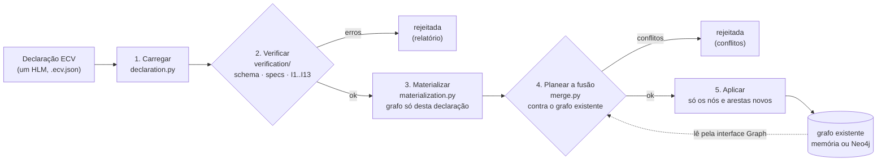

# 3 · ingestion: da Declaração ECV ao grafo, sem duplicar

A ingestão leva uma Declaração ECV (um HLM, com os modelos partilhados repetidos) ao grafo, de forma determinística: primeiro verifica, depois materializa, depois funde com o que o grafo já tem. É o único módulo que lê declarações; o [grafo](../4_graph/README.md) não sabe o que é uma declaração e as [vistas](../5_views/README.md) só leem o grafo.

## Processamento



Cada declaração passa por estes passos, uma de cada vez e pela ordem dada. Uma declaração rejeitada não altera o grafo (não há escritas parciais).

## Organização do módulo

| Ficheiro | Papel |
|---|---|
| `__init__.py` | `ingest(declarations, target=None)` ingere num `MemoryGraph` (novo, ou o dado) e devolve uma `Ingestion` com um `IngestionResult` por declaração (relatório da verificação, plano de fusão, aplicada ou não). `ingest_neo4j(declarations, driver, database, clear)` faz o mesmo sobre o Neo4j. |
| `declaration.py` | `Declaration`: lê o JSON e indexa modelos, funções, contextos, projeções e perfis, sem alterar nada. `rules()` percorre as regras com o sítio onde vivem (`RuleSite`: regra, nível, modelo, propriedade). |
| `paths.py` | Resolve um caminho a partir de um nó (passos, propriedade final, se atravessa uma coleção, tipo); expande o `*` das projeções; lista as ocorrências dos nós de um HLM; `property_key`. |
| `rule_parts.py` | As partes de uma regra: restrição, condição, se é função, caminhos lidos, funções chamadas, contextos usados, mensagem. |
| `descriptions.py` | A descrição legível derivada ("Se … → …"). |
| `verification/` | JSON Schema (se o `jsonschema` estiver instalado), specs de cada entidade (`structure.py`), regras (`rules.py`) e projeções e perfis (`scenarios.py`): invariantes I1 a I13 ([Verificacao.md](../../specs/entidades/transversal/Verificacao.md)), incluindo um HLM por declaração (S-DECL). Devolve um `Report` com erros e avisos. |
| `materialization.py` | Cria, para esta declaração, os nós e as arestas do [modelo do grafo](../4_graph/graph_model.json), por esta ordem: declaração (nó `Declaracao` + `DESCREVE` → HLM) → contextos → funções → modelos, propriedades e composições → regras (restrição, condição, chamadas, `LE`) → projeções (`*` expandido) → perfis. |
| `merge.py` | Compara o grafo da declaração com o destino e devolve o `MergePlan`; aplica-o a um `MemoryGraph`. |

## A fusão

Uma declaração é uma exportação completa de um HLM, por isso traz de novo tudo o que esse HLM usa: o USM `Morada` vem na declaração da Fatura, na do Dispositivo e na da Ordem de Instalação. A fusão garante que, no grafo, cada entidade existe uma só vez.

Para cada nó da declaração materializada, procura-se no destino um nó com a mesma identidade (`<rótulo>:<chave>`, ex.: `USM:Morada`, `RP:RP-PAIS`, `Funcao:somaIgualA`):

| No destino | Resultado |
|---|---|
| não existe | **novo**: o nó entra, com todas as arestas de que é dono |
| existe e é igual | **reutilizado**: nada se escreve (as suas arestas já lá estão) |
| existe e é diferente | **conflito**: a declaração é rejeitada e nada se escreve |

"Igual" compara a assinatura do nó: os seus atributos e o conjunto das arestas de que é dono (tipo, extremos e atributos). O dono de cada aresta está no [modelo do grafo](../4_graph/graph_model.json): um modelo é dono das suas composições (`COMPOSTO_POR`) e propriedades (`CONTEM`); uma regra, das suas ligações (`ASSOCIADA_A`, `RESTRITA_POR`, `CONDICIONADA_POR`) e das arestas `LE` com o seu id, que saem da função partilhada. Assim, um USM partilhado com uma propriedade a mais, uma composição com outra cardinalidade, uma regra com outra mensagem ou uma função com outros parâmetros são detetados como conflito, com a diferença exata:

```
fatura_alterada: 108 nó(s) novo(s), 208 aresta(s) nova(s), 93 nó(s) já existente(s) e iguais (…); 2 conflito(s): nada acrescentado
  CONFLITO USM:Morada: já existe com outra definição
      aresta só na nova declaração: (USM:Morada)-[CONTEM {"ordem": 5}]->(Propriedade:USM:Morada.andar)
  CONFLITO Propriedade:USM:Morada.rua: já existe com outra definição
      atributo descricao: existente 'Arruamento e número de porta' ≠ novo 'Arruamento e número de porta (alterada)'
```

Propriedades da fusão (confirmadas pelos testes):

- **idempotente**: ingerir de novo as mesmas declarações não acrescenta nada;
- **independente da ordem**: ingerir as três declarações por qualquer ordem dá o mesmo grafo;
- **atómica por declaração**: uma declaração com conflitos não deixa nada escrito;
- **igual em memória e no Neo4j**: o plano é calculado pela interface `Graph`, que as duas implementações oferecem; só a aplicação muda (`apply_to_memory` ou `neo4j_store.append`).

O nó `Declaracao` regista a proveniência: cada declaração aceite fica no grafo, ligada ao HLM que descreve (`DESCREVE`). Uma nova versão da mesma declaração (mesmo nome, outro conteúdo) é, por agora, um conflito; a evolução de modelos e regras (versões, substituição) é um passo seguinte.

## Uso

```python
from ecv import config
from ecv.ingestion import ingest, ingest_neo4j

ingestion = ingest(config.example_declarations())
for result in ingestion.results:
    print(result.summary())
g = ingestion.graph                 # MemoryGraph com as três declarações fundidas (430 nós)

from ecv.graph.neo4j_store import connect
results = ingest_neo4j(config.example_declarations(), connect("bolt://localhost:7687", "neo4j", "ecvreferencia"))
```

Na linha de comandos: `python -m ecv verificar`, `python -m ecv grafo`, `python -m ecv importar --limpar`, `python -m ecv descricoes <decl> --escrever`.

## Erros comuns e o que dizem

| Mensagem | Causa |
|---|---|
| `S-DECL uma declaração descreve exatamente um HLM` | Mais de um HLM no ficheiro. Separar numa declaração por HLM, repetindo os modelos partilhados. |
| `CONFLITO USM:X: já existe com outra definição` | Duas declarações descrevem o mesmo modelo de formas diferentes. Alinhar as declarações (o modelo partilhado tem de ser igual em todas). |
| `I3 … 'x' não é uma composição nem uma propriedade de USM Morada` | O caminho não existe a partir do nó onde a regra vive. |
| `I3 … vive na propriedade p mas lê [...]` | A regra lê outras propriedades: passa para o modelo. |
| `I4 uma RP tem restrição e não tem condição` | Uma RP com `condicao`. Se depende de outra propriedade, é uma RIR. |
| `I5 X não é admissível para o tipo base texto` | Por exemplo, RANGE sobre um texto. |
| `I5 f usa contexto externo: o operador é EXT_FUNCTION` | O operador não corresponde aos contextos da função. |
| `I6 a condição lê o alvo da restrição` | Tirar o alvo da condição: o que se quer dizer exprime-se na restrição. |
| `S-REGRA numa RP ou numa RIR a mensagem pertence à restrição` | Mover `mensagem` para `restricao.mensagem`. |
| `S-CHAMADA … espera uma coleção` | O argumento não atravessa uma composição repetível. |
