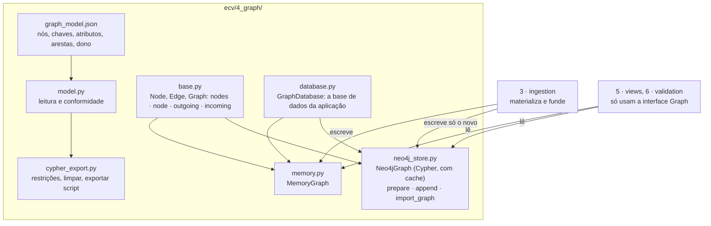
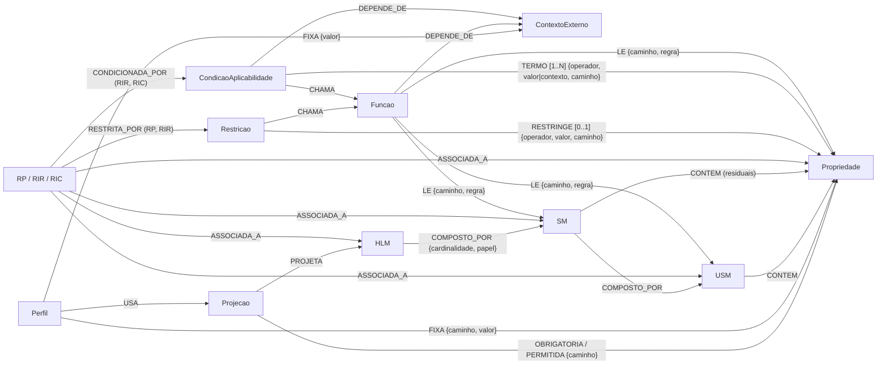

# 4 · graph: o modelo do grafo e onde ele vive

Este módulo define o que é o grafo de conhecimento de validação (os tipos de nó e de aresta, com chaves e atributos) e onde ele vive (em memória ou no Neo4j), com uma interface única para o ler. Não sabe nada de declarações (isso é a [ingestão](../3_ingestion/README.md)) nem de vistas (isso são as [vistas](../5_views/README.md)).

## Para que serve o grafo

As declarações são ficheiros: cada uma descreve um HLM e repete, por inteiro, os modelos, as regras e as funções que esse HLM usa. O grafo é o resultado de as ingerir a todas: um modelo integrado, onde cada entidade partilhada existe uma só vez e onde cada regra está ligada às propriedades que lê e restringe. É sobre ele que se fazem as perguntas que um ficheiro não responde diretamente: que regras restringem esta propriedade, de que valores dependem, que HLM usam este modelo, que regras se aplicam numa instância concreta. O grafo é derivado: não se edita, reconstrói-se a partir dos ficheiros.



| Ficheiro | Papel |
|---|---|
| [`graph_model.json`](graph_model.json) | A definição do grafo: para cada rótulo de nó, a chave, os atributos, o grupo e a cor; para cada tipo de aresta, a origem, o destino, os atributos e o dono (`origem` ou `regra`, usado pela fusão). |
| `model.py` | Lê o modelo; `key_of(label)`; `conformance(graph)` lista os desvios de um grafo em relação ao modelo. |
| `base.py` | `Node`, `Edge` e a interface `Graph`; `logical_id(node)` = `<rótulo>:<chave>`, a identidade de um nó independente do armazenamento. |
| `memory.py` | `MemoryGraph`: nós por id e por rótulo, arestas de saída e de entrada por nó. |
| `neo4j_store.py` | `connect`; `prepare` (restrições de unicidade e limpeza opcional); `append` (nós e arestas em lotes `UNWIND`); `import_graph`; `Neo4jGraph` (a interface `Graph` sobre o Neo4j). |
| `cypher_export.py` | Exporta um grafo como script Cypher autossuficiente; gera as restrições e a limpeza. |
| `database.py` | `GraphDatabase`: o grafo de um âmbito (memória ou Neo4j), reconstruído quando os ficheiros mudam. |
| [`cypher/`](cypher) | `constraints.cypher` (restrições de unicidade) e `clear.cypher` (limpeza dos nós ECV). |

## Como funciona

**Uma interface, dois armazenamentos.** Os ViewModels e a validação só usam `nodes(label)`, `node(label, key)`, `outgoing(node, type)` e `incoming(node, type)`. O `MemoryGraph` responde com dicionários; o `Neo4jGraph` traduz cada operação numa consulta Cypher (`MATCH (n:Rotulo {chave: $v})`, `MATCH (a)-[r:T]->(b) WHERE elementId(a) = $id`) e guarda a resposta em cache. Por isso, cada ViewModel corre igual nos dois, e os testes confirmam que o JSON produzido é idêntico.

**Identidade e chaves.** Cada rótulo tem uma chave (`nome`, `id` ou `chave`). A identidade lógica de um nó é `<rótulo>:<chave>` (ex.: `USM:Morada`, `Propriedade:USM:Morada.pais`, `RIR:RIR-TEMP-C`). É o que a fusão usa para saber se um nó já existe, e é o que as restrições de unicidade garantem no Neo4j.

**Dono de cada aresta.** Para decidir se uma entidade que chega numa declaração é igual à que já existe, a fusão compara os atributos do nó e as arestas de que ele é dono. Quase todas as arestas pertencem ao nó de onde saem (um modelo é dono das suas composições e propriedades; uma regra, das suas ligações). A exceção é `LE`: sai de uma `Funcao` partilhada, mas pertence à regra cuja chamada passa o argumento (atributo `regra`). Isto está declarado em `graph_model.json` (`"dono"`).

**Escrita no Neo4j em lotes.** Os rótulos não podem ser parâmetros em Cypher, por isso `append` agrupa os nós por conjunto de rótulos e as arestas por (tipo, rótulo de origem, rótulo de destino) e faz um `UNWIND` por grupo, em lotes (`loteUnwind` na configuração).

## Nós

| Grupo (cor nas vistas) | Rótulo | Chave | Atributos |
|---|---|---|---|
| ECM (HLM bordô `#8B1E3F`, SM azul `#0072B2`, USM verde-azulado `#0E7C7B`) | `HLM`, `SM`, `USM` | `nome` | `nome`, `descricao`, `notas` |
| ECM | `Propriedade` | `chave` = `<nível>:<dono>.<nome>` | `nome`, `dono`, `nivelDono`, `tipo`, `descricao`, `nomesAlternativos`, `notas` |
| Regras (verde `#009E73`) | `RP`, `RIR`, `RIC` (e `Regra`) | `id` | `id`, `natureza`, `tipo`, `descricao`, `alcance`, `contextosExternos`, `notas`; RIC: `mensagem`, `conclusaoTipo`, `conclusaoValor` |
| Restrição e condição (roxo `#6A3D9A`) | `Restricao` | `id` = `<regra>#restricao` | `regra`, `operador`, `valor` (JSON), `mensagem`, `forma` (`tipificada`/`funcao`), `descricao` |
| Restrição e condição | `CondicaoAplicabilidade` | `id` = `<regra>#condicao` | `regra`, `termos` (n.º), `descricao` |
| Funções e contextos (castanho `#8C6D1F`) | `Funcao` | `nome` | `descricao`, `parametros` (JSON), `retorno`, `notas` |
| Funções e contextos | `ContextoExterno` | `nome` | `tipo`, `descricao`, `fonte` |
| RE: projeções e perfis (cinzento `#7F7F7F`) | `Projecao`, `Perfil` | `nome` | `descricao`, `notas` |
| Proveniência | `Declaracao` | `nome` | `versao`, `descricao`, `dominios`, `hlm` (o HLM descrito) |

As regras têm dois rótulos: o tipo e `Regra`. Por isso, `MATCH (r:Regra)` encontra todas e `MATCH (r:RIR)` só as restritivas.

## Arestas

| Tipo | De → para | Atributos | Significado |
|---|---|---|---|
| `DESCREVE` | Declaracao → HLM | — | A declaração ingerida descreve o HLM (proveniência) |
| `COMPOSTO_POR` | HLM, SM → SM, USM | `cardinalidade`, `papel`, `ordem` | Composição |
| `CONTEM` | USM, SM → Propriedade | `ordem` | A propriedade pertence ao modelo (no SM, residual) |
| `ASSOCIADA_A` | RP, RIR, RIC → HLM, SM, USM, Propriedade | — | Nó onde a regra vive (alcance) |
| `RESTRITA_POR` | RP, RIR → Restricao | — | A regra tem esta restrição |
| `CONDICIONADA_POR` | RIR, RIC → CondicaoAplicabilidade | — | A regra só se aplica quando a condição se verifica |
| `RESTRINGE` [0..1] | Restricao → Propriedade | `operador`, `valor`, `minimo`, `maximo`, `caminho`, `texto` | Alvo único da restrição tipificada |
| `TERMO` [1..N] | CondicaoAplicabilidade → Propriedade | `ordem`, `operador`, `valor` ou `contexto`, `minimo`, `maximo`, `caminho`, `texto` | Termo da condição (fator discriminante) |
| `CHAMA` | Restricao, CondicaoAplicabilidade → Funcao | `chamada`, `argumentos`, `operador`, `regra`, `termo` | A restrição, ou um termo, é uma chamada |
| `LE` | Funcao → Propriedade, USM, SM | `caminho`, `regra`, `posicao`, `parte`, `colecao` | Argumento (alvo) de uma chamada, identificada pela regra. É a única aresta cujo dono, para a fusão, é a regra (atributo `regra`) e não o nó de origem |
| `DEPENDE_DE` | Funcao, CondicaoAplicabilidade → ContextoExterno | `termo` (a partir de uma condição) | Usa um valor externo |
| `PROJETA` | Projecao → HLM | — | A projeção incide sobre o HLM |
| `OBRIGATORIA`, `PERMITIDA` | Projecao → Propriedade | `caminho` | A propriedade, naquela ocorrência, é obrigatória ou permitida |
| `USA` | Perfil → Projecao | — | O perfil usa a projeção |
| `FIXA` | Perfil → Propriedade, ContextoExterno | `caminho` (propriedades), `valor` | Valor conhecido antes da execução |



## Da declaração ao grafo

| Na declaração | No grafo |
|---|---|
| `usm[]`, `sm[]`, `hlm[]` | nós USM, SM, HLM |
| `propriedades[]` | nós Propriedade + `CONTEM` |
| `composicao[]` | `COMPOSTO_POR {cardinalidade, papel, ordem}` |
| regra em `regras[]` (de um modelo ou de uma propriedade) | nó RP/RIR/RIC + `ASSOCIADA_A` para o modelo ou a propriedade |
| `restricao` tipificada | nó Restricao + `RESTRITA_POR` + `RESTRINGE` para a propriedade resolvida |
| `restricao` com função | nó Restricao + `RESTRITA_POR` + `CHAMA` → Funcao + um `LE` por argumento caminho |
| `condicao[]` | nó CondicaoAplicabilidade + `CONDICIONADA_POR`; por termo: `TERMO` (tipificado), `TERMO {contexto}` + `DEPENDE_DE` (contexto), ou `CHAMA` + `LE` (função) |
| `funcoes[]` | nós Funcao + `DEPENDE_DE` para os contextos |
| `contextosExternos[]` | nós ContextoExterno |
| `projecoes[]` | nó Projecao + `PROJETA` + um `OBRIGATORIA`/`PERMITIDA` por caminho expandido |
| `perfis[]` | nó Perfil + `USA` + um `FIXA` por valor fixado |

Os valores (`valor`, `parametros`, `argumentos`) guardam-se como texto JSON, porque o Neo4j só aceita valores simples e listas homogéneas nos atributos. As gamas (`RANGE`) guardam também `minimo` e `maximo` numéricos, para poderem ser comparadas em Cypher. `texto` é a verificação em linguagem natural, útil no Neo4j Browser.

## Importar para o Neo4j

```bash
docker run -d --name ecv-neo4j -p 7474:7474 -p 7687:7687 -e NEO4J_AUTH=neo4j/ecvreferencia neo4j:5.26-community
pip install neo4j
python -m ecv importar --limpar                          # as três declarações de specs/exemplos, de raiz
python -m ecv importar specs/exemplos/fatura.ecv.json    # mais tarde: só acrescenta o que for novo
python -m ecv grafo --cypher carga.cypher                # ou: um script Cypher para correr no cypher-shell
```

Serve qualquer Neo4j a partir da versão 5.23 (as consultas usam `CALL () { … }`). O endereço e as credenciais estão em [ecv.config.json](../config/ecv.config.json) (`neo4j`) e podem vir das variáveis `NEO4J_URI`, `NEO4J_USER`, `NEO4J_PASSWORD` e `NEO4J_DATABASE`. A aplicação web usa o Neo4j como base de dados com `python -m ecv servidor --neo4j`.

```cypher
// a regra RIR-TEMP-REFRIG-CELSIUS e todas as suas ligações (ver em modo grafo)
MATCH p = (r:Regra {id: "RIR-TEMP-REFRIG-CELSIUS"})-[*1..2]->() RETURN p;
// que declarações foram ingeridas e que HLM descrevem
MATCH (d:Declaracao)-[:DESCREVE]->(h:HLM) RETURN d.nome, d.versao, h.nome;
```

As consultas equivalentes a cada ViewModel estão em [`5_views/viewmodels/cypher/`](../5_views/viewmodels/cypher).

## Quantidades (as três declarações de exemplo, fundidas)

<!-- gerar:quantidades-grafo -->
| Nós |  | Arestas |  |
|---|---|---|---|
| Declaracao | 3 | DEPENDE_DE | 7 |
| ContextoExterno | 5 | DESCREVE | 3 |
| Funcao | 12 | COMPOSTO_POR | 23 |
| HLM | 3 | CONTEM | 43 |
| SM | 9 | ASSOCIADA_A | 127 |
| USM | 9 | RESTRITA_POR | 124 |
| Propriedade | 43 | RESTRINGE | 109 |
| RIR | 78 | CONDICIONADA_POR | 81 |
| Restricao | 124 | TERMO | 194 |
| CondicaoAplicabilidade | 81 | CHAMA | 17 |
| RP | 46 | LE | 25 |
| RIC | 3 | PROJETA | 5 |
| Projecao | 5 | OBRIGATORIA | 89 |
| Perfil | 9 | PERMITIDA | 14 |
|  |  | USA | 9 |
|  |  | FIXA | 10 |
| **total** | **430** | **total** | **880** |
<!-- /gerar -->

`python -m ecv grafo` volta a calcular estas quantidades e confirma a conformidade com `graph_model.json`. Materializadas separadamente, as três declarações têm 652 nós (310 + 202 + 140); fundidas, ficam 430, porque os 222 nós repetidos (modelos, propriedades, regras, funções e contextos partilhados) são reutilizados.
