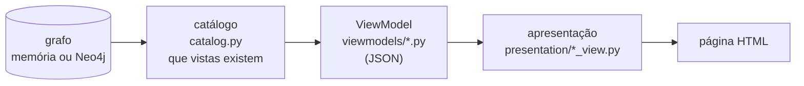

# 5 · views: ViewModels e apresentação

As vistas mostram o grafo a quem tem de o rever. Cada vista é um ViewModel (JSON), que é uma operação sobre o grafo, desenhado numa página HTML. O módulo tem duas partes, com uma fronteira clara:

| Parte | O que faz | Depende de |
|---|---|---|
| [`viewmodels/`](viewmodels/README.md) | Extrai do grafo os nós e as arestas de que cada vista precisa e organiza-os num dicionário JSON. | só da interface `Graph` ([4_graph/base.py](../4_graph/base.py)) |
| `presentation/` | Transforma o JSON numa página HTML. Não volta ao grafo. | só do ViewModel |

Um ViewModel existe por causa de uma vista: a sua forma (linhas, células, blocos, ramos) é a da vista e muda quando a vista muda. O grafo é estável e não sabe que vistas há. Por isso os ViewModels vivem junto da apresentação e dependem do grafo apenas através da interface `Graph`. A validação (módulo 6) e a aplicação web (módulo 7) reutilizam os mesmos ViewModels.

## Processamento

1. **Catálogo.** `catalog(g)` decide que vistas existem para o grafo: por HLM, o modelo, o modelo com regras, as projeções e as lacunas; por SM e USM, o modelo específico; por propriedade restringida por pelo menos `decisaoMinimoRIR` RIR, a decisão; por fator discriminante, as dependências e o impacto; por perfil, a seleção estática; por instância de exemplo cujo perfil exista, a validação; por regra, a ficha. Cada entrada (`ViewEntry`) tem o nome da página, o ViewModel e os parâmetros.
2. **ViewModel.** `build(g, viewmodel, **params)` devolve o JSON.
3. **Página.** `presentation.render_body(vm)` desenha o corpo com o módulo da vista (`model_view`, `decision_view`, `dependency_view`, `rule_view`, `other_views`, `validation_view`). As ligações entre vistas vêm de `links.py`, que só liga páginas que existem no catálogo: não há ligações partidas.

A aplicação web faz os três passos quando uma vista é pedida (`/vistas/<página>.html`): nenhuma página fica gravada. `static_site.py` faz o mesmo para todas as vistas de uma vez, e gera o site estático das declarações de exemplo em `documentacao/vistas/` (usado pela documentação; `python -m ecv vistas`).

## Organização da apresentação

| Ficheiro | Conteúdo |
|---|---|
| `presentation/__init__.py` | `RENDERERS` (ViewModel → função de desenho), `TRAVERSALS` (o percurso no grafo de cada ViewModel), `render_body`, `render_page` |
| `presentation/html.py` | CSS, JavaScript mínimo e as peças comuns (tabela, chip, menu de caixas de seleção) |
| `presentation/svg.py` | caixas, setas e texto para os diagramas |
| `presentation/*_view.py` | uma função de desenho por tipo de vista |
| `links.py` | nomes das páginas e ligações |
| `catalog.py` | o catálogo das vistas de um grafo |
| `static_site.py` | todas as vistas e o índice, numa pasta |

**Interação mínima.** Cada página tem o CSS e um pequeno JavaScript embutidos, sem dependências. O JavaScript só mostra e esconde o que já está na página: expandir e recolher blocos, mostrar as propriedades na árvore, escolher os atributos das regras, mudar o agrupamento, alternar entre tabela e árvore, escolher um valor. Sem JavaScript, ou ao imprimir, a página mostra tudo.

**Cores.** Vêm de [ecv.config.json](../config/ecv.config.json): HLM bordô, SM azul, USM verde-azulado; RP verde, RIR laranja (tracejado), RIC vermelhão, restrição por função roxo; condição e fatores discriminantes rosa; funções e contextos castanho; projeções e perfis cinzento.

**Só dados.** As páginas mostram os dados da vista. O que cada vista representa, como se usa e como se navega está na documentação técnica, a partir de [`documentacao/catalogo_vistas.json`](../../documentacao/catalogo_vistas.json).
