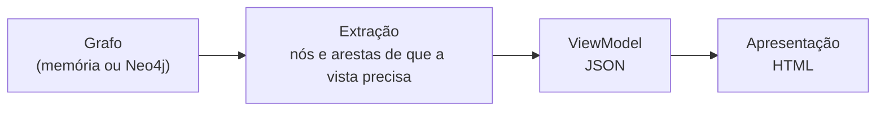

# ViewModels: operações sobre o grafo

Uma vista obtém-se sempre da mesma forma (tese, Figura "Uma vista como operação sobre o grafo"):



Para cada vista há um ViewModel, que declara a parte da informação de que a vista precisa, e apenas essa. A extração obtém do grafo os nós e as arestas e organiza-os no ViewModel. A apresentação gera-se a partir do ViewModel, sem voltar ao grafo.

## Organização

| Ficheiro | Conteúdo |
|---|---|
| `__init__.py` | `REGISTRY` (nome do ViewModel → função, parâmetros, pergunta, ficheiro Cypher) e `build(g, viewmodel, **params)`. |
| `common.py` | Os percursos partilhados: a árvore de um modelo, a ficha de uma regra (restrição, condição e termos, chamadas, onde vive), os valores plausíveis, os caminhos até aos HLM, a cadeia de modelos. |
| `model.py` | `modelo`: um HLM, SM ou USM, com ou sem regras. |
| `projections.py` | `projecoes`. |
| `decision.py` | `decisao` (matriz e árvore de decisão) e `coerencia`. |
| `queries.py` | `dependencias`, `impacto`, `lacunas`, `operadores`. |
| `profiles.py` | `perfil` e `candidatos_perfil`. |
| `rule.py` | `regra`: o subgrafo de uma regra até aos HLM. |
| `evaluation.py` | `evaluate(operador, valor, esperado)`, usado pelos perfis e pelas operações. |
| `cypher/*.cypher`, `cypher_runner.py` | As consultas Cypher equivalentes e a forma de as correr no Neo4j. |

Todos só usam a interface `Graph` (`nodes`, `node`, `outgoing`, `incoming`): correm sobre o grafo em memória e sobre o Neo4j, com resultados idênticos (testado). As consultas Cypher devolvem as linhas do grafo; a organização final (matriz, árvore, blocos) faz-se no Python. A apresentação está em [`../presentation/`](../README.md).

## Como correr

```bash
# ViewModel em JSON, sobre as três declarações de exemplo ingeridas em memória
python -m ecv vm decisao alvo=USM:Medicao.valor
python -m ecv vm modelo nivel=USM nome=Morada regras=true
python -m ecv vm decisao alvo=USM:Medicao.valor 'filtro={"tipoDispositivo":"TEMPERATURA","unidadeMedida":"°C"}'

# o mesmo, sobre o Neo4j (depois de 'importar')
python -m ecv vm decisao alvo=USM:Medicao.valor --neo4j

# a consulta Cypher equivalente, no Neo4j
python -m ecv cypher decisao alvo=USM:Medicao.valor
```

No Neo4j Browser, abre-se o ficheiro `.cypher`, definem-se os parâmetros (`:param alvo => "USM:Medicao.valor"`) e corre-se.

## Os ViewModels

Notação dos percursos: `(a)-[:TIPO]->(b)` percorre a aresta no sentido em que foi criada; `<-[:TIPO]-` percorre-a no sentido inverso.

### `modelo`: Vista de um modelo (HLM, com regras, específico)

- **Pergunta.** Qual é a estrutura de um modelo até às folhas, quem o usa e (com regras) que regras vivem em cada nó?
- **Vistas.** `hlm_<HLM>` (`nivel=HLM`), `regras_<HLM>` (`nivel=HLM, regras=true`), `sm_<SM>` e `usm_<USM>` (`nivel=SM|USM, regras=true`). Substitui as antigas vistas ECM, estrutural, global, alcance, reutilização e "RIC, funções e contextos".
- **Parâmetros.** `nivel`, `nome`, `regras` (opcional).
- **Operação sobre o grafo.**
  1. `(raiz)-[:COMPOSTO_POR*]->(SM|USM)`, pela `ordem`, com `papel` e `cardinalidade`; `-[:CONTEM]->(Propriedade)`.
  2. Fatores discriminantes: propriedades com `<-[:TERMO]-`, ou `<-[:LE {parte: termo}]-`.
  3. Num HLM: `<-[:PROJETA]-(Projecao)<-[:USA]-(Perfil)`.
  4. Num SM ou USM: `<-[:COMPOSTO_POR]-` até aos HLM (os caminhos de quem o usa), e o mesmo para cada SM e USM da subárvore.
  5. Com regras: em cada nó, `<-[:ASSOCIADA_A]-(Regra)`; de cada regra, `-[:RESTRITA_POR]->(Restricao)-[:RESTRINGE|CHAMA]->`, `-[:CONDICIONADA_POR]->(Condicao)-[:TERMO|CHAMA]->`, e `(Funcao)-[:LE {regra}]->`. As RIR agrupam-se pela propriedade que restringem, com a indicação de haver vista de decisão (≥ `decisaoMinimoRIR`).
  6. Com regras: as funções chamadas (`-[:DEPENDE_DE]->`) e os contextos externos (`<-[:FIXA]-(Perfil)`).
- **JSON.** `arvore` (aninhada: `nivel, nome, papel, cardinalidade, propriedades[], filhos[], usadoPor[]`); `blocos[] = {nome, nivel, linhas[], resumoPropriedades[]}` (um por composição direta), cada linha com `regras[]` (fichas) e `rir[] = {alvo, nome, regras[], decisao}`; `projecoes[]`; `usadoPor = {hlm[], caminhos[]}`; com regras, `regras[]` (todas as fichas), `contagem`, `funcoes[]`, `contextos[]`.
- **Cypher.** `modelo.cypher` (árvore, quem usa, projeções) e `regras_modelo.cypher` (regras por nó, com os campos separados).

### `projecoes`: Matriz de projeções

- **Pergunta.** Que propriedades cada projeção exige ou permite, e o que fixa cada perfil?
- **Tese.** Figura "Modelos Fatura e Dispositivo e respetivas projeções"; Tabela "Matriz de projeções do HLM Dispositivo".
- **Parâmetros.** `hlm`.
- **Operação.**
  1. Do HLM, `<-[:PROJETA]-` (projeções).
  2. De cada projeção, `-[:OBRIGATORIA|PERMITIDA {caminho}]->` (marcas por caminho).
  3. Os caminhos de todas as propriedades vêm da árvore do HLM; um caminho sem marca está excluído.
  4. Perfis: `<-[:USA]-` da projeção e `-[:FIXA]->` do perfil.
- **JSON.** `projecoes[]`; `linhas[] = {caminho, celulas{projecao: O|P|-}, difere}`; `perfis[] = {perfil, projecao, fixa[{caminho, valor, projetada} | {contexto, valor}]}`.
- **Cypher.** `projecoes.cypher`.

### `decisao`: Vista de decisão (matriz e árvore)

- **Pergunta.** Que valor é exigido à propriedade em cada combinação dos fatores discriminantes?
- **Tese.** Tabela "Matriz de decisão das gamas válidas de Medicao.valor"; Figuras "Gamas por tipo de dispositivo e unidade" e "Pesquisa sobre as condições de aplicabilidade das temperaturas em °C".
- **Parâmetros.** `alvo` (chave da propriedade), `linhas` (opcional: a dimensão das linhas), `filtro` (opcional: `{propriedade: valor}` para fixar dimensões na árvore).
- **Operação sobre o grafo.**
  1. `(alvo)<-[:RESTRINGE]-(Restricao)<-[:RESTRITA_POR]-(RIR)`: o valor exigido (`operador`, `valor`, `minimo`, `maximo`).
  2. `(RIR)-[:CONDICIONADA_POR]->(Condicao)-[:TERMO {operador IN|EQUALS}]->(Propriedade)`: os fatores discriminantes e os valores de cada RIR.
  3. Para o alvo e para cada fator: `<-[:RESTRINGE]-(Restricao)<-[:RESTRITA_POR]-(RP)` (os valores que pode tomar, sempre).
  4. Matriz: uma dimensão nas linhas (a que mais falta nas regras), as restantes em colunas; células `vazia`, `ok`, `conflito`, `incoerente`. Árvore: uma dimensão por nível, com a cobertura das gamas.
- **JSON.** `propriedade` (com `rp[]`), `dimensoes[] = {nome, chave, dono, plausiveis, usados, rp[]}`, `matriz = {dimensaoLinhas, dimensoesColunas, colunas[], linhas[{valor, plausivel, semRegras, celulas[{estado, regras[]}]}], outras[]}`, `arvore` (nós `dimensao` com `ramos[]`, `semRamo`, `cobertura`; folhas `regras`), `regras[]` (fichas completas das RIR).
- **Cypher.** `decisao.cypher`.

### `coerencia`: Coerência entre regras

- **Pergunta.** Há regras que nunca se aplicam, gamas incompatíveis ou condições repetidas?
- **Tese.** Observações sobre a aplicabilidade (coerência entre regras; ARMAZEM fora dos plausíveis).
- **Parâmetros.** Nenhum.
- **Operação.**
  1. Para cada `(Condicao)-[:TERMO {EQUALS|IN}]->(p)`, comparar os valores com os plausíveis de `p`.
  2. Para cada propriedade, os pares de RESTRINGE RANGE (de RP e RIR) cujas condições são compatíveis (os valores dos termos sobre a mesma propriedade intersetam-se) e cujas gamas são disjuntas.
  3. Agrupar as condições pelo conjunto dos seus TERMO e CHAMA.
- **JSON.** `foraDosPlausiveis[] {regra, propriedade, valores, plausiveis}`, `incompativeis[] {propriedade, regras[2]}`, `mesmaCondicao[] {condicao, regras[]}`.
- **Cypher.** `coerencia.cypher`.

### `dependencias`: Análise de dependência de validade

- **Pergunta.** Que restrições e conclusões implica cada valor desta propriedade, e que propriedades dependem dela?
- **Tese.** Figura "Propriedades cuja restrição é inferida a partir de tipoDispositivo".
- **Parâmetros.** `propriedade` (chave).
- **Operação sobre o grafo.**
  1. `(p)<-[:TERMO]-(Condicao)<-[:CONDICIONADA_POR]-(Regra)` e `(p)<-[:LE {parte: termo}]-(Funcao)` (regras cuja condição lê a propriedade).
  2. De cada regra, a condição completa (todos os termos, com o termo sobre `p` marcado `foco`) e os alvos: `-[:RESTRITA_POR]->(Restricao)-[:RESTRINGE]->` ou `-[:CHAMA]->(Funcao)-[:LE]->`.
  3. Os valores: as RP IN de `p` (plausíveis) e os valores usados nos termos de seleção. Para cada valor, as regras cujos termos de foco (`EQUALS`, `IN`, `NOT_EQUALS`) são verdadeiros com esse valor.
- **JSON.** `propriedade`, `plausiveis[]`, `rp[]`, `valores[] = {valor, plausivel, regras[], afetadas[], semRegras}`, `outrosTermos[]` (regras cujo termo não é de seleção), `regras[]` (fichas, com `foco` em cada termo e `alvos[]`), `afetadas[]`.
- **Cypher.** `dependencias.cypher`.

### `impacto`: Impacto de uma alteração

- **Pergunta.** Que regras, projeções e perfis são afetados se a propriedade mudar (nome, valores plausíveis, posição)?
- **Tese.** Figura "Regras afetadas por uma alteração de tipoDispositivo" (problema P4, custo de propagação).
- **Parâmetros.** `propriedade`.
- **Operação.** Reunião de quatro percursos:
  - `(p)<-[:RESTRINGE]-()<-[:RESTRITA_POR]-(regra)` (alvo);
  - `(p)<-[:TERMO]-()<-[:CONDICIONADA_POR]-(regra)` (termo);
  - `(p)<-[:LE]-(Funcao)` (argumento, com a regra na aresta);
  - `(p)<-[:ASSOCIADA_A]-(regra)` (vive na propriedade).

  Depois, `(p)<-[:OBRIGATORIA|PERMITIDA]-(Projecao)` e `(p)<-[:FIXA]-(Perfil)`.
- **JSON.** `regras[] {id, tipo, descricao, papeis[]}`, `contagem {RP, RIR, RIC}`, `projecoes[] {projecao, tipo, caminho}`, `perfis[] {perfil, caminho, valor}`.
- **Cypher.** `impacto.cypher`.

### `lacunas`: Lacunas

- **Pergunta.** Que propriedades não têm regras, e quais nenhuma projeção usa?
- **Tese.** Figura "Propriedades sem regras e propriedades nunca projetadas".
- **Parâmetros.** `hlm`; `projecoes` (lista opcional; por omissão, todas as do HLM).
- **Operação.**
  - Sem regras: propriedades da árvore do HLM sem `<-[:RESTRINGE]-`, `<-[:ASSOCIADA_A]-` nem `<-[:LE]-`. Indica-se se são lidas em termos.
  - Nunca projetadas: caminhos sem `<-[:OBRIGATORIA|PERMITIDA {caminho}]-` das projeções consideradas.
- **JSON.** `projecoesConsideradas[]`, `semRegras[] {propriedade, nome, dono, lidaEmTermos[]}`, `nuncaProjetadas[] {caminho, propriedade}`.
- **Cypher.** `lacunas.cypher`.

### `operadores`: Verificações por operador

- **Pergunta.** Que restrições e termos usam cada operador, e que propriedades são enumerados?
- **Tese.** Navegação por tipo de verificação (Expressividade).
- **Parâmetros.** Nenhum.
- **Operação.** `Restricao.operador`, `TERMO.operador` e `CHAMA.operador` (termos com função), agrupados. Enumerados: `(p)<-[:ASSOCIADA_A]-(RP)-[:RESTRITA_POR]->(Restricao {operador: IN})`.
- **JSON.** `operadores[] {operador, restricoes[{regra, texto}], termos[{regra, texto}]}`, `enumerados[] {propriedade, valores}`.
- **Cypher.** `operadores.cypher`.

### `perfil`: Seleção estática e dinâmica

- **Pergunta.** Que regras o perfil torna sempre aplicáveis, nunca aplicáveis, dinâmicas ou não avaliáveis?
- **Tese.** Figuras "Seleção estática" e "Propriedade usada na aplicabilidade mas não projetada".
- **Parâmetros.** `perfil`.
- **Operação.**
  1. `(Perfil)-[:USA]->(Projecao)-[:PROJETA]->(HLM)`.
  2. Os caminhos projetados (`-[:OBRIGATORIA|PERMITIDA]->`) e os valores fixados (`(Perfil)-[:FIXA]->`).
  3. Para cada regra da árvore do HLM, em cada ocorrência (prefixo), cada `TERMO` é classificado:
     - **verdadeiro/falso** se o caminho absoluto está fixado (avaliado com `ecv/5_views/viewmodels/evaluation.py`);
     - **dinâmico** se está projetado;
     - **indisponível** se não está projetado nem fixado.

     Um termo com função é dinâmico se todos os argumentos estão disponíveis.
- **Estado da regra.** `nunca aplicável` (um termo falso), `alvo fora da projeção`, `não avaliável` (um termo indisponível), `sempre aplicável` (todos verdadeiros) ou `dinâmica`. As RP ficam `avaliada` ou `fora da projeção`. Os contextos externos ficam "fixado no perfil" ou "obtido pelo motor".
- **JSON.** `projecao`, `hlm`, `fixados[] {caminho, valor, projetada}`, `contextos[] {nome, valor}`, `resumo {estado: n}`, `regras[] {regra, tipo, ocorrencia, descricao, estado, termos[{texto, estado, caminhos, valorFixado}], alvos, contextos, restricao}`.
- **Cypher.** `perfil.cypher` (estado de cada termo; EQUALS resolvido em Cypher, os restantes operadores no Python).

### `candidatos_perfil`: O que fixar num perfil

- **Pergunta.** Que propriedades se podem fixar num perfil para validar estas?
- **Tese.** Tabela "Pesquisa das propriedades usadas na aplicabilidade das regras sobre valor e unidadeMedida".
- **Parâmetros.** `alvos` (lista de chaves).
- **Operação.** `(alvo)<-[:RESTRINGE]-()<-[:RESTRITA_POR]-(RIR)-[:CONDICIONADA_POR]->()-[:TERMO]->(p)`, mais os argumentos das funções nos termos.
- **JSON.** `linhas[] {alvo, nome, regras[], propriedades[]}`, `candidatas[]`.
- **Cypher.** `candidatos_perfil.cypher`.

### `validacao`: Validação de uma instância

- **Pergunta.** A instância cumpre as regras do HLM no cenário do perfil (estrutura, conformidade e conclusões)?
- **Parâmetros.** `exemplo` (uma instância de `validacao/exemplos`), ou `instancia` com `perfil` ou `hlm`; `contextos` opcional.
- **Operação.** O motor de [`validacao/`](../../validacao/README.md): o cenário do perfil (`USA`, `PROJETA`, `OBRIGATORIA`, `PERMITIDA`, `FIXA`), a árvore do HLM e, para cada regra em cada ocorrência concreta da instância, a condição (`TERMO`, `CHAMA`) e a restrição (`RESTRINGE`, `CHAMA`) avaliadas sobre os valores da instância.
- **Estados.** `não conforme`, `conforme`, `conclusão`, `não aplicável`, `sem valor`, `não avaliável`, `fora da projeção`, `ausente`.
- **JSON.** `instancia`, `descricaoInstancia`, `hlm`, `perfil`, `projecao`, `valida`, `fixados[] {caminho, valor}`, `contextos[] {nome, valor, origem}`, `resumo {estado: n}`, `estrutura[] {tipo, caminho, problema}`, `resumoEstrutura`, `conclusoes[]`, `regras[] {regra, tipo, descricao, vive, ocorrencia, estado, termos[{texto, valor, resultado}], valor, detalhe, mensagem, conclusao}`, `instanciaAvaliada`.
- **Cypher.** `validacao.cypher` (o cenário e, por ocorrência, cada regra com a restrição e os termos; a avaliação sobre os valores da instância está no Python).

### `regra`: Ficha de uma regra

- **Pergunta.** O que declara uma regra, a que elementos está ligada e por que modelos chega a cada HLM?
- **Tese.** Figuras "Ligações de cada tipo de regra no grafo" e "A regra RIR-TEMP-REFRIG-CELSIUS no grafo".
- **Parâmetros.** `id`.
- **Operação sobre o grafo.**
  1. A regra e `-[:ASSOCIADA_A]->` (onde vive).
  2. `-[:RESTRITA_POR]->(Restricao)`: `-[:RESTRINGE]->(Propriedade)` ou `-[:CHAMA]->(Funcao)-[:LE {regra}]->`, `-[:DEPENDE_DE]->(ContextoExterno)`.
  3. `-[:CONDICIONADA_POR]->(Condicao)`: `-[:TERMO]->`, `-[:CHAMA]->`, `-[:DEPENDE_DE]->`.
  4. De cada propriedade (ou modelo) envolvida: `<-[:CONTEM]-(dono)<-[:COMPOSTO_POR*]-` até todos os HLM.
- **JSON.** `regra` (ficha), `restricao` (com `alvo` e, numa função, `funcao` com parâmetros e contextos), `condicao` (`termos[]` com `alvo`, `contextoInfo` ou `funcao`), `viveEm` (com os HLM onde tem efeito), `subgrafoRegra = {nos[], arestas[]}`, `subgrafoModelos = {nos[], arestas[]}`.
- **Cypher.** `regra.cypher` (ficha, subgrafo da regra, cadeia dos modelos).

## Equivalência entre o grafo em memória e o Neo4j

O teste `tests/test_graph_views.py::TestNeo4j` (corre quando `NEO4J_URI` está definido) ingere as três declarações no Neo4j de forma incremental, confirma que reingerir não acrescenta nada, compara o JSON de vários ViewModels calculados nos dois e corre todas as consultas Cypher. Os resultados são iguais, porque os ViewModels ordenam tudo o que o Neo4j devolve sem ordem garantida.
