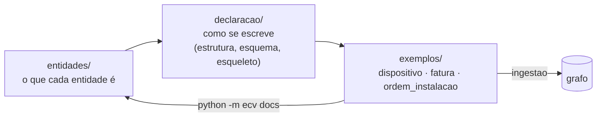

# specs: o que a ECV é, sem código

Este módulo é a especificação: as entidades, a forma da declaração e os exemplos. Não tem código; o código lê-o (a verificação usa o esquema, a ingestão e as vistas usam os exemplos, e `python -m ecv docs` preenche os exemplos dos ficheiros das entidades a partir das declarações).

| Pasta | Conteúdo | Começar por |
|---|---|---|
| [`entidades/`](entidades/README.md) | Um ficheiro por entidade (HLM, SM, USM, Propriedade, Composição, Regra, RP, RIR, RIC, Restrição, Condição de aplicabilidade, Função, Contexto externo, Projeção, Perfil) e os transversais (caminhos, catálogo, nomenclatura, verificação). Cada ficheiro: descrição, diagrama com todos os atributos e ligações, atributos, exemplos, pode e não pode, como identificar. | `entidades/README.md` |
| [`declaracao/`](declaracao/README.md) | A estrutura final da Declaração ECV (um HLM por declaração), todas as possibilidades secção a secção e as razões das escolhas; o [esqueleto](declaracao/esqueleto.ecv.json) com todas as construções; o [JSON Schema](declaracao/ecv.schema.json). | `declaracao/README.md` |
| [`exemplos/`](exemplos/README.md) | As declarações de exemplo, uma por HLM (Dispositivo, Fatura, OrdemInstalacao), com os modelos partilhados repetidos; a correspondência com cada figura e tabela da tese; as anomalias intencionais. | `exemplos/README.md` |

