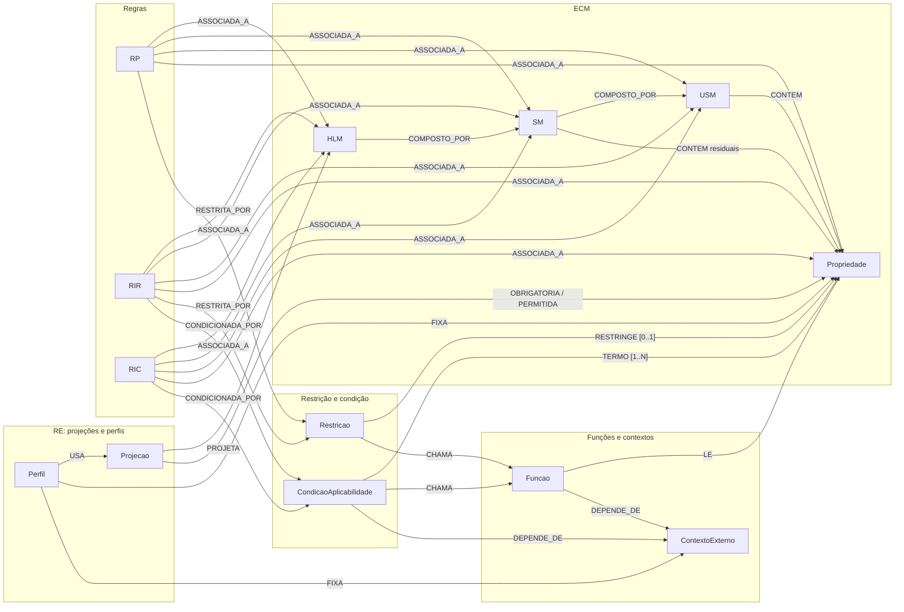

# Entidades da ECV

Cada entidade da Estratificação do Conhecimento de Validação (ECV) tem um ficheiro próprio, sempre com a mesma ordem:

1. **Descrição**: o que a entidade é, por inteiro;
2. **Diagrama**: todos os atributos e todas as ligações a outras entidades, com os atributos de ligação marcados (**LIGAÇÃO**) e, em cada seta, o atributo da declaração e a aresta do grafo;
3. **Atributos**: o papel de cada atributo, e as ligações no grafo;
4. **Exemplos**: o esboço na declaração e os exemplos tirados das declarações de exemplo ([`../exemplos/`](../exemplos/README.md)), gerados por `python -m ecv docs`;
5. **Pode e não pode**, e como identificar a entidade (por exemplo, como saber se um modelo é um HLM, um SM ou um USM);
6. **Detalhes**: as explicações complementares (formas, casos particulares);
7. **Verificações**: os códigos de spec e de invariante que se lhe aplicam.

A ECV junta três tipos de conhecimento:

1. **Estrutura (ECM, Estratificação Composicional de Modelos):** que modelos existem, como se compõem e que propriedades têm.
2. **Validade (ECR, Estratificação Contextual de Regras):** as regras, caracterizadas por natureza, alcance e expressividade, e os elementos de que são feitas (restrição, condição, funções, contextos externos), além das projeções.
3. **Cenário (perfis de execução):** que projeção se usa e que valores são conhecidos antes da execução.

## Índice

| Camada | Entidade | Ficheiro | Em uma frase |
|---|---|---|---|
| ECM | HLM | [ecm/HLM.md](ecm/HLM.md) | O modelo que o domínio instancia (uma fatura, um dispositivo). Só composição de SM. |
| ECM | SM | [ecm/SM.md](ecm/SM.md) | Agrupa USM com uma finalidade. Pode ter propriedades residuais. Pode reunir uma coleção. |
| ECM | USM | [ecm/USM.md](ecm/USM.md) | Informação canónica, igual em qualquer domínio (morada, coordenadas). Dona das propriedades. |
| ECM | Propriedade | [ecm/Propriedade.md](ecm/Propriedade.md) | Informação atómica com nome, tipo base, descrição e nomes alternativos. |
| ECM | Composição | [ecm/Composicao.md](ecm/Composicao.md) | Liga um modelo ao que compõe, com papel e cardinalidade. Dá os caminhos e as coleções. |
| ECR | Regra (geral) | [ecr/Regra.md](ecr/Regra.md) | Natureza, alcance, expressividade, nomenclatura, descrição e mensagens comuns a RP, RIR e RIC. |
| ECR | RE e Projeção | [ecr/RE_Projecao.md](ecr/RE_Projecao.md) | A regra estrutural não se declara regra a regra: exprime-se pela projeção. |
| ECR | RP | [ecr/RP.md](ecr/RP.md) | Plausibilidade: só uma restrição, sem condição. Aplica-se sempre. |
| ECR | RIR | [ecr/RIR.md](ecr/RIR.md) | Inferência restritiva: uma condição decide se a restrição é avaliada. |
| ECR | RIC | [ecr/RIC.md](ecr/RIC.md) | Inferência conclusiva: satisfeita a condição, comunica um estado ou uma ação. |
| ECR | Restrição | [ecr/Restricao.md](ecr/Restricao.md) | Um alvo, um operador, os valores esperados e a mensagem de não conformidade. Pode ser uma função. |
| ECR | Condição de aplicabilidade | [ecr/CondicaoAplicabilidade.md](ecr/CondicaoAplicabilidade.md) | Termos combinados com E. Cada termo tem um alvo, um operador e um valor (ou uma função, ou um contexto). |
| ECR | Função | [ecr/Funcao.md](ecr/Funcao.md) | Verificação delegada: nome, descrição, parâmetros (alvos e literais), contextos externos. |
| ECR | Contexto externo | [ecr/ContextoExterno.md](ecr/ContextoExterno.md) | Valor de fora do modelo e da regra (a data de hoje, uma chave). |
| Cenário | Perfil | [ecr/Perfil.md](ecr/Perfil.md) | Usa uma projeção e fixa valores (propriedades e contextos) antes da execução. |
| Transversal | Caminhos | [transversal/Caminhos.md](transversal/Caminhos.md) | Como se refere uma propriedade a partir de um nó (`Leitura.Medicao.valor`). |
| Transversal | Catálogo | [transversal/Catalogo.md](transversal/Catalogo.md) | Operadores, tipos base e forma dos valores. |
| Transversal | Nomenclatura | [transversal/Nomenclatura.md](transversal/Nomenclatura.md) | Regras de nomes para tudo: modelos, propriedades, regras, funções, valores. |
| Transversal | Verificação | [transversal/Verificacao.md](transversal/Verificacao.md) | Specs de cada entidade e invariantes I1 a I13. |

## Mapa das entidades e das ligações

As ligações têm o nome da aresta correspondente no grafo ([grafo](../../ecv/4_graph/README.md)).

## Resumo: atributos e ligações de cada entidade

| Entidade | Atributos | Ligações (aresta → destino) | Declara-se em |
|---|---|---|---|
| HLM | nome, descricao, notas | COMPOSTO_POR → SM; recebe ASSOCIADA_A (regras), PROJETA (projeções) | `hlm[]` |
| SM | nome, descricao, notas | COMPOSTO_POR → USM; CONTEM → Propriedade (residuais); recebe COMPOSTO_POR, ASSOCIADA_A | `sm[]` |
| USM | nome, descricao, notas | CONTEM → Propriedade; recebe COMPOSTO_POR, ASSOCIADA_A | `usm[]` |
| Propriedade | nome, tipo, descricao, nomesAlternativos, notas | recebe CONTEM, ASSOCIADA_A, RESTRINGE, TERMO, LE, OBRIGATORIA, PERMITIDA, FIXA | `propriedades[]` de um USM ou SM |
| Composição | sm ou usm, papel, cardinalidade | é a aresta COMPOSTO_POR | `composicao[]` de um HLM ou SM |
| RP | id, natureza, descricao, notas | ASSOCIADA_A → nó; RESTRITA_POR → Restricao | `regras[]` do nó ou da propriedade |
| RIR | id, natureza, descricao, notas | ASSOCIADA_A; RESTRITA_POR → Restricao; CONDICIONADA_POR → CondicaoAplicabilidade | `regras[]` do nó |
| RIC | id, natureza, descricao, mensagem, conclusao, notas | ASSOCIADA_A; CONDICIONADA_POR → CondicaoAplicabilidade | `regras[]` do nó ou da propriedade |
| Restrição | propriedade (alvo), operador, valor, mensagem; ou operador + chamada + mensagem | RESTRINGE → Propriedade (0..1); CHAMA → Funcao | `restricao` da regra |
| Condição de aplicabilidade | termos (lista) | TERMO → Propriedade (1..N); CHAMA → Funcao; DEPENDE_DE → ContextoExterno | `condicao` da regra |
| Função | nome, descricao, parametros, contextosExternos, retorno | LE → Propriedade/USM/SM (por chamada); DEPENDE_DE → ContextoExterno | `funcoes[]` |
| Contexto externo | nome, tipo, descricao, fonte | recebe DEPENDE_DE, FIXA | `contextosExternos[]` |
| Projeção | nome, hlm, descricao, obrigatorias, permitidas | PROJETA → HLM; OBRIGATORIA / PERMITIDA → Propriedade | `projecoes[]` |
| Perfil | nome, projecao, descricao, fixa | USA → Projecao; FIXA → Propriedade / ContextoExterno | `perfis[]` |

## Quantidades nas declarações de exemplo

<!-- gerar:contagens -->
| Entidade | Quantidade |
|---|---|
| HLM | 3 |
| SM | 9 |
| USM | 9 |
| Propriedades | 43 |
| RP | 46 |
| RIR | 78 |
| RIC | 3 |
| Funções | 12 |
| Contextos externos | 5 |
| Projeções | 5 |
| Perfis | 9 |
<!-- /gerar -->

Os blocos de exemplos destes ficheiros (tabelas e JSON) são gerados a partir das declarações de exemplo com `python -m ecv docs`. Por isso coincidem sempre com elas.
