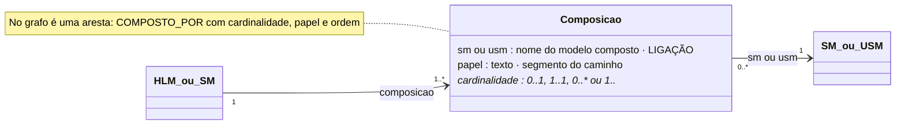

# Composição (com papel e cardinalidade)

## Descrição

A composição liga um modelo ao modelo que ele compõe: um HLM compõe SM, um SM compõe USM. A cardinalidade é declarada na composição, e não no modelo composto. Indica quantas instâncias a composição admite, no formato mínimo..máximo. O papel é o nome com que o modelo composto é alcançado, ou seja, o segmento do caminho. Por omissão, o papel é o nome do modelo composto.

"O papel é atribuído pela composição, e não pela definição" (tese, Secção ECM). O mesmo USM Morada é a morada do emitente, a do cliente ou a da instalação, consoante o SM que o compõe.

## Diagrama

Todos os atributos da entidade e todas as ligações a outras entidades. **LIGAÇÃO** marca os atributos que ligam a outra entidade; cada seta indica o atributo da declaração e a aresta correspondente no grafo.



## Atributos

| Atributo | Tipo | Obrigatório | Descrição |
|---|---|---|---|
| `sm` ou `usm` | nome do modelo | um dos dois | `sm` num HLM, `usm` num SM. |
| `papel` | texto, PascalCase | não | Segmento do caminho; por omissão, o nome do modelo. |
| `cardinalidade` | `0..1` · `1..1` · `0..*` · `1..*` | sim | Quantas instâncias. |

## Exemplos

### Exemplos das declarações de exemplo

<!-- gerar:tabela-composicoes -->
| Modelo que compõe | Modelo composto | Papel (segmento do caminho) | Cardinalidade | Leitura |
|---|---|---|---|---|
| HLM Dispositivo | SM Identificacao | Identificacao | 1..1 | singular |
| HLM Dispositivo | SM Leitura | Leitura | 1..1 | singular |
| HLM Dispositivo | SM Localizacao | Localizacao | 1..1 | singular |
| HLM Dispositivo | SM Diagnostico | Diagnostico | 0..1 | opcional |
| HLM Fatura | SM Cabecalho | Cabecalho | 1..1 | singular |
| HLM Fatura | SM Emitente | Emitente | 1..1 | singular |
| HLM Fatura | SM Cliente | Cliente | 1..1 | singular |
| HLM Fatura | SM Linhas | Linhas | 1..1 | singular |
| HLM OrdemInstalacao | SM Pedido | Pedido | 1..1 | singular |
| HLM OrdemInstalacao | SM Cliente | Requerente | 1..1 | singular |
| HLM OrdemInstalacao | SM Localizacao | Localizacao | 1..* | repetível (coleção) |
| SM Leitura | USM Medicao | Medicao | 1..1 | singular |
| SM Leitura | USM Instalacao | Instalacao | 1..1 | singular |
| SM Leitura | USM Assinatura | Assinatura | 0..1 | opcional |
| SM Localizacao | USM InformacaoGeografica | InformacaoGeografica | 1..1 | singular |
| SM Localizacao | USM Morada | Morada | 1..1 | singular |
| SM Diagnostico | USM Diagnostico | Diagnostico | 1..1 | singular |
| SM Emitente | USM Entidade | Entidade | 1..1 | singular |
| SM Emitente | USM Morada | Morada | 1..1 | singular |
| SM Emitente | USM Contacto | Contacto | 1..1 | singular |
| SM Cliente | USM Entidade | Entidade | 1..1 | singular |
| SM Cliente | USM Morada | Morada | 1..1 | singular |
| SM Linhas | USM Linha | Linha | 1..* | repetível (coleção) |
<!-- /gerar -->

## Pode e não pode

| Pode | Não pode |
|---|---|
| HLM → SM; SM → USM | HLM → USM; SM → SM; USM → qualquer modelo |
| Ter papel diferente do nome do modelo | Repetir um papel no mesmo nó |
| Cardinalidade `0..1`, `1..1`, `0..*`, `1..*` | Outras cardinalidades (por exemplo `2..5`); usam-se funções (`contagemInferiorA`) |
| Formar caminhos pelos quais o mesmo modelo é alcançado várias vezes | Formar ciclos (I1) |

## Detalhes

### Cardinalidades

| Cardinalidade | Leitura | Exemplo |
|---|---|---|
| `1..1` | singular e obrigatória | Fatura → Cabecalho |
| `0..1` | singular e opcional | Dispositivo → Diagnostico; Leitura → Assinatura |
| `1..*` | repetível, pelo menos uma (coleção) | Linhas → Linha; OrdemInstalacao → Localizacao |
| `0..*` | repetível, pode ser vazia | (não usada nos exemplos) |

### Coleções

Uma coleção é uma composição com máximo `*`. As consequências são as seguintes (tese, Secção Coleções):

- **Nomenclatura.** Quando um SM existe para reunir uma coleção, o seu nome está no plural (`Linhas`) e o elemento no singular (`Linha`). Um HLM nunca existe só para reunir uma coleção: compõe o SM repetido com o seu nome, e a cardinalidade indica a repetição (`OrdemInstalacao → Localizacao [1..*]`).
- **Porque não uma propriedade "linhas".** Primeiro, o HLM não tem propriedades. Segundo, as regras sobre o conjunto precisam de um nó onde viver (o SM `Linhas`). Terceiro, o SM com as suas regras é reutilizável. Quarto, a consulta distingue diretamente as regras de cada linha, do conjunto e da relação com o documento.
- **Caminhos através de uma coleção.** `Linhas.Linha.valor` (a partir do HLM Fatura) é a lista dos valores de todas as linhas. `Linhas.Linha` é a coleção de instâncias. Só funções podem ler coleções (`somaIgualA`, `contagemInferiorA`): uma restrição tipificada tem um único alvo, que não pode ser uma coleção.

### Papéis

O papel distingue duas ocorrências do mesmo modelo no mesmo nó e dá nome à ocorrência:

```json
"composicao": [
  {"usm": "UsmB", "papel": "Origem",  "cardinalidade": "1..1"},
  {"usm": "UsmB", "papel": "Destino", "cardinalidade": "0..1"}
]
```

Os caminhos passam a ser `Origem.estado` e `Destino.estado` (ver o [esqueleto](../../declaracao/esqueleto.ecv.json)). Nas declarações de exemplo, a OrdemInstalacao compõe o SM `Cliente` com o papel `Requerente`: `Requerente.Entidade.nif`.

### No grafo

A composição é uma aresta e não um nó: `(HLM|SM)-[:COMPOSTO_POR {cardinalidade, papel, ordem}]->(SM|USM)`. A `ordem` guarda a ordem da declaração, usada nas vistas.

## Verificações

- **S-COMP:** exatamente um de `sm` ou `usm`, coerente com o nível; cardinalidade válida; papel em PascalCase e único.
- **I1:** composição acíclica.
- **I2:** o modelo composto está declarado.
- **Funções com parâmetros de coleção:** um parâmetro `colecao: true` só recebe um caminho que atravessa uma composição repetível, e um parâmetro simples nunca recebe uma coleção.
