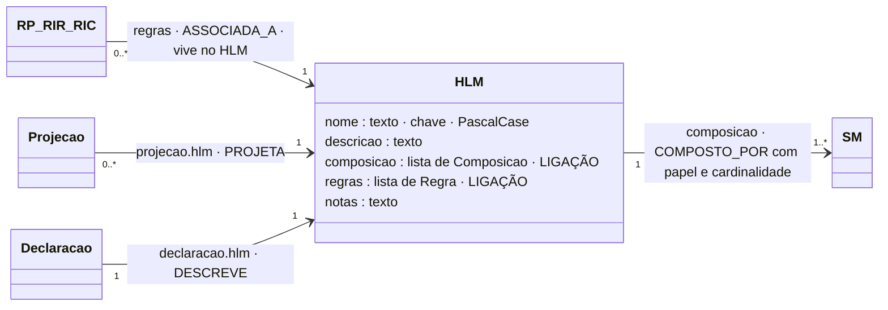

# HLM: High Level Model (modelo de alto nível)

## Descrição

O HLM é o nível de topo da ECM: a entidade que o domínio instancia e a que chama "um modelo", como uma fatura, um dispositivo ou uma ordem de instalação. É o nível de maior especificidade contextual. Um HLM não declara propriedades próprias. É exclusivamente uma composição de submodelos (SM).

## Diagrama

Todos os atributos da entidade e todas as ligações a outras entidades. **LIGAÇÃO** marca os atributos que ligam a outra entidade; cada seta indica o atributo da declaração e a aresta correspondente no grafo.



## Atributos

| Atributo | Tipo | Obrigatório | Descrição |
|---|---|---|---|
| `nome` | texto, PascalCase | sim | Identificador do HLM, único entre os HLM. |
| `descricao` | texto (≥ 10 caracteres) | sim | O que o modelo representa, em linguagem natural. Aparece nas vistas. |
| `composicao` | lista de composições (≥ 1) | sim | Os SM que compõe; ver [Composicao.md](Composicao.md). |
| `regras` | lista de regras | não | Regras que vivem no HLM (o alcance é o HLM). |
| `notas` | texto | não | Comentário livre; não é conhecimento de validação. |

### Ligações no grafo

| Aresta | Sentido | Outro extremo | Atributos | Significado |
|---|---|---|---|---|
| `COMPOSTO_POR` | HLM → | SM | cardinalidade, papel, ordem | O HLM compõe o SM. |
| `ASSOCIADA_A` | ← | RP, RIR, RIC | — | A regra vive no HLM. |
| `PROJETA` | ← | Projecao | — | A projeção incide sobre o HLM. |

No grafo: nó `HLM` (chave `nome`). O modelo completo do grafo está em [ecv/4_graph/graph_model.json](../../../ecv/4_graph/graph_model.json).

## Exemplos

### Esboço na declaração

Na lista `hlm` da declaração:

```json
"hlm": [
  {
    "nome": "NomeDoHLM",
    "descricao": "O que o modelo representa.",
    "composicao": [
      {"sm": "SubmodeloA", "cardinalidade": "1..1"},
      {"sm": "SubmodeloB", "papel": "OutroPapel", "cardinalidade": "0..1"},
      {"sm": "SubmodeloColecao", "cardinalidade": "1..*"}
    ],
    "regras": [ /* RP, RIR, RIC que leem mais do que um SM */ ]
  }
]
```

### Exemplos das declarações de exemplo

<!-- gerar:tabela-hlm -->
| HLM | Descrição | Composição (papel, SM, cardinalidade) | Regras que vivem no HLM |
|---|---|---|---|
| Dispositivo | Dispositivo IoT: identificação, leitura, localização e diagnóstico. | Identificacao [1..1], Leitura [1..1], Localizacao [1..1], Diagnostico [0..1] | RIR-TEMP-UN, RIR-HUM-UN, RIR-PRES-UN, RIR-VEL-UN, RIR-TEMP-C, RIR-TEMP-K … (+34) |
| Fatura | Documento fiscal de venda: cabeçalho, emitente, cliente e linhas. | Cabecalho [1..1], Emitente [1..1], Cliente [1..1], Linhas [1..1] | RP-SOMA, RIR-FS-LIN, RIR-FT-NIF |
| OrdemInstalacao | Ordem de instalação de equipamento: quem a pede e onde instalar. | Pedido [1..1], Requerente (Cliente) [1..1], Localizacao [1..*] | RP-ORDEM-MAX |
<!-- /gerar -->

**Fatura.** O exemplo da faturação. Compõe quatro SM; as regras que vivem no HLM cruzam SM: a soma das linhas (RP-SOMA), o número de linhas de uma fatura simplificada (RIR-FS-LIN) e o NIF obrigatório acima de 1000 euros (RIR-FT-NIF).

<!-- gerar:json-hlm:Fatura -->
```json
{
  "nome": "Fatura",
  "descricao": "Documento fiscal de venda: cabeçalho, emitente, cliente e linhas.",
  "composicao": [
    {"sm": "Cabecalho", "cardinalidade": "1..1"},
    {"sm": "Emitente", "cardinalidade": "1..1"},
    {"sm": "Cliente", "cardinalidade": "1..1"},
    {"sm": "Linhas", "cardinalidade": "1..1"}
  ],
  "regras": [
    {
      "id": "RP-SOMA",
      "natureza": "plausibilidade",
      "descricao": "somaIgualA(Linhas.Linha.valor, Cabecalho.totalFatura)",
      "restricao": {
        "operador": "FUNCTION",
        "chamada": {
          "funcao": "somaIgualA",
          "argumentos": [
            {"caminho": "Linhas.Linha.valor"},
            {"caminho": "Cabecalho.totalFatura"}
          ]
        },
        "mensagem": "O total da fatura não corresponde à soma dos valores das linhas."
      }
    },
    {
      "id": "RIR-FS-LIN",
      "natureza": "inferencia_restritiva",
      "descricao": "Se Cabecalho.tipoDocumento = FS → contagemInferiorA(Linhas.Linha, 11)",
      "condicao": [
        {"propriedade": "Cabecalho.tipoDocumento", "operador": "EQUALS", "valor": "FS"}
      ],
      "restricao": {
        "operador": "FUNCTION",
        "chamada": {
          "funcao": "contagemInferiorA",
          "argumentos": [
            {"caminho": "Linhas.Linha"},
            {"literal": 11}
          ]
        },
        "mensagem": "Uma fatura simplificada não pode ter mais de 10 linhas."
      }
    },
    {
      "id": "RIR-FT-NIF",
      "natureza": "inferencia_restritiva",
      "descricao": "Se Cabecalho.totalFatura > 1000 → Cliente.Entidade.nif ≠ 999999990",
      "condicao": [
        {"propriedade": "Cabecalho.totalFatura", "operador": "GT", "valor": 1000}
      ],
      "restricao": {
        "propriedade": "Cliente.Entidade.nif",
        "operador": "NOT_EQUALS",
        "valor": "999999990",
        "mensagem": "Uma fatura acima de 1000 euros tem de identificar o NIF do cliente (não pode usar o NIF de consumidor final 999999990)."
      }
    }
  ]
}
```
<!-- /gerar -->

**OrdemInstalacao.** O exemplo da ECM. Reutiliza o SM `Cliente` da Fatura com o papel `Requerente` (o papel é atribuído pela composição, não pela definição). Reutiliza também o SM `Localizacao` do Dispositivo com cardinalidade `1..*`: uma ordem pode abranger vários locais.

<!-- gerar:json-hlm:OrdemInstalacao -->
```json
{
  "nome": "OrdemInstalacao",
  "descricao": "Ordem de instalação de equipamento: quem a pede e onde instalar.",
  "composicao": [
    {"sm": "Pedido", "cardinalidade": "1..1"},
    {"sm": "Cliente", "papel": "Requerente", "cardinalidade": "1..1"},
    {"sm": "Localizacao", "cardinalidade": "1..*"}
  ],
  "regras": [
    {
      "id": "RP-ORDEM-MAX",
      "natureza": "plausibilidade",
      "descricao": "contagemInferiorA(Localizacao, 21)",
      "restricao": {
        "operador": "FUNCTION",
        "chamada": {
          "funcao": "contagemInferiorA",
          "argumentos": [
            {"caminho": "Localizacao"},
            {"literal": 21}
          ]
        },
        "mensagem": "Uma ordem de instalação abrange no máximo 20 locais."
      }
    }
  ],
  "notas": "Exemplo da Secção ECM: reutiliza o SM Cliente da Fatura (com o papel Requerente, atribuído pela composição) e o SM Localizacao do Dispositivo, com cardinalidade 1..*."
}
```
<!-- /gerar -->

**Dispositivo.** O exemplo IoT. As dezenas de RIR que inferem gamas a partir do tipo, da unidade e do ambiente vivem aqui, porque leem `Identificacao` e `Leitura` (ver [RIR.md](../ecr/RIR.md)).

<!-- gerar:json-hlm-resumo:Dispositivo -->
```json
{
  "nome": "Dispositivo",
  "descricao": "Dispositivo IoT: identificação, leitura, localização e diagnóstico.",
  "composicao": [
    {"sm": "Identificacao", "cardinalidade": "1..1"},
    {"sm": "Leitura", "cardinalidade": "1..1"},
    {"sm": "Localizacao", "cardinalidade": "1..1"},
    {"sm": "Diagnostico", "cardinalidade": "0..1"}
  ],
  "notas": "As gamas seguem o mapeamento conhecido do Capítulo 4 (matriz de decisão): RIR-TEMP-C é a gama física [-60, 1300] (no texto do Capítulo 3 usou-se [-50, 100], ilustrativa).",
  "regras": ["... 40 regra(s) omitida(s) neste excerto ..."]
}
```
<!-- /gerar -->

Relação com a tese: na Secção ECM, o exemplo conceptual tem os HLM "Fatura", "Ordem de Instalação" e "Medição de Dispositivo". Aqui são `Fatura`, `OrdemInstalacao` e `Dispositivo`.

## Pode e não pode

| Pode | Não pode |
|---|---|
| Compor um ou mais SM, cada um com a sua cardinalidade (`1..1`, `0..1`, `1..*`, `0..*`) | Declarar propriedades (`propriedades` é proibido) |
| Compor o mesmo SM mais de uma vez, com papéis diferentes | Compor USM diretamente |
| Ter regras que leem propriedades de mais de um SM (RP, RIR, RIC) | Ter regras que só leem dentro de um SM não repetível (deviam viver nesse SM, aviso I8) |
| Ser alvo de projeções (só o HLM é projetado) | Ser composto por outro modelo |
| Reutilizar SM de outros HLM (Cliente, Localizacao) | — |

### Como saber se um modelo é um HLM

Um modelo é um HLM quando responde "sim" a todas estas perguntas:

| Pergunta | Exemplo (sim) | Contraexemplo (não) |
|---|---|---|
| É o que um sistema recebe, guarda ou envia como um todo, com identidade de negócio própria? | Fatura, Dispositivo, OrdemInstalacao | Morada (é sempre parte de outra coisa) |
| É a unidade sobre a qual faz sentido dizer "esta utilização precisa destas partes" (uma projeção)? | FaturaSimplificada e FaturaAT sobre Fatura | Linha (não se projeta sozinha) |
| Toda a sua informação cabe em grupos com finalidade (SM)? | Fatura = Cabecalho + Emitente + Cliente + Linhas | — |
| Não existe só para reunir uma coleção? | — | "Linhas" é um SM, não um HLM |

Se alguma informação parecer pertencer ao HLM diretamente, como o número da fatura, pertence a um SM: aqui, ao SM Cabecalho, que só tem propriedades residuais.

## Detalhes

### Contextos de utilização

- **Ponto de entrada da validação.** Uma instância é sempre de um HLM. O perfil, através da projeção, diz qual.
- **Âncora das projeções.** Só o HLM tem a visão completa do modelo.
- **Sítio das regras que cruzam SM.** Por exemplo, a soma das linhas igual ao total da fatura (RP-SOMA), ou o tipo de dispositivo e a unidade da medição (RIR-TEMP-C).

## Verificações

- **S-MOD:** nome em PascalCase; descrição com pelo menos 10 caracteres; pelo menos uma composição; sem `propriedades`.
- **S-COMP:** cada composição tem `sm`, nunca `usm`; a cardinalidade é uma das quatro; os papéis são únicos.
- **I2:** os SM compostos estão declarados.
- **I8 (aviso):** uma regra do HLM que só lê dentro de um SM não repetível poderia viver nesse SM.
