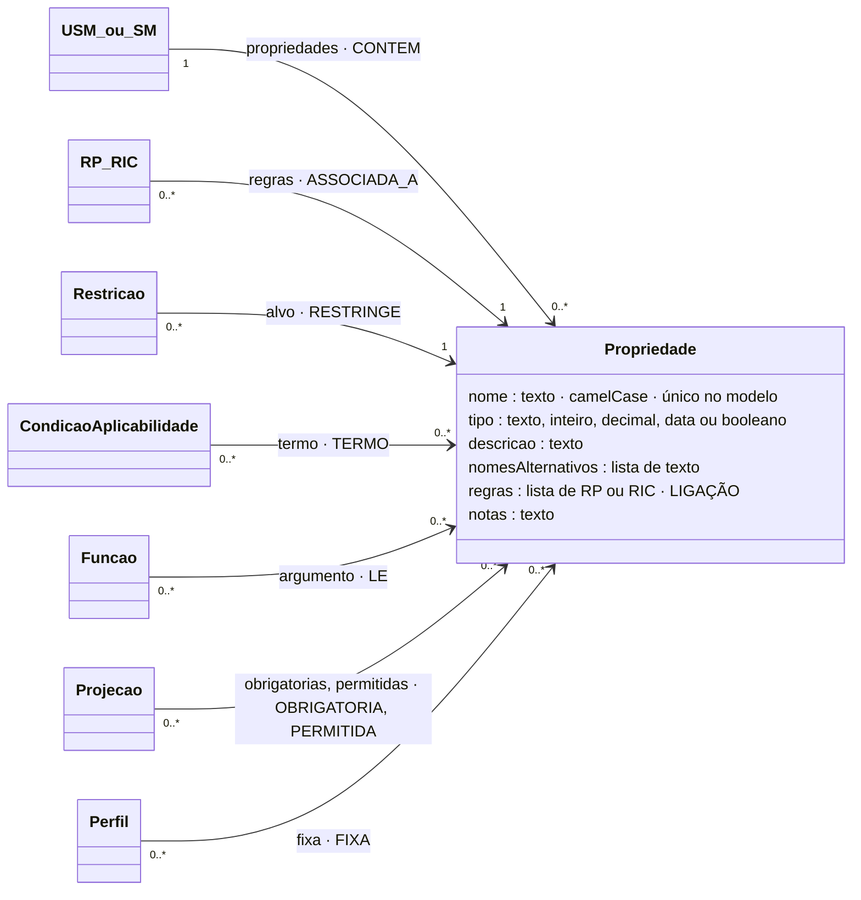

# Propriedade

## Descrição

A propriedade é a informação atómica de um modelo. Tem uma única definição, no modelo que a contém, e é reutilizada em todas as ocorrências desse modelo. Além do nome, tem informação complementar que não altera o que a propriedade representa, mas condiciona a forma como é reconhecida e interpretada (tese, Secção ECM):

- **Tipo base:** a natureza do valor (texto, inteiro, decimal, data, booleano). Determina o que pode ser guardado e que verificações fazem sentido.
- **Nomes alternativos:** as formas sob as quais a mesma propriedade aparece nas fontes (`zipCode`, `postalCode`, `CP` para `codigoPostal`). Permitem reconhecer a propriedade na ingestão sem um mapeamento por fonte.
- **Descrição:** o significado e as particularidades da interpretação. Tem de ser precisa: uma descrição vaga (por exemplo, só "Valor") aparece como tal nas vistas.

## Diagrama

Todos os atributos da entidade e todas as ligações a outras entidades. **LIGAÇÃO** marca os atributos que ligam a outra entidade; cada seta indica o atributo da declaração e a aresta correspondente no grafo.



## Atributos

| Atributo | Tipo | Obrigatório | Descrição |
|---|---|---|---|
| `nome` | texto, camelCase | sim | Único no modelo. |
| `tipo` | `texto` · `inteiro` · `decimal` · `data` · `booleano` | sim | Tipo base. Limita os operadores possíveis ([Catalogo.md](../transversal/Catalogo.md)). |
| `descricao` | texto (≥ 5) | sim | Significado e particularidades. |
| `nomesAlternativos` | lista de texto | não | Nomes nas fontes. |
| `regras` | lista | não | RP (ou RIC) que vivem na propriedade. |
| `notas` | texto | não | Comentário livre. |

Tipos base e o que admitem:

| Tipo | Valores | Exemplo |
|---|---|---|
| `texto` | cadeia de caracteres | `"PT"`, `"1000-001"` |
| `inteiro` | número inteiro | `3` |
| `decimal` | número | `-12.5` |
| `data` | `AAAA-MM-DD` (ou data e hora ISO 8601) | `"2026-09-01"`, `"2026-09-30T12:00:00Z"` |
| `booleano` | `true` / `false` | `true` |

Um enumerado não é um tipo próprio: é uma propriedade `texto` cujo Conjunto de Regras de Plausibilidade é uma lista fechada (uma RP com `IN`). Ver [RP.md](../ecr/RP.md).

### Ligações no grafo

| Aresta | Sentido | Outro extremo | Significado |
|---|---|---|---|
| `CONTEM` | ← | USM ou SM | O modelo dono da propriedade. |
| `ASSOCIADA_A` | ← | RP, RIC | A regra vive na propriedade. |
| `RESTRINGE` | ← | Restricao | A propriedade é o alvo de uma restrição tipificada. |
| `TERMO` | ← | CondicaoAplicabilidade | A propriedade é lida num termo de uma condição (fator discriminante). |
| `LE` | ← | Funcao | A propriedade é argumento de uma chamada (com a regra na aresta). |
| `OBRIGATORIA` / `PERMITIDA` | ← | Projecao | A propriedade, naquele caminho, é exigida ou admitida. |
| `FIXA` | ← | Perfil | Valor conhecido antes da execução. |

No grafo: nó `Propriedade` (chave `chave`). O modelo completo do grafo está em [ecv/4_graph/graph_model.json](../../../ecv/4_graph/graph_model.json).

## Exemplos

### Esboço na declaração

Na lista `propriedades` de um USM (ou de um SM, para as residuais):

```json
{
  "nome": "codigoPostal",
  "tipo": "texto",
  "descricao": "Código postal da morada",
  "nomesAlternativos": ["zipCode", "postalCode", "CP"],
  "regras": [ { "id": "RP-…", "natureza": "plausibilidade", "descricao": "…", "restricao": { … } } ]
}
```

### Exemplos das declarações de exemplo

Todas as propriedades:

<!-- gerar:tabela-propriedades -->
| Chave | Tipo | Descrição | Nomes alternativos | Regras na propriedade |
|---|---|---|---|---|
| `SM:Identificacao.identificador` | texto | Identificador do dispositivo | deviceId | 1 |
| `SM:Identificacao.fabricante` | texto | Fabricante do dispositivo | manufacturer | 1 |
| `SM:Identificacao.estado` | texto | Estado operacional do dispositivo | status | 1 |
| `SM:Identificacao.tipoDispositivo` | texto | Grandeza medida pelo dispositivo | deviceType | 1 |
| `SM:Localizacao.indicacaoAcesso` | texto | Indicação de acesso ao local (texto livre, ex.: portão lateral, chave no cofre) | accessNotes | 0 |
| `SM:Cabecalho.numero` | texto | Número do documento (série/sequência) | invoiceNo | 0 |
| `SM:Cabecalho.serie` | texto | Série do documento, comunicada à AT | series | 0 |
| `SM:Cabecalho.atcud` | texto | Código único do documento (ATCUD) | ATCUD | 0 |
| `SM:Cabecalho.tipoDocumento` | texto | Tipo de documento fiscal | invoiceType | 1 |
| `SM:Cabecalho.dataEmissao` | data | Data de emissão do documento | invoiceDate | 1 |
| `SM:Cabecalho.totalFatura` | decimal | Total do documento, em euros | grossTotal | 1 |
| `SM:Cabecalho.hash` | texto | Hash do documento, encadeado com o anterior da série | hashDocumento | 0 |
| `SM:Cliente.consentimentoComercial` | booleano | Consentimento do cliente para comunicações comerciais | marketingConsent | 0 |
| `SM:Pedido.numeroOrdem` | texto | Número da ordem de instalação | orderId | 1 |
| `SM:Pedido.dataPedido` | data | Data em que a instalação foi pedida | requestDate | 1 |
| `USM:Morada.rua` | texto | Arruamento e número de porta | — | 0 |
| `USM:Morada.codigoPostal` | texto | Código postal da morada | zipCode, postalCode, CP | 1 |
| `USM:Morada.localidade` | texto | Localidade da morada (em maiúsculas, sem acentos) | — | 0 |
| `USM:Morada.freguesia` | texto | Freguesia da morada (só para moradas em Lisboa) | — | 1 |
| `USM:Morada.pais` | texto | País da morada (código ISO de duas letras) | country, countryCode | 1 |
| `USM:Medicao.unidadeMedida` | texto | Unidade de medida associada ao valor medido | unit | 1 |
| `USM:Medicao.valor` | decimal | Valor medido, na unidade indicada | value, reading | 1 |
| `USM:Medicao.dataMedicao` | data | Instante em que a medição foi feita (data e hora ISO 8601) | timestamp, measuredAt | 2 |
| `USM:Instalacao.ambiente` | texto | Ambiente onde o dispositivo está instalado | environment | 1 |
| `USM:Assinatura.mensagem` | texto | Conteúdo assinado, tal como enviado pelo dispositivo | payload | 0 |
| `USM:Assinatura.assinatura` | texto | Assinatura HMAC-SHA256 da mensagem, em hexadecimal | signature | 1 |
| `USM:Diagnostico.nivelBateria` | decimal | Nível de bateria (%) | battery | 1 |
| `USM:Diagnostico.dataUltimaManutencao` | data | Data da última manutenção | lastMaintenance | 2 |
| `USM:Diagnostico.sinalRede` | decimal | Intensidade do sinal de rede (dBm) | rssi | 1 |
| `USM:Diagnostico.latencia` | decimal | Latência da comunicação (ms) | latency | 1 |
| `USM:Diagnostico.taxaRececao` | decimal | Taxa de receção de mensagens (%) | receptionRate | 1 |
| `USM:InformacaoGeografica.latitude` | decimal | Latitude, em graus decimais | lat | 1 |
| `USM:InformacaoGeografica.longitude` | decimal | Longitude, em graus decimais | lon, lng | 1 |
| `USM:InformacaoGeografica.altitude` | decimal | Altitude, em metros | alt, elevation | 1 |
| `USM:InformacaoGeografica.sistemaReferencia` | texto | Sistema de referência das coordenadas | crs, datum | 1 |
| `USM:Entidade.nif` | texto | Número de identificação fiscal | taxId, VATNumber | 2 |
| `USM:Entidade.nome` | texto | Nome ou denominação social | name, denominacao | 0 |
| `USM:Contacto.email` | texto | Endereço de correio eletrónico | eMail, correioEletronico | 1 |
| `USM:Linha.numero` | inteiro | Número da linha no documento | lineNumber | 1 |
| `USM:Linha.descricao` | texto | Descrição do bem ou serviço | description | 1 |
| `USM:Linha.valor` | decimal | Valor da linha, em euros | amount | 2 |
| `USM:Linha.tipoIVA` | texto | Tipo de taxa de IVA aplicada à linha | taxType | 1 |
| `USM:Linha.taxaIVA` | decimal | Taxa de IVA aplicada à linha (%) | taxPercentage | 2 |
<!-- /gerar -->

Uma propriedade com duas RP, uma tipificada e uma função:

<!-- gerar:json-propriedade:USM:Entidade.nif -->
```json
{
  "nome": "nif",
  "tipo": "texto",
  "descricao": "Número de identificação fiscal",
  "nomesAlternativos": ["taxId", "VATNumber"],
  "regras": [
    {
      "id": "RP-NIF",
      "natureza": "plausibilidade",
      "descricao": "Entidade.nif segue o padrão ^[0-9]{9}$",
      "restricao": {
        "propriedade": "nif",
        "operador": "PATTERN",
        "valor": "^[0-9]{9}$",
        "mensagem": "O NIF tem de ter nove algarismos."
      }
    },
    {
      "id": "RP-NIF-DC",
      "natureza": "plausibilidade",
      "descricao": "digitoControloValido(Entidade.nif)",
      "restricao": {
        "operador": "FUNCTION",
        "chamada": {
          "funcao": "digitoControloValido",
          "argumentos": [
            {"caminho": "nif"}
          ]
        },
        "mensagem": "O dígito de controlo do NIF não está correto."
      }
    }
  ]
}
```
<!-- /gerar -->

Uma propriedade com uma RP função com contexto externo e uma RIC que compara a propriedade com um contexto externo:

<!-- gerar:json-propriedade:USM:Medicao.dataMedicao -->
```json
{
  "nome": "dataMedicao",
  "tipo": "data",
  "descricao": "Instante em que a medição foi feita (data e hora ISO 8601)",
  "nomesAlternativos": ["timestamp", "measuredAt"],
  "regras": [
    {
      "id": "RP-RELOGIO",
      "natureza": "plausibilidade",
      "descricao": "desfasamentoInferiorA(Medicao.dataMedicao, 300)",
      "restricao": {
        "operador": "EXT_FUNCTION",
        "chamada": {
          "funcao": "desfasamentoInferiorA",
          "argumentos": [
            {"caminho": "dataMedicao"},
            {"literal": 300}
          ]
        },
        "mensagem": "O instante da leitura está adiantado em relação ao relógio do servidor (relógio do dispositivo desacertado)."
      },
      "contextosExternos": ["relogioServidor"]
    },
    {
      "id": "RIC-MED-DIFERIDA",
      "natureza": "inferencia_conclusiva",
      "descricao": "Se Medicao.dataMedicao < dataDeHoje (contexto externo) → informa Estado DIFERIDA",
      "condicao": [
        {"propriedade": "dataMedicao", "operador": "LT", "contexto": "dataDeHoje"}
      ],
      "mensagem": "Estado DIFERIDA: a leitura foi medida antes de hoje e chega com atraso; deve ser tratada como dado histórico.",
      "conclusao": {"tipo": "ESTADO", "valor": "DIFERIDA"},
      "contextosExternos": ["dataDeHoje"],
      "notas": "Contexto externo usado diretamente num termo da condição (sem função): dataMedicao < dataDeHoje."
    }
  ]
}
```
<!-- /gerar -->

Uma propriedade residual sem regras:

<!-- gerar:json-propriedade:SM:Cliente.consentimentoComercial -->
```json
{
  "nome": "consentimentoComercial",
  "tipo": "booleano",
  "descricao": "Consentimento do cliente para comunicações comerciais",
  "nomesAlternativos": ["marketingConsent"],
  "notas": "Propriedade residual: não é canónica (uma pessoa existe sem consentimento) nem é do HLM (é de quem compra)."
}
```
<!-- /gerar -->

## Pode e não pode

| Pode | Não pode |
|---|---|
| Ter regras de plausibilidade (RP) que só leem a própria propriedade | Ter uma RIR (a condição não pode ler o alvo da restrição, I6) |
| Ter uma RP cuja restrição é uma função com a propriedade como único alvo (RP-NIF-DC, RP-RELOGIO) | Ter regras que leem outras propriedades (I3: vão para o modelo) |
| Ter uma RIC cuja condição só lê a propriedade (RIC-MED-DIFERIDA) | Ter um tipo fora dos cinco tipos base |
| Ser alvo de restrições, termos e argumentos de funções de regras que vivem acima | Ter o mesmo nome que outra propriedade ou papel do mesmo modelo |
| Ter vários nomes alternativos | — |

## Detalhes

### Onde pode viver

| Onde | Quando | Exemplo |
|---|---|---|
| Num USM | Quase sempre: informação canónica | `Morada.codigoPostal`, `Medicao.valor` |
| Num SM (residual) | Só faz sentido naquele agrupamento | `Cliente.consentimentoComercial`, `Cabecalho.totalFatura` |
| Num HLM | Nunca | — |

### Contextos de utilização

- **Identidade partilhada.** Há uma só definição de `codigoPostal`, com as suas regras, em todas as moradas.
- **Reconhecimento na ingestão.** `reading` é reconhecido como `valor` pelos nomes alternativos.
- **Fator discriminante.** `tipoDispositivo`, `unidadeMedida` e `ambiente` decidem que gama se aplica a `valor`.

## Verificações

- **S-PROP:** camelCase; tipo válido; descrição ≥ 5; `nomesAlternativos` é uma lista; sem repetidos.
- **I3:** uma regra declarada na propriedade só lê essa propriedade.
- **I5:** os operadores das regras que a usam são admissíveis para o tipo.
