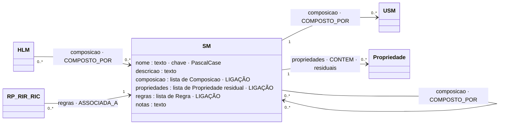

# SM: Sub Model (submodelo)

## Descrição

O SM é o nível intermédio da ECM. Agrupa informação canónica (USM) com uma finalidade determinada: é aqui que um conjunto de USM deixa de ser matéria-prima e passa a representar algo que o negócio reconhece, como o cliente, a leitura ou as linhas do documento. Um SM compõe USM e pode declarar propriedades residuais, as que só fazem sentido naquele agrupamento.

Um SM pode ser reutilizado por vários HLM quando a finalidade se repete noutro domínio. Por exemplo, `Cliente` é usado pela Fatura e pela OrdemInstalacao.

## Diagrama

Todos os atributos da entidade e todas as ligações a outras entidades. **LIGAÇÃO** marca os atributos que ligam a outra entidade; cada seta indica o atributo da declaração e a aresta correspondente no grafo.



## Atributos

| Atributo | Tipo | Obrigatório | Descrição |
|---|---|---|---|
| `nome` | texto, PascalCase | sim | Único entre os SM. Plural se reúne uma coleção. |
| `descricao` | texto (≥ 10) | sim | A finalidade do agrupamento. |
| `composicao` | lista de `{usm, papel?, cardinalidade}` | sim, ou `propriedades` | Os USM que compõe. |
| `propriedades` | lista de propriedades | sim, ou `composicao` | Propriedades residuais. |
| `regras` | lista de regras | não | Regras que vivem no SM. |
| `notas` | texto | não | Comentário livre. |

### Ligações no grafo

| Aresta | Sentido | Outro extremo | Significado |
|---|---|---|---|
| `COMPOSTO_POR` | ← | HLM | Um HLM compõe este SM (cardinalidade e papel na aresta). |
| `COMPOSTO_POR` | SM → | USM | O SM compõe o USM. |
| `CONTEM` | SM → | Propriedade | Propriedade residual. |
| `ASSOCIADA_A` | ← | RP, RIR, RIC | Regra que vive no SM. |
| `LE` | ← | Funcao | Um argumento de função que termina no SM (instâncias de um SM repetível, como `contagemInferiorA(Localizacao, 21)`). |

No grafo: nó `SM` (chave `nome`). O modelo completo do grafo está em [ecv/4_graph/graph_model.json](../../../ecv/4_graph/graph_model.json).

## Exemplos

### Esboço na declaração

```json
"sm": [
  {
    "nome": "NomeDoSM",
    "descricao": "Finalidade do agrupamento.",
    "composicao": [
      {"usm": "UsmCanonico", "cardinalidade": "1..1"},
      {"usm": "OutroUsm", "papel": "PapelEspecifico", "cardinalidade": "0..1"}
    ],
    "propriedades": [ /* residuais */ ],
    "regras": [ /* regras que leem mais de um USM deste SM, ou a coleção */ ]
  }
]
```

### Exemplos das declarações de exemplo

<!-- gerar:tabela-sm -->
| SM | Descrição | Compõe (USM) | Propriedades residuais | Composto por | Regras no SM |
|---|---|---|---|---|---|
| Identificacao | Identificação do dispositivo: identificador, fabricante, estado e grandeza medida. | — | identificador, fabricante, estado, tipoDispositivo | HLM Dispositivo | — |
| Leitura | Uma leitura: a medição, o local onde foi feita e, se existir, a assinatura da mensagem. | Medicao [1..1], Instalacao [1..1], Assinatura [0..1] | — | HLM Dispositivo | — |
| Localizacao | Localização de um equipamento: coordenadas, morada e indicação de acesso. | InformacaoGeografica [1..1], Morada [1..1] | indicacaoAcesso | HLM Dispositivo, HLM OrdemInstalacao | RIR-LX-LOCALIDADE |
| Diagnostico | Diagnóstico técnico do dispositivo. | Diagnostico [1..1] | — | HLM Dispositivo | — |
| Cabecalho | Cabeçalho do documento: identificação, série, tipo, data, total e encadeamento. | — | numero, serie, atcud, tipoDocumento, dataEmissao, totalFatura, hash | HLM Fatura | RIR-FS, RIR-FS-NUM, RP-HASH, RP-ATCUD |
| Emitente | Quem emite o documento: identificação, morada e contacto. | Entidade [1..1], Morada [1..1], Contacto [1..1] | — | HLM Fatura | RIR-EMAIL-CX, RIR-EMAIL-CY |
| Cliente | Quem adquire os bens ou serviços (cliente comprador). | Entidade [1..1], Morada [1..1] | consentimentoComercial | HLM Fatura, HLM OrdemInstalacao | — |
| Linhas | Coleção das linhas do documento. | Linha [1..*] | — | HLM Fatura | RP-LIN-NUM, RP-LIN-SEQ, RP-LIN-MAX |
| Pedido | Dados do pedido de instalação: número e data. | — | numeroOrdem, dataPedido | HLM OrdemInstalacao | — |
<!-- /gerar -->

**Linhas (SM de coleção).** As três RP vivem aqui porque verificam o conjunto, e não cada linha.

<!-- gerar:json-sm:Linhas -->
```json
{
  "nome": "Linhas",
  "descricao": "Coleção das linhas do documento.",
  "composicao": [
    {"usm": "Linha", "cardinalidade": "1..*"}
  ],
  "regras": [
    {
      "id": "RP-LIN-NUM",
      "natureza": "plausibilidade",
      "descricao": "valoresUnicos(Linhas.Linha.numero)",
      "restricao": {
        "operador": "FUNCTION",
        "chamada": {
          "funcao": "valoresUnicos",
          "argumentos": [
            {"caminho": "Linha.numero"}
          ]
        },
        "mensagem": "Existem linhas com o mesmo número."
      }
    },
    {
      "id": "RP-LIN-SEQ",
      "natureza": "plausibilidade",
      "descricao": "valoresConsecutivos(Linhas.Linha.numero)",
      "restricao": {
        "operador": "FUNCTION",
        "chamada": {
          "funcao": "valoresConsecutivos",
          "argumentos": [
            {"caminho": "Linha.numero"}
          ]
        },
        "mensagem": "A numeração das linhas tem de começar em 1 e não ter falhas."
      }
    },
    {
      "id": "RP-LIN-MAX",
      "natureza": "plausibilidade",
      "descricao": "contagemInferiorA(Linhas.Linha, 100)",
      "restricao": {
        "operador": "FUNCTION",
        "chamada": {
          "funcao": "contagemInferiorA",
          "argumentos": [
            {"caminho": "Linha"},
            {"literal": 100}
          ]
        },
        "mensagem": "A fatura tem 100 ou mais linhas."
      }
    }
  ],
  "notas": "SM que existe para reunir uma coleção: nome no plural; o elemento (USM Linha) no singular."
}
```
<!-- /gerar -->

**Cliente (SM reutilizado, com propriedade residual).**

<!-- gerar:json-sm:Cliente -->
```json
{
  "nome": "Cliente",
  "descricao": "Quem adquire os bens ou serviços (cliente comprador).",
  "composicao": [
    {"usm": "Entidade", "cardinalidade": "1..1"},
    {"usm": "Morada", "cardinalidade": "1..1"}
  ],
  "propriedades": [
    {
      "nome": "consentimentoComercial",
      "tipo": "booleano",
      "descricao": "Consentimento do cliente para comunicações comerciais",
      "nomesAlternativos": ["marketingConsent"],
      "notas": "Propriedade residual: não é canónica (uma pessoa existe sem consentimento) nem é do HLM (é de quem compra)."
    }
  ],
  "notas": "Na Secção ECM da tese corresponde ao 'SM Cliente Comprador', reutilizado pela Fatura e pela Ordem de Instalação."
}
```
<!-- /gerar -->

**Localizacao (SM reutilizado, com uma RIR cuja condição é uma função).**

<!-- gerar:json-sm:Localizacao -->
```json
{
  "nome": "Localizacao",
  "descricao": "Localização de um equipamento: coordenadas, morada e indicação de acesso.",
  "composicao": [
    {"usm": "InformacaoGeografica", "cardinalidade": "1..1"},
    {"usm": "Morada", "cardinalidade": "1..1"}
  ],
  "propriedades": [
    {
      "nome": "indicacaoAcesso",
      "tipo": "texto",
      "descricao": "Indicação de acesso ao local (texto livre, ex.: portão lateral, chave no cofre)",
      "nomesAlternativos": ["accessNotes"],
      "notas": "Propriedade residual: só faz sentido porque a finalidade do SM é situar equipamento."
    }
  ],
  "regras": [
    {
      "id": "RIR-LX-LOCALIDADE",
      "natureza": "inferencia_restritiva",
      "descricao": "Se dentroDe(Localizacao.InformacaoGeografica.latitude, Localizacao.InformacaoGeografica.longitude, [(38.796, -9.23), (38.796, -9.09), (38.69, -9.09), (38.69, -9.23)]) → Localizacao.Morada.localidade = LISBOA",
      "condicao": [
        {
          "operador": "FUNCTION",
          "chamada": {
            "funcao": "dentroDe",
            "argumentos": [
              {"caminho": "InformacaoGeografica.latitude"},
              {"caminho": "InformacaoGeografica.longitude"},
              {
                "literal": [[38.796, -9.23], [38.796, -9.09], [38.69, -9.09], [38.69, -9.23]]
              }
            ]
          }
        }
      ],
      "restricao": {
        "propriedade": "Morada.localidade",
        "operador": "EQUALS",
        "valor": "LISBOA",
        "mensagem": "Um equipamento localizado dentro dos limites de Lisboa tem de ter a localidade LISBOA na morada."
      },
      "notas": "Função usada num termo da condição de aplicabilidade (e não na restrição)."
    }
  ],
  "notas": "Na Secção ECM da tese corresponde ao 'SM Localização de Equipamento', reutilizado pelo Dispositivo e pela Ordem de Instalação."
}
```
<!-- /gerar -->

**Cabecalho (SM só com propriedades residuais e regras entre elas).**

<!-- gerar:json-sm-resumo:Cabecalho -->
```json
{
  "nome": "Cabecalho",
  "descricao": "Cabeçalho do documento: identificação, série, tipo, data, total e encadeamento.",
  "propriedades": [
    {
      "nome": "numero",
      "tipo": "texto",
      "descricao": "Número do documento (série/sequência)",
      "nomesAlternativos": ["invoiceNo"]
    },
    {
      "nome": "serie",
      "tipo": "texto",
      "descricao": "Série do documento, comunicada à AT",
      "nomesAlternativos": ["series"]
    },
    {
      "nome": "atcud",
      "tipo": "texto",
      "descricao": "Código único do documento (ATCUD)",
      "nomesAlternativos": ["ATCUD"]
    },
    {
      "nome": "tipoDocumento",
      "tipo": "texto",
      "descricao": "Tipo de documento fiscal",
      "nomesAlternativos": ["invoiceType"]
    },
    {
      "nome": "dataEmissao",
      "tipo": "data",
      "descricao": "Data de emissão do documento",
      "nomesAlternativos": ["invoiceDate"]
    },
    {
      "nome": "totalFatura",
      "tipo": "decimal",
      "descricao": "Total do documento, em euros",
      "nomesAlternativos": ["grossTotal"]
    },
    {
      "nome": "hash",
      "tipo": "texto",
      "descricao": "Hash do documento, encadeado com o anterior da série",
      "nomesAlternativos": ["hashDocumento"]
    }
  ],
  "notas": "SM só com propriedades residuais (não compõe USM): o cabeçalho só faz sentido no documento fiscal.",
  "regras": ["... 4 regra(s) omitida(s) neste excerto ..."]
}
```
<!-- /gerar -->

Relação com a tese: "SM Cliente Comprador" e "SM Localização de Equipamento" da Secção ECM correspondem a `Cliente` e `Localizacao`. A propriedade residual "indicação de acesso" é `Localizacao.indicacaoAcesso` e o "consentimento" é `Cliente.consentimentoComercial`.

## Pode e não pode

| Pode | Não pode |
|---|---|
| Compor USM, cada um com cardinalidade e, se preciso, papel | Compor outros SM ou HLM |
| Compor o mesmo USM duas vezes, com papéis diferentes (`Origem`, `Destino`) | Repetir um papel |
| Declarar propriedades residuais | Ter uma propriedade com o mesmo nome de um papel |
| Ser composto por vários HLM (reutilização) | Ficar sem composição e sem propriedades |
| Ter regras sobre a coleção (RP com funções sobre `Linha`) | — |
| Ter regras que relacionam os seus USM (RIR-EMAIL-CX, RIR-LX-LOCALIDADE) | — |

### Como saber se um modelo é um SM (e não um USM ou um HLM)

| Pergunta | Se sim | Exemplo |
|---|---|---|
| Junta informação canónica para uma finalidade (quem compra, onde está o equipamento)? | É um SM. | `Cliente` = Entidade + Morada |
| Existe para reunir uma coleção (as linhas, os locais)? | É um SM de coleção, com nome no plural. | `Linhas` compõe `Linha [1..*]` |
| Tem informação que só faz sentido neste agrupamento e em nenhum outro? | São propriedades residuais deste SM. | `Cliente.consentimentoComercial`, `Localizacao.indicacaoAcesso` |
| A informação significa o mesmo em qualquer domínio? | Então é um USM, não um SM. | Morada |
| É o que o domínio instancia como um todo? | Então é um HLM. | Fatura |

**Teste da propriedade residual (tese, Secção ECM).** Altere-se a finalidade do SM mantendo os mesmos USM. Se a propriedade desaparecesse, é residual. Se sobrevivesse, pertence a um USM e está no sítio errado. O consentimento para comunicações comerciais não é canónico, porque uma pessoa existe sem ele. Também não é do HLM, porque é de quem compra e não da fatura. É, por isso, residual do SM Cliente.

## Detalhes

### Três formas de SM

| Forma | Quando | Exemplos |
|---|---|---|
| **SM de composição** | Junta USM com uma finalidade | `Emitente` (Entidade, Morada, Contacto), `Cliente`, `Leitura`, `Localizacao`, `Diagnostico` |
| **SM de coleção** | Reúne `1..*` ou `0..*` instâncias de um USM; nome no plural | `Linhas` (USM `Linha [1..*]`) |
| **SM só com propriedades residuais** | Informação própria do domínio, sem nenhum USM canónico | `Cabecalho` (número, série, tipo, data, total), `Identificacao`, `Pedido` |

### Contextos de utilização

- **Dar finalidade à informação canónica.** O mesmo USM Morada é a morada fiscal no Emitente e a morada da instalação na Localizacao.
- **Coleções.** As regras sobre o conjunto (números únicos, consecutivos, número máximo) precisam de um nó onde viver. Esse nó é o SM da coleção, e não uma propriedade "linhas" (tese, Secção Coleções).
- **Reutilização entre HLM.** Um SM pensado para a faturação (Cliente) serve a ordem de instalação sem adaptação.

### SM de metainformação

Um HLM principal pode compor um SM genérico de metainformação, `Metainformacao` (cardinalidade `0..1`, papel `Metainformacao`). Não descreve o domínio: descreve o próprio modelo (de onde vem, que versão da fonte, que entidade da fonte representa, para que é usado). É um SM só com propriedades residuais; as propriedades recomendadas estão em [ecv/config/ecv.config.json](../../../ecv/config/ecv.config.json) (`metainformacao`):

| Propriedade | Tipo | Significado |
|---|---|---|
| `origemModelo` | texto | Fonte do modelo de dados (norma, sistema ou repositório), ex.: `CIUS-PT 2.1.1`, `Smart Data Models Device` |
| `versaoOrigem` | texto | Versão da fonte |
| `referenciaOrigem` | texto | Identificador da entidade na fonte (ex.: `BG-0 Invoice`, `Device`) |
| `utilizacao` | texto | Finalidade ou contexto de utilização |
| `dominio` | texto | Domínio a que o modelo pertence |
| `observacoes` | texto | Outra metainformação |

Por ser igual em todos os HLM que o usam, a fusão guarda-o uma só vez; os valores (a origem concreta de cada HLM) são dados da instância ou valores fixados num perfil, não estrutura.

## Verificações

- **S-MOD:** PascalCase; descrição ≥ 10; tem composição ou propriedades; não compõe SM.
- **S-COMP:** papéis únicos; cardinalidade válida.
- **S-PROP:** nomes de propriedades únicos e diferentes dos papéis.
- **I8 (aviso):** uma regra do SM que só lê dentro de um USM não repetível poderia viver nesse USM.
