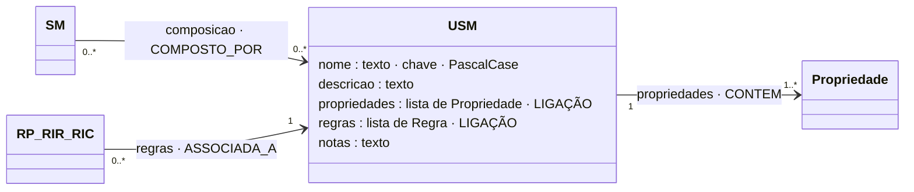

# USM: Universal Sub Model (submodelo universal)

## Descrição

O USM é o nível de base da ECM: informação canónica, pura, independente do domínio e do uso que dela se faça. Uma morada é uma morada, quer sirva para faturar, quer sirva para localizar um sensor. O USM é o dono da identidade das propriedades que contém: cada propriedade tem uma única definição, no USM, e é reutilizada em todos os caminhos que o compõem. As regras que vivem no USM e nas suas propriedades acompanham-no para todo o lado.

## Diagrama

Todos os atributos da entidade e todas as ligações a outras entidades. **LIGAÇÃO** marca os atributos que ligam a outra entidade; cada seta indica o atributo da declaração e a aresta correspondente no grafo.



## Atributos

| Atributo | Tipo | Obrigatório | Descrição |
|---|---|---|---|
| `nome` | texto, PascalCase | sim | Único entre os USM. |
| `descricao` | texto (≥ 10) | sim | O que a informação é, independentemente do uso. |
| `propriedades` | lista (≥ 1) | sim | Ver [Propriedade.md](Propriedade.md). |
| `regras` | lista | não | Regras que vivem no USM. |
| `notas` | texto | não | Comentário livre. |

### Ligações no grafo

| Aresta | Sentido | Outro extremo | Significado |
|---|---|---|---|
| `COMPOSTO_POR` | ← | SM | Um SM compõe este USM. Cada aresta é uma ocorrência, com o seu papel. |
| `CONTEM` | USM → | Propriedade | As propriedades do USM. |
| `ASSOCIADA_A` | ← | RP, RIR, RIC | Regras que vivem no USM. |
| `LE` | ← | Funcao | Argumento de função que termina no USM: as instâncias de uma coleção (`contagemInferiorA(Linha, 100)`). |

No grafo: nó `USM` (chave `nome`). O modelo completo do grafo está em [ecv/4_graph/graph_model.json](../../../ecv/4_graph/graph_model.json).

## Exemplos

### Esboço na declaração

```json
"usm": [
  {
    "nome": "NomeDoUSM",
    "descricao": "O que a informação é.",
    "propriedades": [
      {"nome": "umaPropriedade", "tipo": "texto", "descricao": "…", "nomesAlternativos": ["…"], "regras": [ /* RP */ ]}
    ],
    "regras": [ /* RIR, RIC ou RP com função que leem várias propriedades do USM */ ]
  }
]
```

### Exemplos das declarações de exemplo

<!-- gerar:tabela-usm -->
| USM | Descrição | Propriedades | Composto pelos SM | N.º de regras |
|---|---|---|---|---|
| Morada | Morada postal: arruamento, código postal, localidade, freguesia e país. | rua, codigoPostal, localidade, freguesia, pais | Localizacao, Emitente, Cliente | 30 |
| Medicao | Leitura de um sensor: unidade, valor medido e instante da medição. | unidadeMedida, valor, dataMedicao | Leitura | 4 |
| Instalacao | Local de instalação do dispositivo, caracterizado pelo ambiente. | ambiente | Leitura | 1 |
| Assinatura | Assinatura digital de uma mensagem enviada por um dispositivo. | mensagem, assinatura | Leitura | 2 |
| Diagnostico | Estado técnico do dispositivo: bateria, manutenção e rede. | nivelBateria, dataUltimaManutencao, sinalRede, latencia, taxaRececao | Diagnostico | 8 |
| InformacaoGeografica | Coordenadas geográficas de um ponto e o respetivo sistema de referência. | latitude, longitude, altitude, sistemaReferencia | Localizacao | 5 |
| Entidade | Pessoa singular ou coletiva identificada pelo NIF. | nif, nome | Emitente, Cliente | 2 |
| Contacto | Contacto eletrónico de uma entidade. | email | Emitente | 1 |
| Linha | Linha de um documento: um bem ou serviço, com valor e IVA. | numero, descricao, valor, tipoIVA, taxaIVA | Linhas | 11 |
<!-- /gerar -->

**Morada.** Reutilizada por Emitente, Cliente e Localizacao. Tem as RIR do código postal por país e as RIR por freguesia de Lisboa (o mapeamento conhecido do Capítulo 4). O excerto omite as regras.

<!-- gerar:json-usm-resumo:Morada -->
```json
{
  "nome": "Morada",
  "descricao": "Morada postal: arruamento, código postal, localidade, freguesia e país.",
  "propriedades": [
    {"nome": "rua", "tipo": "texto", "descricao": "Arruamento e número de porta"},
    {
      "nome": "codigoPostal",
      "tipo": "texto",
      "descricao": "Código postal da morada",
      "nomesAlternativos": ["zipCode", "postalCode", "CP"]
    },
    {"nome": "localidade", "tipo": "texto", "descricao": "Localidade da morada (em maiúsculas, sem acentos)"},
    {"nome": "freguesia", "tipo": "texto", "descricao": "Freguesia da morada (só para moradas em Lisboa)"},
    {
      "nome": "pais",
      "tipo": "texto",
      "descricao": "País da morada (código ISO de duas letras)",
      "nomesAlternativos": ["country", "countryCode"]
    }
  ],
  "regras": ["... 27 regra(s) omitida(s) neste excerto ..."]
}
```
<!-- /gerar -->

**Diagnostico.** Tem RIC com função e contexto externo (RIC-MANUT) e RIC só com termos tipificados (RIC-REDE).

<!-- gerar:json-usm:Diagnostico -->
```json
{
  "nome": "Diagnostico",
  "descricao": "Estado técnico do dispositivo: bateria, manutenção e rede.",
  "propriedades": [
    {
      "nome": "nivelBateria",
      "tipo": "decimal",
      "descricao": "Nível de bateria (%)",
      "nomesAlternativos": ["battery"],
      "regras": [
        {
          "id": "RP-BATERIA",
          "natureza": "plausibilidade",
          "descricao": "Diagnostico.nivelBateria entre 0 e 100",
          "restricao": {
            "propriedade": "nivelBateria",
            "operador": "RANGE",
            "valor": [0, 100],
            "mensagem": "O nível de bateria é uma percentagem entre 0 e 100."
          }
        }
      ]
    },
    {
      "nome": "dataUltimaManutencao",
      "tipo": "data",
      "descricao": "Data da última manutenção",
      "nomesAlternativos": ["lastMaintenance"],
      "regras": [
        {
          "id": "RP-MANUT-DATA",
          "natureza": "plausibilidade",
          "descricao": "Diagnostico.dataUltimaManutencao ≥ 2000-01-01",
          "restricao": {
            "propriedade": "dataUltimaManutencao",
            "operador": "GTE",
            "valor": "2000-01-01",
            "mensagem": "A data da última manutenção não é uma data plausível."
          }
        },
        {
          "id": "RP-MANUT-FUTURA",
          "natureza": "plausibilidade",
          "descricao": "naoPosteriorAHoje(Diagnostico.dataUltimaManutencao)",
          "restricao": {
            "operador": "EXT_FUNCTION",
            "chamada": {
              "funcao": "naoPosteriorAHoje",
              "argumentos": [
                {"caminho": "dataUltimaManutencao"}
              ]
            },
            "mensagem": "A data da última manutenção não pode ser posterior à data de hoje."
          },
          "contextosExternos": ["dataDeHoje"]
        }
      ]
    },
    {
      "nome": "sinalRede",
      "tipo": "decimal",
      "descricao": "Intensidade do sinal de rede (dBm)",
      "nomesAlternativos": ["rssi"],
      "regras": [
        {
          "id": "RP-SINAL",
          "natureza": "plausibilidade",
          "descricao": "Diagnostico.sinalRede entre -140 e 0",
          "restricao": {
            "propriedade": "sinalRede",
            "operador": "RANGE",
            "valor": [-140, 0],
            "mensagem": "A intensidade do sinal de rede (dBm) tem de estar entre -140 e 0."
          }
        }
      ]
    },
    {
      "nome": "latencia",
      "tipo": "decimal",
      "descricao": "Latência da comunicação (ms)",
      "nomesAlternativos": ["latency"],
      "regras": [
        {
          "id": "RP-LATENCIA",
          "natureza": "plausibilidade",
          "descricao": "Diagnostico.latencia entre 0 e 60000",
          "restricao": {
            "propriedade": "latencia",
            "operador": "RANGE",
            "valor": [0, 60000],
            "mensagem": "A latência (ms) tem de estar entre 0 e 60000."
          }
        }
      ]
    },
    {
      "nome": "taxaRececao",
      "tipo": "decimal",
      "descricao": "Taxa de receção de mensagens (%)",
      "nomesAlternativos": ["receptionRate"],
      "regras": [
        {
          "id": "RP-RECECAO",
          "natureza": "plausibilidade",
          "descricao": "Diagnostico.taxaRececao entre 0 e 100",
          "restricao": {
            "propriedade": "taxaRececao",
            "operador": "RANGE",
            "valor": [0, 100],
            "mensagem": "A taxa de receção é uma percentagem entre 0 e 100."
          }
        }
      ]
    }
  ],
  "regras": [
    {
      "id": "RIC-MANUT",
      "natureza": "inferencia_conclusiva",
      "descricao": "Se Diagnostico.nivelBateria entre 0 e 10 e excedeDiasDesdeHoje(Diagnostico.dataUltimaManutencao, 7) → informa Ação MANUTENCAO",
      "condicao": [
        {"propriedade": "nivelBateria", "operador": "RANGE", "valor": [0, 10]},
        {
          "operador": "EXT_FUNCTION",
          "chamada": {
            "funcao": "excedeDiasDesdeHoje",
            "argumentos": [
              {"caminho": "dataUltimaManutencao"},
              {"literal": 7}
            ]
          }
        }
      ],
      "mensagem": "Ação MANUTENCAO: o nível de bateria está baixo e o dispositivo não recebe manutenção há mais de 7 dias.",
      "conclusao": {"tipo": "ACAO", "valor": "MANUTENCAO"},
      "contextosExternos": ["dataDeHoje"]
    },
    {
      "id": "RIC-REDE",
      "natureza": "inferencia_conclusiva",
      "descricao": "Se Diagnostico.sinalRede entre -120 e -100 e Diagnostico.latencia entre 500 e 10000 e Diagnostico.taxaRececao entre 0 e 50 → informa Estado NAO_FIAVEL",
      "condicao": [
        {"propriedade": "sinalRede", "operador": "RANGE", "valor": [-120, -100]},
        {"propriedade": "latencia", "operador": "RANGE", "valor": [500, 10000]},
        {"propriedade": "taxaRececao", "operador": "RANGE", "valor": [0, 50]}
      ],
      "mensagem": "Estado NAO_FIAVEL: o sinal de rede é fraco e a receção irregular; as medições deste dispositivo são QUESTIONAVEL.",
      "conclusao": {"tipo": "ESTADO", "valor": "NAO_FIAVEL"}
    }
  ]
}
```
<!-- /gerar -->

**InformacaoGeografica.** RP-AREA é uma RP com função que lê duas propriedades. Por isso vive no USM e não numa propriedade.

<!-- gerar:json-usm:InformacaoGeografica -->
```json
{
  "nome": "InformacaoGeografica",
  "descricao": "Coordenadas geográficas de um ponto e o respetivo sistema de referência.",
  "propriedades": [
    {
      "nome": "latitude",
      "tipo": "decimal",
      "descricao": "Latitude, em graus decimais",
      "nomesAlternativos": ["lat"],
      "regras": [
        {
          "id": "RP-LAT",
          "natureza": "plausibilidade",
          "descricao": "InformacaoGeografica.latitude entre -90 e 90",
          "restricao": {
            "propriedade": "latitude",
            "operador": "RANGE",
            "valor": [-90, 90],
            "mensagem": "A latitude tem de estar entre -90 e 90."
          }
        }
      ]
    },
    {
      "nome": "longitude",
      "tipo": "decimal",
      "descricao": "Longitude, em graus decimais",
      "nomesAlternativos": ["lon", "lng"],
      "regras": [
        {
          "id": "RP-LON",
          "natureza": "plausibilidade",
          "descricao": "InformacaoGeografica.longitude entre -180 e 180",
          "restricao": {
            "propriedade": "longitude",
            "operador": "RANGE",
            "valor": [-180, 180],
            "mensagem": "A longitude tem de estar entre -180 e 180."
          }
        }
      ]
    },
    {
      "nome": "altitude",
      "tipo": "decimal",
      "descricao": "Altitude, em metros",
      "nomesAlternativos": ["alt", "elevation"],
      "regras": [
        {
          "id": "RP-ALT",
          "natureza": "plausibilidade",
          "descricao": "InformacaoGeografica.altitude entre -500 e 9000",
          "restricao": {
            "propriedade": "altitude",
            "operador": "RANGE",
            "valor": [-500, 9000],
            "mensagem": "A altitude (m) tem de estar entre -500 e 9000."
          }
        }
      ]
    },
    {
      "nome": "sistemaReferencia",
      "tipo": "texto",
      "descricao": "Sistema de referência das coordenadas",
      "nomesAlternativos": ["crs", "datum"],
      "regras": [
        {
          "id": "RP-SRC",
          "natureza": "plausibilidade",
          "descricao": "InformacaoGeografica.sistemaReferencia ∈ {WGS84, ETRS89, PT-TM06}",
          "restricao": {
            "propriedade": "sistemaReferencia",
            "operador": "IN",
            "valor": ["WGS84", "ETRS89", "PT-TM06"],
            "mensagem": "O sistema de referência tem de ser WGS84, ETRS89 ou PT-TM06."
          }
        }
      ]
    }
  ],
  "regras": [
    {
      "id": "RP-AREA",
      "natureza": "plausibilidade",
      "descricao": "dentroDe(InformacaoGeografica.latitude, InformacaoGeografica.longitude, [(38.8, -9.25), (38.8, -9.05), (38.68, -9.05), (38.68, -9.25)])",
      "restricao": {
        "operador": "FUNCTION",
        "chamada": {
          "funcao": "dentroDe",
          "argumentos": [
            {"caminho": "latitude"},
            {"caminho": "longitude"},
            {
              "literal": [[38.8, -9.25], [38.8, -9.05], [38.68, -9.05], [38.68, -9.25]]
            }
          ]
        },
        "mensagem": "O dispositivo está fora da área onde foi autorizado."
      },
      "notas": "A área autorizada é informação da própria regra (parâmetro literal), não contexto externo."
    }
  ]
}
```
<!-- /gerar -->

Relação com a tese: o USM `Entidade` corresponde ao "USM Pessoa" do exemplo conceptual da Secção ECM; a declaração usa Entidade (pessoa singular ou coletiva) por coerência com a fatura. A tabela dos códigos postais de Lisboa (Capítulo 4) está declarada como RIR em `Morada`.

## Pode e não pode

| Pode | Não pode |
|---|---|
| Ter propriedades (pelo menos uma) | Compor outros modelos |
| Ter regras que leem várias das suas propriedades (RIR-CP-PT, RIC-MANUT, RP-AREA) | Ter regras que leem fora de si (iriam para o SM ou o HLM) |
| Ser composto por vários SM, por caminhos diferentes | Repetir nomes de propriedades |
| Ser composto com cardinalidade repetível (elemento de uma coleção: Linha) | — |

### Como saber se um modelo é um USM

| Pergunta | Se sim |
|---|---|
| Significa o mesmo em qualquer domínio (faturação, monitorização, redes)? | É candidato a USM. |
| Pode ser composto por SM de domínios diferentes sem adaptação? | É um USM. |
| Contém alguma propriedade que só faz sentido para uma finalidade? | Essa propriedade não é deste USM: é residual de um SM. |
| Precisa de outra informação para não ser ambíguo? | Essa informação faz parte do USM. O sistema de referência pertence a `InformacaoGeografica`, porque uma coordenada sem ele é ambígua. |

São USM típicos uma pessoa ou entidade, uma morada, uma coordenada geográfica, um intervalo temporal ou um montante com moeda. Também o são a medição de um sensor, uma assinatura digital ou uma linha de documento.

## Detalhes

### Contextos de utilização

- **Definir uma vez, usar em todo o lado.** `Morada` aparece em cinco caminhos e três HLM. As regras do código postal valem em todos (tese, Secção ECM e operação "reutilização").
- **Validação dentro da informação canónica.** O formato do código postal por país (RIR-CP-PT/ES/GB) só lê a morada, logo vive na morada.
- **Elemento de coleção.** `Linha` é composto `1..*` por `Linhas`; as regras de cada linha (IVA) vivem na `Linha`.

## Verificações

- **S-MOD:** PascalCase; descrição ≥ 10; pelo menos uma propriedade; sem composição.
- **I3:** os caminhos das regras resolvem a partir do USM.
- **I8 (aviso):** uma regra do USM que só lê uma propriedade poderia viver nessa propriedade.
