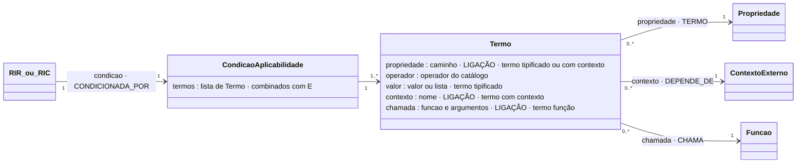

# Condição de aplicabilidade (e termos)

## Descrição

A condição de aplicabilidade decide se uma regra de inferência se aplica. Usam-na a **RIR**, para decidir se a restrição é avaliada, e a **RIC**, para decidir se a conclusão é comunicada. É composta por um ou mais **termos**, combinados por conjunção:

```
condição = termo1 E termo2 E … E termoN
```

Cada termo tem exatamente a forma de uma verificação tipificada: um alvo (a propriedade que lê), um operador e um valor. O valor de um termo é o **fator discriminante**. A condição não existe de forma autónoma: é uma parte da regra, e cada regra tem uma única condição. Não há uma estrutura de decisões à parte: a árvore e a tabela de decisão derivam das regras (vistas `arvore` e `decisao`).

## Diagrama

Todos os atributos da entidade e todas as ligações a outras entidades. **LIGAÇÃO** marca os atributos que ligam a outra entidade; cada seta indica o atributo da declaração e a aresta correspondente no grafo.



## Atributos

| Atributo | Papel |
|---|---|
| `propriedade` | caminho · **ligação** · termo tipificado ou com contexto |
| `operador` | operador do catálogo |
| `valor` | valor ou lista · termo tipificado |
| `contexto` | nome · **ligação** · termo com contexto |
| `chamada` | funcao e argumentos · **ligação** · termo função |

### Ligações no grafo

| Aresta | Sentido | Outro extremo | Atributos |
|---|---|---|---|
| `CONDICIONADA_POR` | ← | RIR ou RIC | — |
| `TERMO` | Condicao → | Propriedade (1..N) | `ordem`, `operador`, `valor` (JSON) ou `contexto`, `minimo`/`maximo`, `caminho`, `texto` |
| `CHAMA` | Condicao → | Funcao | `termo` (ordem), `chamada`, `argumentos`, `operador`, `regra` |
| `DEPENDE_DE` | Condicao → | ContextoExterno | `termo`: um termo compara com o contexto |

Atributos do nó `CondicaoAplicabilidade`: `id` (`<regra>#condicao`), `regra`, `termos` (número) e `descricao` (os termos ligados por "e").

No grafo: nó `CondicaoAplicabilidade` (chave `id`). O modelo completo do grafo está em [ecv/4_graph/graph_model.json](../../../ecv/4_graph/graph_model.json).

## Exemplos

### Esboço na declaração

No atributo `condicao` da regra, como uma lista (a ordem é irrelevante):

```json
"condicao": [
  {"propriedade": "nivelBateria", "operador": "RANGE", "valor": [0, 10]},
  {"operador": "EXT_FUNCTION", "chamada": {"funcao": "excedeDiasDesdeHoje", "argumentos": [{"caminho": "dataUltimaManutencao"}, {"literal": 7}]}}
]
```

### Exemplos das declarações de exemplo

Uma condição com três termos (RIR-TEMP-REFRIG-CELSIUS, a listagem da tese):

<!-- gerar:json-regra:RIR-TEMP-REFRIG-CELSIUS -->
```json
{
  "id": "RIR-TEMP-REFRIG-CELSIUS",
  "natureza": "inferencia_restritiva",
  "descricao": "Se Identificacao.tipoDispositivo = TEMPERATURA e Leitura.Medicao.unidadeMedida = °C e Leitura.Instalacao.ambiente = REFRIGERACAO → Leitura.Medicao.valor entre -30 e 0",
  "condicao": [
    {"propriedade": "Identificacao.tipoDispositivo", "operador": "EQUALS", "valor": "TEMPERATURA"},
    {"propriedade": "Leitura.Medicao.unidadeMedida", "operador": "EQUALS", "valor": "°C"},
    {"propriedade": "Leitura.Instalacao.ambiente", "operador": "EQUALS", "valor": "REFRIGERACAO"}
  ],
  "restricao": {
    "propriedade": "Leitura.Medicao.valor",
    "operador": "RANGE",
    "valor": [-30, 0],
    "mensagem": "Temperatura fora da gama de refrigeração (-30 a 0 °C)."
  }
}
```
<!-- /gerar -->

Uma condição com um termo tipificado e um termo função com contexto externo:

<!-- gerar:json-regra:RIC-MANUT -->
```json
{
  "id": "RIC-MANUT",
  "natureza": "inferencia_conclusiva",
  "descricao": "Se Diagnostico.nivelBateria entre 0 e 10 e excedeDiasDesdeHoje(Diagnostico.dataUltimaManutencao, 7) → informa Ação MANUTENCAO",
  "condicao": [
    {"propriedade": "nivelBateria", "operador": "RANGE", "valor": [0, 10]},
    {
      "operador": "EXT_FUNCTION",
      "chamada": {
        "funcao": "excedeDiasDesdeHoje",
        "argumentos": [
          {"caminho": "dataUltimaManutencao"},
          {"literal": 7}
        ]
      }
    }
  ],
  "mensagem": "Ação MANUTENCAO: o nível de bateria está baixo e o dispositivo não recebe manutenção há mais de 7 dias.",
  "conclusao": {"tipo": "ACAO", "valor": "MANUTENCAO"},
  "contextosExternos": ["dataDeHoje"]
}
```
<!-- /gerar -->

Uma condição que é só uma função sem contexto (limites de Lisboa como literal):

<!-- gerar:json-regra:RIR-LX-LOCALIDADE -->
```json
{
  "id": "RIR-LX-LOCALIDADE",
  "natureza": "inferencia_restritiva",
  "descricao": "Se dentroDe(Localizacao.InformacaoGeografica.latitude, Localizacao.InformacaoGeografica.longitude, [(38.796, -9.23), (38.796, -9.09), (38.69, -9.09), (38.69, -9.23)]) → Localizacao.Morada.localidade = LISBOA",
  "condicao": [
    {
      "operador": "FUNCTION",
      "chamada": {
        "funcao": "dentroDe",
        "argumentos": [
          {"caminho": "InformacaoGeografica.latitude"},
          {"caminho": "InformacaoGeografica.longitude"},
          {
            "literal": [[38.796, -9.23], [38.796, -9.09], [38.69, -9.09], [38.69, -9.23]]
          }
        ]
      }
    }
  ],
  "restricao": {
    "propriedade": "Morada.localidade",
    "operador": "EQUALS",
    "valor": "LISBOA",
    "mensagem": "Um equipamento localizado dentro dos limites de Lisboa tem de ter a localidade LISBOA na morada."
  },
  "notas": "Função usada num termo da condição de aplicabilidade (e não na restrição)."
}
```
<!-- /gerar -->

## Pode e não pode

| Pode | Não pode |
|---|---|
| Ter 1..N termos (alvos), sobre propriedades a qualquer profundidade do nó da regra | Estar vazia numa RIR ou RIC (I4) |
| Misturar termos tipificados, com contexto e com função | Ter OU entre termos |
| Usar valores fora dos valores plausíveis (por exemplo `nivelBateria ∈ [0, 10]` é um limite próprio) | Ler o alvo da restrição da mesma regra (I6) |
| Ser parcialmente resolvida por um perfil (seleção estática) | Existir fora de uma regra, ou ser partilhada por duas regras |

Sobre os valores: usar um valor fora dos valores plausíveis numa seleção (`EQUALS` ou `IN`) dá o aviso I7, porque a regra nunca se aplicaria a esse valor.

## Detalhes

### Formas de termo

| Forma | Declaração | Exemplo |
|---|---|---|
| **Tipificado** | `{"propriedade", "operador", "valor"}` | `{"propriedade": "Leitura.Instalacao.ambiente", "operador": "EQUALS", "valor": "REFRIGERACAO"}` |
| **Com contexto externo** | `{"propriedade", "operador", "contexto"}`: compara a propriedade com o valor de um contexto | `{"propriedade": "dataMedicao", "operador": "LT", "contexto": "dataDeHoje"}` (RIC-MED-DIFERIDA) |
| **Função** | `{"operador": "FUNCTION" ou "EXT_FUNCTION", "chamada": {…}}` | `excedeDiasDesdeHoje(dataUltimaManutencao, 7)` (RIC-MANUT); `dentroDe(lat, lon, limitesDeLisboa)` (RIR-LX-LOCALIDADE) |

Os operadores mais usados nos termos são:

- `EQUALS`, quando seleciona um único valor (`tipoDispositivo = TEMPERATURA`). Um valor simples, e não um conjunto: o dispositivo é de temperatura, e não "de um dos tipos da lista".
- `IN`, quando seleciona vários valores da mesma propriedade (`ambiente ∈ {REFRIGERACAO, ESTUFA}`). É a única disjunção admitida.
- `RANGE` e as comparações, quando seleciona um intervalo (`nivelBateria entre 0 e 10`, `totalFatura > 1000`).

Num termo com contexto, o operador é `EQUALS`, `NOT_EQUALS`, `LT`, `LTE`, `GT` ou `GTE`, e o tipo do contexto tem de ser o da propriedade.

### Porque não há OU entre termos

1. **Legibilidade.** "tipoDispositivo = HUMIDADE e unidadeMedida = % ou tipoDispositivo = VELOCIDADE e unidadeMedida = m/s" só se lê com regras de precedência e admite duas leituras.
2. **Navegação.** Com termos apenas conjuntivos, cada regra é um único caminho na árvore de decisão, e a árvore deriva das regras. Com OU, uma regra ocuparia vários ramos.
3. **Significado.** Duas condições ligadas por OU representam, em regra, conhecimento diferente que só coincide na restrição (RIR-HUM e RIR-VEL-MS) e devem ser duas regras.

O OU não desaparece. Perguntar "que condições levam à restrição valor ∈ [0, 100]" devolve as duas regras, e a sua reunião é a disjunção. Dentro da mesma propriedade, a disjunção faz-se com `IN`.

### Seleção estática e dinâmica

Os termos são avaliados com os valores da instância (seleção dinâmica) ou com os valores fixados no perfil (seleção estática). Um termo sobre uma propriedade fixada fica resolvido antes da execução: verdadeiro ou falso. Um termo sobre uma propriedade que nem está na projeção nem está fixada é indisponível, e a regra não é avaliável (aviso I10). Ver [Perfil.md](Perfil.md) e a vista `perfil_<nome>.html`.

## Verificações

**S-TERMO**, **I4**, **I5** (operador e tipo; contexto comparável), **I6**, **I7** (aviso) e **I10** (aviso, por perfil).
