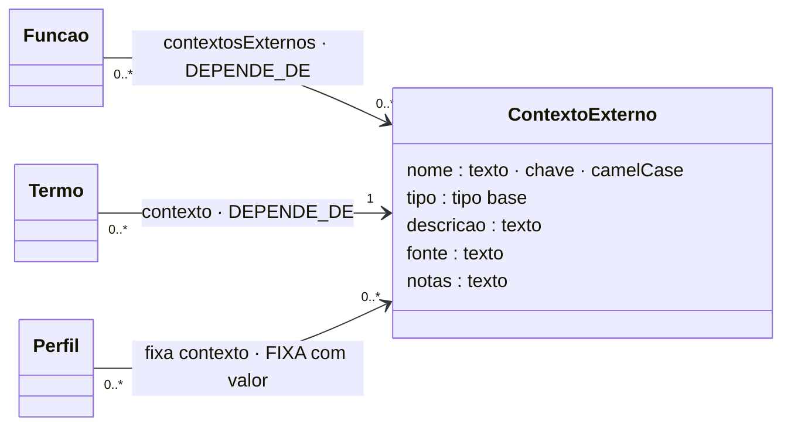

# Contexto externo

## Descrição

Parte da informação de que uma regra precisa não pertence ao modelo nem à regra: a data atual, a chave com que um dispositivo assina as mensagens, o relógio do servidor, as séries comunicadas à AT, o hash do último documento emitido. Chama-se a isto contexto externo (a tese marca-o com ᵉˣᵗ).

A dependência da validação em relação a um contexto tem de estar num sítio consultável (eixos E7 e E9). O contexto declara-se uma vez e liga-se a quem o usa. Assim, é possível perguntar que regras dependem de um sistema externo e que contextos têm de estar disponíveis para avaliar.

## Diagrama

Todos os atributos da entidade e todas as ligações a outras entidades. **LIGAÇÃO** marca os atributos que ligam a outra entidade; cada seta indica o atributo da declaração e a aresta correspondente no grafo.



## Atributos

| Atributo | Tipo | Obrigatório | Descrição |
|---|---|---|---|
| `nome` | camelCase | sim | Único. |
| `tipo` | tipo base | sim | Para comparar com propriedades num termo. |
| `descricao` | texto (≥ 10) | sim | O que é o valor. |
| `fonte` | texto | não (recomendado) | De onde o motor o obtém. |
| `notas` | texto | não | Comentário livre. |

A regra pode ainda declarar `contextosExternos` (lista de nomes): é derivável (dos termos e das funções). Se estiver presente, tem de coincidir com os contextos usados (aviso I11).

### Ligações no grafo

| Aresta | Sentido | Outro extremo | Atributos |
|---|---|---|---|
| `DEPENDE_DE` | ← | Funcao | — |
| `DEPENDE_DE` | ← | CondicaoAplicabilidade | `termo` |
| `FIXA` | ← | Perfil | `valor` |

No grafo: nó `ContextoExterno` (chave `nome`). O modelo completo do grafo está em [ecv/4_graph/graph_model.json](../../../ecv/4_graph/graph_model.json).

## Exemplos

### Esboço na declaração

```json
"contextosExternos": [
  {"nome": "dataDeHoje", "tipo": "data", "descricao": "Data atual no momento da avaliação (AAAA-MM-DD).",
   "fonte": "Relógio do motor de avaliação; pode ser fixada por um perfil."}
]
```

### Exemplos das declarações de exemplo

<!-- gerar:tabela-contextos -->
| Contexto | Tipo | Descrição | Fonte | Usado pelas funções | Usado em termos (regras) | Fixado por perfis |
|---|---|---|---|---|---|---|
| dataDeHoje | data | Data atual no momento da avaliação (AAAA-MM-DD). | Relógio do motor de avaliação; pode ser fixada por um perfil para tornar a avaliação reprodutível. | excedeDiasDesdeHoje, naoPosteriorAHoje | RIC-MED-DIFERIDA | TesteRefrigeracao = 2026-09-30, AuditoriaSetembro2026 = 2026-09-30 |
| relogioServidor | data | Instante atual do servidor que recebe as leituras (data e hora ISO 8601). | Relógio do servidor da plataforma IoT. | desfasamentoInferiorA | — | TesteRefrigeracao = 2026-09-30T12:00:00Z |
| chaveDispositivo | texto | Chave secreta com que cada dispositivo assina as suas mensagens (HMAC-SHA256). | Cofre de chaves da plataforma IoT, consultado pelo identificador do dispositivo. | assinaturaValida | — | TesteRefrigeracao = chave-de-teste-0001 |
| hashAnterior | texto | Hash do último documento emitido na mesma série, que encadeia o documento atual. | Sistema de faturação do emitente. | hashEncadeadoValido | — | — |
| seriesComunicadasAT | texto | Séries de documentos comunicadas à AT, cada uma com o respetivo código de validação. | Portal das Finanças (AT), sincronizado pelo sistema de faturação. | atcudValido | — | — |
<!-- /gerar -->

## Pode e não pode

| Pode | Não pode |
|---|---|
| Ser usado por várias funções e termos | Ser passado como argumento de uma chamada (as funções acedem-lhe pela interface do motor) |
| Ser comparado com uma propriedade do mesmo tipo | Ser comparado com uma propriedade de outro tipo (I5) |
| Ser fixado por perfis | Ser confundido com um literal da regra (a área autorizada é um literal) |

## Detalhes

### Como é usado

| Uso | Declaração | Exemplo |
|---|---|---|
| **Por uma função** | a função lista-o em `contextosExternos`; a regra usa `EXT_FUNCTION` | `excedeDiasDesdeHoje` usa `dataDeHoje` (RIC-MANUT) |
| **Diretamente num termo** | `{"propriedade", "operador", "contexto"}` | `dataMedicao < dataDeHoje` (RIC-MED-DIFERIDA) |
| **Fixado por um perfil** | `{"contexto": "dataDeHoje", "valor": "2026-09-30"}` em `perfis[].fixa` | AuditoriaSetembro2026, TesteRefrigeracao |

O motor obtém o valor no momento da avaliação, a partir da fonte, ou recebe-o já fixado pelo perfil. Fixá-lo torna a avaliação reprodutível: uma auditoria avaliada "como se hoje fosse" 2026-09-30.

## Verificações

**S-CTX** (nome, tipo, descrição), **S-FUNC** (contextos das funções declarados), **S-TERMO** (contexto de um termo declarado), **I5** (tipo comparável) e **I13** (aviso: declarado mas não usado).
