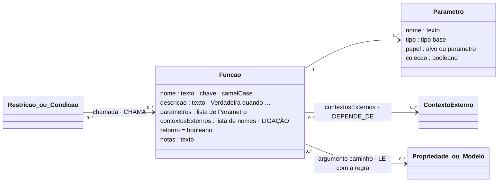

# Função

## Descrição

As funções ocupam o espaço onde quase nunca há conhecimento partilhado sobre a forma como os dados são validados: somar uma coleção, verificar unicidade, calcular sobre uma geometria, validar um hash, uma assinatura ou o dígito de controlo de um NIF. A regra delega a verificação em quem a sabe fazer: uma função declarada.

Uma função é declarada com:

- um **nome**;
- uma **descrição**, que diz quando é verdadeira;
- os **parâmetros**, que são os **alvos** (propriedades ou coleções que lê do modelo) e os **literais** (valores declarados na regra);
- os **contextos externos** de que depende;
- o **retorno**, sempre `booleano`.

Na declaração, a função só é declarada: a implementação vive no motor de avaliação. Na tese, as funções são geradas por um LLM a partir da declaração, testadas, revistas e só depois registadas no motor.

## Diagrama

Todos os atributos da entidade e todas as ligações a outras entidades. **LIGAÇÃO** marca os atributos que ligam a outra entidade; cada seta indica o atributo da declaração e a aresta correspondente no grafo.



## Atributos

| Atributo | Tipo | Obrigatório |
|---|---|---|
| `nome` | camelCase | sim |
| `descricao` | texto (≥ 10): "Verdadeira quando …" | sim |
| `parametros` | lista (≥ 1) | sim |
| `contextosExternos` | lista de nomes (pode ser vazia) | sim |
| `retorno` | `"booleano"` | sim |
| `notas` | texto | não |

### Ligações no grafo

| Aresta | Sentido | Outro extremo | Atributos |
|---|---|---|---|
| `CHAMA` | ← | Restricao ou CondicaoAplicabilidade | `chamada`, `argumentos`, `operador`, `regra`, `termo` |
| `LE` | Funcao → | Propriedade, USM ou SM | `caminho`, `regra`, `posicao`, `parte`, `colecao` |
| `DEPENDE_DE` | Funcao → | ContextoExterno | — |

O nó `Funcao` é único por nome e partilhado pelas regras que a usam. Por isso, cada aresta `LE` tem o atributo `regra`, que identifica a chamada a que o argumento pertence.

No grafo: nó `Funcao` (chave `nome`). O modelo completo do grafo está em [ecv/4_graph/graph_model.json](../../../ecv/4_graph/graph_model.json).

## Exemplos

### Esboço na declaração

As funções declaram-se uma vez, na lista `funcoes`, e são chamadas pelo nome nas regras:

```json
"funcoes": [
  {
    "nome": "excedeDiasDesdeHoje",
    "descricao": "Verdadeira quando passaram mais de n dias desde a data indicada até à data de hoje.",
    "parametros": [
      {"nome": "data", "tipo": "data", "papel": "alvo"},
      {"nome": "n", "tipo": "inteiro", "papel": "parametro"}
    ],
    "contextosExternos": ["dataDeHoje"],
    "retorno": "booleano"
  }
]
```

Na regra:

```json
{"operador": "EXT_FUNCTION", "chamada": {"funcao": "excedeDiasDesdeHoje", "argumentos": [{"caminho": "dataUltimaManutencao"}, {"literal": 7}]}}
```

### Exemplos das declarações de exemplo

<!-- gerar:tabela-funcoes -->
| Função | Verdadeira quando | Parâmetros | Contextos externos | Operador | Regras |
|---|---|---|---|---|---|
| excedeDiasDesdeHoje | Verdadeira quando passaram mais de n dias desde a data indicada até à data de hoje. | data: data, n: inteiro (literal) | dataDeHoje | EXT_FUNCTION | RIC-MANUT |
| naoPosteriorAHoje | Verdadeira quando a data indicada não é posterior à data de hoje. | data: data | dataDeHoje | EXT_FUNCTION | RP-DATAEMISSAO, RP-ORDEM-DATA, RP-MANUT-FUTURA |
| desfasamentoInferiorA | Verdadeira quando o instante indicado não está adiantado mais de s segundos em relação ao relógio do servidor. | instante: data, s: inteiro (literal) | relogioServidor | EXT_FUNCTION | RP-RELOGIO |
| dentroDe | Verdadeira quando o ponto (latitude, longitude) está dentro da área, um polígono de vértices (latitude, longitude). | latitude: decimal, longitude: decimal, area: poligono (literal) | — | FUNCTION | RIR-LX-LOCALIDADE, RP-AREA |
| assinaturaValida | Verdadeira quando a assinatura (HMAC-SHA256) corresponde à mensagem e à chave do dispositivo. | mensagem: texto, assinatura: texto | chaveDispositivo | EXT_FUNCTION | RP-ASSINATURA |
| valoresUnicos | Verdadeira quando nenhum valor da coleção se repete. | valores: lista<inteiro> [coleção] | — | FUNCTION | RP-LIN-NUM |
| valoresConsecutivos | Verdadeira quando os valores da coleção começam em 1 e não têm falhas. | valores: lista<inteiro> [coleção] | — | FUNCTION | RP-LIN-SEQ |
| contagemInferiorA | Verdadeira quando a coleção tem menos de n instâncias. | instancias: modelo [coleção], n: inteiro (literal) | — | FUNCTION | RIR-FS-LIN, RP-ORDEM-MAX, RP-LIN-MAX |
| somaIgualA | Verdadeira quando a soma dos valores da coleção, arredondada ao cêntimo, é igual ao total. | valores: lista<decimal> [coleção], total: decimal | — | FUNCTION | RP-SOMA |
| digitoControloValido | Verdadeira quando o dígito de controlo (módulo 11) do NIF está correto. | nif: texto | — | FUNCTION | RP-NIF-DC |
| hashEncadeadoValido | Verdadeira quando o hash do documento deriva do número, da data, do total e do hash do documento anterior da série. | numero: texto, dataEmissao: data, totalFatura: decimal, hash: texto | hashAnterior | EXT_FUNCTION | RP-HASH |
| atcudValido | Verdadeira quando o ATCUD pertence a uma série comunicada à AT e corresponde ao seu código de validação. | atcud: texto, serie: texto | seriesComunicadasAT | EXT_FUNCTION | RP-ATCUD |
<!-- /gerar -->

Função com uma coleção e um literal:

<!-- gerar:json-funcao:contagemInferiorA -->
```json
{
  "nome": "contagemInferiorA",
  "descricao": "Verdadeira quando a coleção tem menos de n instâncias.",
  "parametros": [
    {
      "nome": "instancias",
      "tipo": "modelo",
      "papel": "alvo",
      "colecao": true,
      "descricao": "Instâncias de um modelo composto com cardinalidade repetível."
    },
    {
      "nome": "n",
      "tipo": "inteiro",
      "papel": "parametro",
      "descricao": "Limite exclusivo do número de instâncias."
    }
  ],
  "contextosExternos": [],
  "retorno": "booleano"
}
```
<!-- /gerar -->

Função com quatro alvos e um contexto externo:

<!-- gerar:json-funcao:hashEncadeadoValido -->
```json
{
  "nome": "hashEncadeadoValido",
  "descricao": "Verdadeira quando o hash do documento deriva do número, da data, do total e do hash do documento anterior da série.",
  "parametros": [
    {"nome": "numero", "tipo": "texto", "papel": "alvo"},
    {"nome": "dataEmissao", "tipo": "data", "papel": "alvo"},
    {"nome": "totalFatura", "tipo": "decimal", "papel": "alvo"},
    {"nome": "hash", "tipo": "texto", "papel": "alvo"}
  ],
  "contextosExternos": ["hashAnterior"],
  "retorno": "booleano"
}
```
<!-- /gerar -->

Funções da tese que não estão na declaração. `eQuadrado(area)`, `eCirculo(area)` e `interseta(areaA, areaB)` (tese, Tabela "Funções declaradas", com a regra RP-AREA-FORMA) só leem literais das regras. Não validam dados, analisam a própria declaração (por exemplo, se duas áreas autorizadas se intersetam). Pertencem, por isso, às operações sobre o grafo, e não a uma regra com alvo. Uma restrição sem alvo no modelo não é uma restrição de validação.

## Pode e não pode

| Pode | Não pode |
|---|---|
| Ser usada por várias regras, com argumentos diferentes (`contagemInferiorA` em RP-LIN-MAX, RIR-FS-LIN e RP-ORDEM-MAX) | Devolver outra coisa que não um booleano |
| Ler propriedades, listas de valores de uma coleção ou instâncias de um modelo | Aceder a contextos externos que não declare |
| Depender de contextos externos (só com EXT_FUNCTION) | Ser chamada com um número de argumentos diferente do de parâmetros |
| Receber literais declarados na regra | Ter efeitos laterais ou repetir verificações de presença (regra de geração) |

## Detalhes

### Onde pode ser usada

| Lugar | Operador | Efeito | Exemplos |
|---|---|---|---|
| **Numa restrição** (RP ou RIR) | `FUNCTION` ou `EXT_FUNCTION` | A função é a verificação; se falha, comunica-se a mensagem da restrição | RP-SOMA, RP-AREA, RP-HASH, RIR-FS-LIN |
| **Num termo de uma condição** (RIR ou RIC) | `FUNCTION` ou `EXT_FUNCTION` | A função decide (com os outros termos) se a regra se aplica | RIC-MANUT (`excedeDiasDesdeHoje`), RIR-LX-LOCALIDADE (`dentroDe` Lisboa) |

O operador é `FUNCTION` quando a função só usa valores do modelo e da regra, e `EXT_FUNCTION` quando usa também contextos externos (I5).

### Parâmetros

| Campo | Valores | Significado |
|---|---|---|
| `nome` | texto | Nome do parâmetro (posição na chamada). |
| `tipo` | tipo base, `lista<tipo>`, `modelo`, ou outro (`poligono`) | O que a função recebe. |
| `papel` | `alvo` · `parametro` | `alvo` recebe um caminho do modelo (`{"caminho": …}`); `parametro` recebe um literal da regra (`{"literal": …}`). |
| `colecao` | booleano | O argumento atravessa uma composição repetível (lista de valores ou de instâncias). |
| `descricao` | texto | Opcional. |

O que é literal e o que é contexto. A área autorizada de RP-AREA não está no modelo, mas também não é um contexto externo: é informação da própria regra, como os limites de um RANGE, e passa-se como literal. A data de hoje é um contexto externo: não pertence ao modelo nem à regra.

## Verificações

**S-FUNC** (declaração), **S-CHAMADA** (função declarada; número de argumentos; caminho ou literal conforme o papel; coleções), **I5** (FUNCTION vs EXT_FUNCTION) e **I13** (aviso: função declarada mas não usada).
