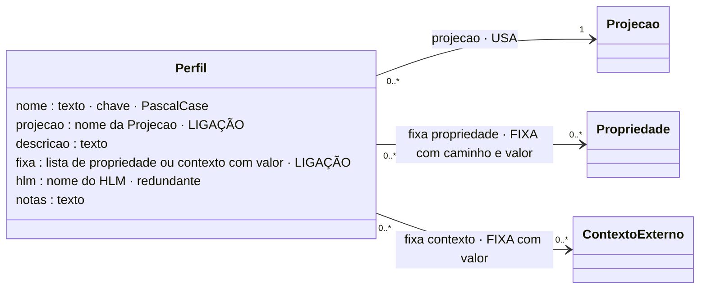

# Perfil de execução

## Descrição

O perfil liga o conhecimento de validação a um cenário concreto. Indica a **projeção** usada (e, por ela, o HLM). Fixa os **valores conhecidos antes da execução**: propriedades do modelo e contextos externos. O perfil não contém regras. Define o cenário em que as regras já declaradas vão ser avaliadas.

A diferença entre **seleção estática** e **seleção dinâmica** não está na regra nem na condição. Está na origem dos valores usados para avaliar a condição: o perfil (estática) ou a instância (dinâmica).

| Seleção | Os valores vêm de | Efeito | Exemplo |
|---|---|---|---|
| Estática | `fixa` do perfil | Os termos ficam resolvidos antes da execução: a regra fica sempre aplicável ou nunca aplicável | RefrigeracaoLote: RIR-TEMP-REFRIG-CELSIUS sempre aplicável, RIR-TEMP-ESTUFA-CELSIUS nunca aplicável |
| Dinâmica | a instância | A condição é avaliada instância a instância; as propriedades da condição têm de estar na projeção | LeiturasIndustriais (nada fixado) |

Uma propriedade fixada pode não fazer parte da projeção: o seu valor já é conhecido, e a instância não precisa de o trazer (TesteRefrigeracao fixa `ambiente`, que DispositivoTeste não projeta). Se uma condição lê uma propriedade que não está na projeção nem está fixada, a regra não é avaliável. O motor assinala isto quando o perfil é criado (aviso I10, perfil TesteLaboratorio).

## Diagrama

Todos os atributos da entidade e todas as ligações a outras entidades. **LIGAÇÃO** marca os atributos que ligam a outra entidade; cada seta indica o atributo da declaração e a aresta correspondente no grafo.



## Atributos

| Atributo | Tipo | Obrigatório | Descrição |
|---|---|---|---|
| `nome` | PascalCase | sim | Único. |
| `projecao` | nome de projeção | sim | A projeção usada. |
| `descricao` | texto | não (recomendado) | O cenário. |
| `fixa` | lista de `{propriedade, valor}` ou `{contexto, valor}` | sim (pode ser vazia) | Valores conhecidos antes da execução. |
| `hlm` | nome de HLM | não | Redundante (vem da projeção); se presente, tem de coincidir. |
| `notas` | texto | não | Comentário livre. |

### Ligações no grafo

| Aresta | Sentido | Outro extremo | Atributos |
|---|---|---|---|
| `USA` | Perfil → | Projecao | — |
| `FIXA` | Perfil → | Propriedade | `caminho`, `valor` (JSON) |
| `FIXA` | Perfil → | ContextoExterno | `valor` (JSON) |

No grafo: nó `Perfil` (chave `nome`). O modelo completo do grafo está em [ecv/4_graph/graph_model.json](../../../ecv/4_graph/graph_model.json).

## Exemplos

### Esboço na declaração

```json
"perfis": [
  {
    "nome": "RefrigeracaoLote",
    "projecao": "DispositivoProducao",
    "descricao": "Lote de sensores de temperatura em câmaras de refrigeração, em °C.",
    "fixa": [
      {"propriedade": "Identificacao.tipoDispositivo", "valor": "TEMPERATURA"},
      {"propriedade": "Leitura.Instalacao.ambiente", "valor": "REFRIGERACAO"},
      {"propriedade": "Leitura.Medicao.unidadeMedida", "valor": "°C"},
      {"contexto": "dataDeHoje", "valor": "2026-09-30"}
    ]
  }
]
```

### Exemplos das declarações de exemplo

<!-- gerar:tabela-perfis -->
| Perfil | Projeção | Descrição | Valores fixados |
|---|---|---|---|
| RefrigeracaoLote | DispositivoProducao | Lote de sensores de temperatura em câmaras de refrigeração, em °C. | Identificacao.tipoDispositivo = TEMPERATURA; Leitura.Instalacao.ambiente = REFRIGERACAO; Leitura.Medicao.unidadeMedida = °C |
| LeiturasIndustriais | DispositivoProducao | Plataforma com leituras de várias fontes: nenhum valor fixado. | — (seleção dinâmica) |
| Estufas | DispositivoProducao | Sensores instalados em estufas agrícolas. | Leitura.Instalacao.ambiente = ESTUFA |
| TesteLaboratorio | DispositivoTeste | Testes de bancada: o ambiente não é projetado nem fixado. | — (seleção dinâmica) |
| TesteRefrigeracao | DispositivoTeste | Testes de sensores de refrigeração, com contextos externos fixados. | Leitura.Instalacao.ambiente = REFRIGERACAO; contexto dataDeHoje = 2026-09-30; contexto relogioServidor = 2026-09-30T12:00:00Z; contexto chaveDispositivo = chave-de-teste-0001 |
| EmissaoSimplificada | FaturaSimplificada | Emissão de faturas simplificadas: o tipo de documento é conhecido. | Cabecalho.tipoDocumento = FS |
| SubmissaoAT | FaturaAT | Submissão à AT: nenhum valor conhecido à partida (seleção dinâmica). | — (seleção dinâmica) |
| AuditoriaSetembro2026 | FaturaAT | Auditoria reprodutível: a data de hoje é fixada. | contexto dataDeHoje = 2026-09-30 |
| OrdensCorrentes | OrdemCompleta | Ordens de instalação correntes. | — (seleção dinâmica) |
<!-- /gerar -->

Perfil que fixa propriedades (seleção estática):

<!-- gerar:json-perfil:RefrigeracaoLote -->
```json
{
  "nome": "RefrigeracaoLote",
  "projecao": "DispositivoProducao",
  "descricao": "Lote de sensores de temperatura em câmaras de refrigeração, em °C.",
  "fixa": [
    {"propriedade": "Identificacao.tipoDispositivo", "valor": "TEMPERATURA"},
    {"propriedade": "Leitura.Instalacao.ambiente", "valor": "REFRIGERACAO"},
    {"propriedade": "Leitura.Medicao.unidadeMedida", "valor": "°C"}
  ],
  "notas": "Seleção estática (tese, Figura 'Seleção estática'): RIR-TEMP-REFRIG-CELSIUS sempre aplicada; as gamas de outros ambientes nunca."
}
```
<!-- /gerar -->

Perfil que fixa uma propriedade não projetada e injeta contextos externos:

<!-- gerar:json-perfil:TesteRefrigeracao -->
```json
{
  "nome": "TesteRefrigeracao",
  "projecao": "DispositivoTeste",
  "descricao": "Testes de sensores de refrigeração, com contextos externos fixados.",
  "fixa": [
    {"propriedade": "Leitura.Instalacao.ambiente", "valor": "REFRIGERACAO"},
    {"contexto": "dataDeHoje", "valor": "2026-09-30"},
    {"contexto": "relogioServidor", "valor": "2026-09-30T12:00:00Z"},
    {"contexto": "chaveDispositivo", "valor": "chave-de-teste-0001"}
  ],
  "notas": "A propriedade fixada (ambiente) não está na projeção: o seu valor já é conhecido e resolve os termos da condição."
}
```
<!-- /gerar -->

Perfil que só injeta um contexto (avaliação reprodutível):

<!-- gerar:json-perfil:AuditoriaSetembro2026 -->
```json
{
  "nome": "AuditoriaSetembro2026",
  "projecao": "FaturaAT",
  "descricao": "Auditoria reprodutível: a data de hoje é fixada.",
  "fixa": [
    {"contexto": "dataDeHoje", "valor": "2026-09-30"}
  ],
  "notas": "Perfil que injeta um contexto externo: as regras que dependem de dataDeHoje usam este valor."
}
```
<!-- /gerar -->

Perfil com regras não avaliáveis (aviso I10):

<!-- gerar:json-perfil:TesteLaboratorio -->
```json
{
  "nome": "TesteLaboratorio",
  "projecao": "DispositivoTeste",
  "descricao": "Testes de bancada: o ambiente não é projetado nem fixado.",
  "fixa": [],
  "notas": "Demonstra o invariante I10: as RIR cuja condição lê ambiente não são avaliáveis neste perfil."
}
```
<!-- /gerar -->

## Pode e não pode

| Pode | Não pode |
|---|---|
| Usar exatamente uma projeção | Conter regras |
| Fixar propriedades (por caminho a partir do HLM) com valores plausíveis | Fixar um valor não plausível (I9) |
| Fixar contextos externos | Fixar um caminho que não existe (I9) |
| Não fixar nada (seleção dinâmica) | Ter um HLM diferente do da projeção |

## Detalhes

### Como construir um perfil estático

Faz-se a pesquisa "candidatos a fixar": dadas as propriedades a validar, obtêm-se as outras propriedades usadas nas condições das regras que as restringem. Para `valor` e `unidadeMedida`, são `tipoDispositivo`, `unidadeMedida` e `ambiente` (vista `candidatos_perfil`).

### Observações (tese, Seleção estática e dinâmica)

1. O conhecimento não muda com o cenário: só o perfil muda.
2. A seleção é declarada, e não escondida em código.
3. O que fica de fora é consultável antes de executar.
4. O perfil lê-se como uma regra.
5. A fronteira com o exterior é explícita: os contextos são fixados no perfil ou obtidos pelo motor.

## Verificações

**S-PERFIL** (projeção declarada; cada fixação tem `propriedade` ou `contexto` e `valor`), **I9** (caminhos existem; valores plausíveis) e **I10** (aviso: regras não avaliáveis).
