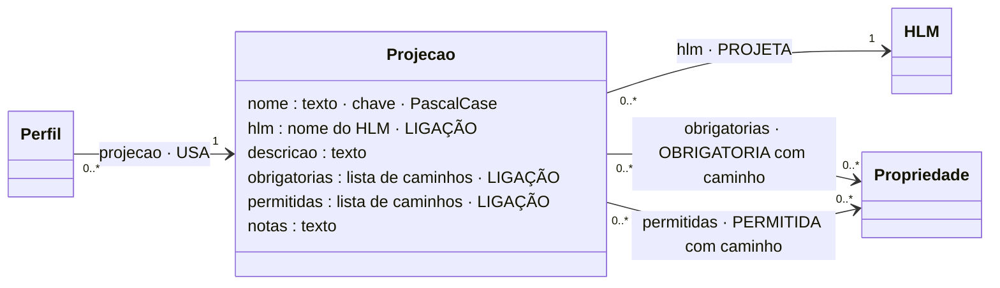

# RE (regra estrutural) e Projeção

## Descrição

As condições estruturais são a presença, o tipo e a cardinalidade (notNull, isString, isInteger, …). Não se declaram regra a regra. O tipo já está na propriedade e a cardinalidade na composição (eixo E4). O que varia de utilização para utilização é que partes do modelo devem estar presentes. Isso exprime-se pela **projeção**.

Uma projeção é definida sobre um HLM e distingue, para uma utilização:

- **obrigatórias:** propriedades que têm de estar presentes e respeitar a estrutura;
- **permitidas:** propriedades que podem estar presentes e são avaliadas quando existem;
- **proibidas:** todas as restantes, implicitamente (não se declaram).

A projeção não cria regras sobre as propriedades nem escolhe que regras correm. Define o âmbito estrutural da avaliação para uma utilização concreta. Estrutura e regras não se confundem (eixo E2).

## Diagrama

Todos os atributos da entidade e todas as ligações a outras entidades. **LIGAÇÃO** marca os atributos que ligam a outra entidade; cada seta indica o atributo da declaração e a aresta correspondente no grafo.



## Atributos

| Atributo | Tipo | Obrigatório | Descrição |
|---|---|---|---|
| `nome` | texto, PascalCase | sim | Único entre as projeções. |
| `hlm` | nome de HLM | sim | O HLM projetado. |
| `descricao` | texto | não (recomendado) | A utilização. |
| `obrigatorias` | lista de caminhos | sim (pode ser vazia) | A partir do HLM; aceita `X.*`. |
| `permitidas` | lista de caminhos | sim (pode ser vazia) | Idem. |
| `notas` | texto | não | Comentário livre. |

Os caminhos partem do HLM (`Leitura.Medicao.*`, `Identificacao.estado`). `X.*` expande para todas as propriedades, a qualquer profundidade, abaixo de X. Um caminho sem `*` tem de terminar numa propriedade.

### Ligações no grafo

| Aresta | Sentido | Outro extremo | Atributos | Significado |
|---|---|---|---|---|
| `PROJETA` | Projecao → | HLM | — | Sobre que HLM incide. |
| `OBRIGATORIA` | Projecao → | Propriedade | `caminho` | Uma aresta por ocorrência (caminho expandido). |
| `PERMITIDA` | Projecao → | Propriedade | `caminho` | Idem. |
| `USA` | ← | Perfil | — | Perfis que usam a projeção. |

A mesma propriedade pode receber várias arestas da mesma projeção, uma por caminho. Por exemplo, `USM:Morada.codigoPostal` recebe uma por `Emitente.Morada.codigoPostal` e outra por `Cliente.Morada.codigoPostal`.

No grafo: nó `Projecao` (chave `nome`). O modelo completo do grafo está em [ecv/4_graph/graph_model.json](../../../ecv/4_graph/graph_model.json).

## Exemplos

### Esboço na declaração

Na lista `projecoes`:

```json
{
  "nome": "NomeDaProjecao",
  "hlm": "NomeDoHLM",
  "descricao": "Para que utilização.",
  "obrigatorias": ["SmA.*", "SmB.UsmX.propriedade"],
  "permitidas": ["SmC.*"]
}
```

### Exemplos das declarações de exemplo

<!-- gerar:tabela-projecoes -->
| Projeção | HLM | Descrição | Obrigatórias | Permitidas |
|---|---|---|---|---|
| DispositivoTeste | Dispositivo | Equipamento em testes: identificação mínima e medição; coordenadas opcionais. | Identificacao.identificador, Identificacao.estado, Identificacao.tipoDispositivo, Leitura.Medicao.* | Localizacao.InformacaoGeografica.* |
| DispositivoProducao | Dispositivo | Equipamento em produção: identificação completa, leitura, localização e diagnóstico. | Identificacao.*, Leitura.Medicao.*, Leitura.Instalacao.*, Localizacao.InformacaoGeografica.*, Localizacao.Morada.pais, Diagnostico.* | Leitura.Assinatura.*, Localizacao.Morada.rua, Localizacao.Morada.codigoPostal, Localizacao.Morada.localidade, Localizacao.Morada.freguesia, Localizacao.indicacaoAcesso |
| FaturaSimplificada | Fatura | Fatura simplificada: dispensa a identificação do cliente. | Cabecalho.*, Emitente.*, Linhas.* | — |
| FaturaAT | Fatura | Fatura para submissão à AT: exige o cliente. | Cabecalho.*, Emitente.*, Cliente.Entidade.*, Cliente.Morada.*, Linhas.* | Cliente.consentimentoComercial |
| OrdemCompleta | OrdemInstalacao | Ordem de instalação com requerente e locais completos. | Pedido.*, Requerente.Entidade.*, Requerente.Morada.*, Localizacao.InformacaoGeografica.*, Localizacao.Morada.* | Requerente.consentimentoComercial, Localizacao.indicacaoAcesso |
<!-- /gerar -->

<!-- gerar:json-projecao:DispositivoProducao -->
```json
{
  "nome": "DispositivoProducao",
  "hlm": "Dispositivo",
  "descricao": "Equipamento em produção: identificação completa, leitura, localização e diagnóstico.",
  "obrigatorias": [
    "Identificacao.*",
    "Leitura.Medicao.*",
    "Leitura.Instalacao.*",
    "Localizacao.InformacaoGeografica.*",
    "Localizacao.Morada.pais",
    "Diagnostico.*"
  ],
  "permitidas": [
    "Leitura.Assinatura.*",
    "Localizacao.Morada.rua",
    "Localizacao.Morada.codigoPostal",
    "Localizacao.Morada.localidade",
    "Localizacao.Morada.freguesia",
    "Localizacao.indicacaoAcesso"
  ]
}
```
<!-- /gerar -->

<!-- gerar:json-projecao:FaturaAT -->
```json
{
  "nome": "FaturaAT",
  "hlm": "Fatura",
  "descricao": "Fatura para submissão à AT: exige o cliente.",
  "obrigatorias": ["Cabecalho.*", "Emitente.*", "Cliente.Entidade.*", "Cliente.Morada.*", "Linhas.*"],
  "permitidas": ["Cliente.consentimentoComercial"]
}
```
<!-- /gerar -->

A matriz de projeções de cada HLM está em `documentacao/vistas/projecoes_<HLM>.html`. É a tabela "Modelos Fatura e Dispositivo e respetivas projeções" da tese e a "Matriz de projeções" do Capítulo 4.

Relação com a tese: no Capítulo 3, DispositivoProducao tinha `Diagnostico.*` como permitida; aqui segue a matriz do Capítulo 4 (Diagnóstico obrigatório, Morada parcialmente permitida).

## Pode e não pode

| Pode | Não pode |
|---|---|
| Incidir sobre um único HLM | Incidir sobre um SM ou USM |
| Usar `X.*` para todas as propriedades abaixo de X | Ter a mesma propriedade (caminho) obrigatória e permitida (I9) |
| Selecionar uma ocorrência específica pelo caminho (`Localizacao.Morada.pais`) | Selecionar um caminho que não existe (I9) |
| Coexistir com outras projeções sobre o mesmo HLM | Conter regras ou valores fixados (os valores são do perfil) |

### Como saber se é uma projeção (e não uma regra)

| Situação | O que usar |
|---|---|
| "Para esta utilização, o NIF do cliente tem de vir" | Projeção (obrigatória) |
| "O NIF tem nove algarismos" | RP |
| "Acima de 1000 euros, o NIF do cliente não pode ser o de consumidor final" | RIR |
| "Na fatura simplificada não vem o cliente" | Projeção (FaturaSimplificada não inclui `Cliente.*`) |

## Detalhes

### Contextos de utilização

- Estruturas diferentes por utilização do mesmo modelo (CA5): uma fatura simplificada e uma fatura para a AT; um dispositivo em testes e em produção.
- A pesquisa inversa "em que projeções é usada esta propriedade" (vista `impacto`) e a matriz de projeções (vista `projecoes`).
- Juntamente com o perfil, decide se uma regra é avaliável: se a condição lê uma propriedade que a projeção não inclui e o perfil não fixa, a regra não é avaliável (I10).

## Verificações

**S-PROJ** (nome; HLM declarado; listas) e **I9** (caminhos existem; obrigatórias ∩ permitidas = ∅).
