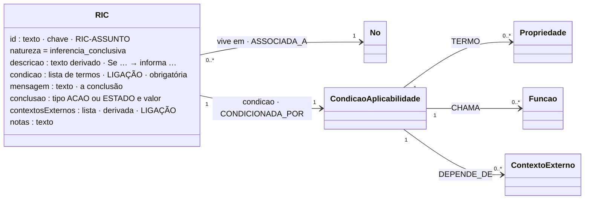

# RIC: Regra de Inferência Conclusiva

## Descrição

Uma RIC é uma regra de inferência cuja condição de aplicabilidade não identifica uma restrição a avaliar. Quando a condição é satisfeita, a própria regra comunica uma **conclusão** sobre o domínio: um estado derivado ou uma ação. Não valida um valor: conclui. "RIC-MANUT não diz se a leitura é válida; acrescenta conhecimento sobre o dispositivo e propõe uma ação" (tese).

O estado derivado não é mais uma entidade do sistema. É informação sobre a avaliação. Se o modelo tem uma propriedade que o recebe, ou se outro sistema age consoante esse estado, isso é responsabilidade de quem implementa, e não da ECR.

## Diagrama

Todos os atributos da entidade e todas as ligações a outras entidades. **LIGAÇÃO** marca os atributos que ligam a outra entidade; cada seta indica o atributo da declaração e a aresta correspondente no grafo.



## Atributos

Os atributos comuns a todas as regras (`id`, `natureza`, `descricao`, `contextosExternos`, `notas`) estão em [Regra.md](Regra.md); aqui ficam os próprios deste tipo.

| Atributo | Obrigatório | Descrição |
|---|---|---|
| `mensagem` | sim | A mensagem de conclusão: transporta o estado ou a ação e o motivo. Pertence à regra (numa RP ou RIR, a mensagem pertence à restrição). |
| `conclusao` | recomendado | `{"tipo": "ACAO" | "ESTADO", "valor": "MANUTENCAO"}`. Torna a conclusão consultável (vista do modelo com regras, agrupada por natureza) e dá o "informa …" da descrição. |

### Ligações no grafo

| Aresta | Para |
|---|---|
| `ASSOCIADA_A` | onde vive (Propriedade, USM, SM, HLM) |
| `CONDICIONADA_POR` | CondicaoAplicabilidade (termos, funções, contextos) |

No grafo, a mensagem e a conclusão são atributos do nó RIC (`mensagem`, `conclusaoTipo`, `conclusaoValor`).

No grafo: nó `RIC` (chave `id`). O modelo completo do grafo está em [ecv/4_graph/graph_model.json](../../../ecv/4_graph/graph_model.json).

## Exemplos

### Esboço na declaração

```json
{
  "id": "RIC-MANUT",
  "natureza": "inferencia_conclusiva",
  "descricao": "Se Diagnostico.nivelBateria entre 0 e 10 e excedeDiasDesdeHoje(Diagnostico.dataUltimaManutencao, 7) → informa Ação MANUTENCAO",
  "condicao": [
    {"propriedade": "nivelBateria", "operador": "RANGE", "valor": [0, 10]},
    {"operador": "EXT_FUNCTION", "chamada": {"funcao": "excedeDiasDesdeHoje",
      "argumentos": [{"caminho": "dataUltimaManutencao"}, {"literal": 7}]}}
  ],
  "mensagem": "Ação MANUTENCAO: o nível de bateria está baixo e o dispositivo não recebe manutenção há mais de 7 dias.",
  "conclusao": {"tipo": "ACAO", "valor": "MANUTENCAO"},
  "contextosExternos": ["dataDeHoje"]
}
```

### Exemplos das declarações de exemplo

<!-- gerar:tabela-ric -->
| Regra | Vive em | Descrição | Mensagem de conclusão | Contextos externos |
|---|---|---|---|---|
| RIC-MED-DIFERIDA | USM Medicao.dataMedicao | Se Medicao.dataMedicao < dataDeHoje (contexto externo) → informa Estado DIFERIDA | Estado DIFERIDA: a leitura foi medida antes de hoje e chega com atraso; deve ser tratada como dado histórico. | dataDeHoje |
| RIC-MANUT | USM Diagnostico | Se Diagnostico.nivelBateria entre 0 e 10 e excedeDiasDesdeHoje(Diagnostico.dataUltimaManutencao, 7) → informa Ação MANUTENCAO | Ação MANUTENCAO: o nível de bateria está baixo e o dispositivo não recebe manutenção há mais de 7 dias. | dataDeHoje |
| RIC-REDE | USM Diagnostico | Se Diagnostico.sinalRede entre -120 e -100 e Diagnostico.latencia entre 500 e 10000 e Diagnostico.taxaRececao entre 0 e 50 → informa Estado NAO_FIAVEL | Estado NAO_FIAVEL: o sinal de rede é fraco e a receção irregular; as medições deste dispositivo são QUESTIONAVEL. | — |
<!-- /gerar -->

RIC com termos tipificados (estado derivado):

<!-- gerar:json-regra:RIC-REDE -->
```json
{
  "id": "RIC-REDE",
  "natureza": "inferencia_conclusiva",
  "descricao": "Se Diagnostico.sinalRede entre -120 e -100 e Diagnostico.latencia entre 500 e 10000 e Diagnostico.taxaRececao entre 0 e 50 → informa Estado NAO_FIAVEL",
  "condicao": [
    {"propriedade": "sinalRede", "operador": "RANGE", "valor": [-120, -100]},
    {"propriedade": "latencia", "operador": "RANGE", "valor": [500, 10000]},
    {"propriedade": "taxaRececao", "operador": "RANGE", "valor": [0, 50]}
  ],
  "mensagem": "Estado NAO_FIAVEL: o sinal de rede é fraco e a receção irregular; as medições deste dispositivo são QUESTIONAVEL.",
  "conclusao": {"tipo": "ESTADO", "valor": "NAO_FIAVEL"}
}
```
<!-- /gerar -->

RIC numa propriedade, com um termo que compara a propriedade com um contexto externo (sem função): é a "medição anterior à data de hoje" da tese.

<!-- gerar:json-regra:RIC-MED-DIFERIDA -->
```json
{
  "id": "RIC-MED-DIFERIDA",
  "natureza": "inferencia_conclusiva",
  "descricao": "Se Medicao.dataMedicao < dataDeHoje (contexto externo) → informa Estado DIFERIDA",
  "condicao": [
    {"propriedade": "dataMedicao", "operador": "LT", "contexto": "dataDeHoje"}
  ],
  "mensagem": "Estado DIFERIDA: a leitura foi medida antes de hoje e chega com atraso; deve ser tratada como dado histórico.",
  "conclusao": {"tipo": "ESTADO", "valor": "DIFERIDA"},
  "contextosExternos": ["dataDeHoje"],
  "notas": "Contexto externo usado diretamente num termo da condição (sem função): dataMedicao < dataDeHoje."
}
```
<!-- /gerar -->

## Pode e não pode

| Pode | Não pode |
|---|---|
| Ter condição (1..N termos) e mensagem de conclusão | Ter restrição (I4) |
| Ter `conclusao: {tipo: ACAO | ESTADO, valor}` | Ter uma mensagem com menos de 10 caracteres |
| Usar termos com função e contexto externo (RIC-MANUT) | — |
| Usar um termo que compara uma propriedade com um contexto externo (RIC-MED-DIFERIDA) | — |
| Viver numa propriedade, quando a condição só lê essa propriedade | — |

### Como saber se é uma RIC

| Pergunta | Se sim |
|---|---|
| Quando a condição se verifica, há algo a comunicar, e não um valor a verificar? | RIC |
| O resultado é um estado (NAO_FIAVEL, DIFERIDA) ou uma ação (MANUTENCAO)? | RIC |
| O resultado é "o valor X tem de estar em Y"? | RIR |

## Verificações

**I4** (condição, mensagem, sem restrição), **S-REGRA** (`conclusao` só em RIC), **I5**, **I7**, **I11**.
