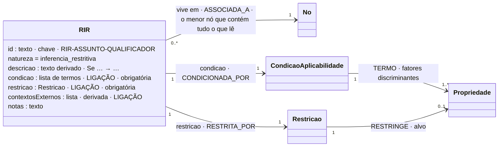

# RIR: Regra de Inferência Restritiva

## Descrição

As regras de inferência fazem inferências sobre o domínio: a partir dos valores de outras propriedades, do momento da avaliação ou de informação externa, inferem como o domínio se comporta. Uma RIR usa uma **condição de aplicabilidade** para decidir se a sua **restrição** é avaliada. A condição decide se a regra se aplica; a restrição decide se o dado é válido. Se a condição não é satisfeita, o resultado é "não aplicável", e não "inválido".

Exemplo da tese: num ambiente de refrigeração, uma temperatura em °C tem de estar entre -30 e 0 (RIR-TEMP-REFRIG-CELSIUS).

## Diagrama

Todos os atributos da entidade e todas as ligações a outras entidades. **LIGAÇÃO** marca os atributos que ligam a outra entidade; cada seta indica o atributo da declaração e a aresta correspondente no grafo.



## Atributos

Os atributos comuns a todas as regras (`id`, `natureza`, `descricao`, `contextosExternos`, `notas`) estão em [Regra.md](Regra.md); aqui ficam os próprios deste tipo.

| Atributo | Papel |
|---|---|
| `id` | texto · chave · RIR-ASSUNTO-QUALIFICADOR |
| `natureza` | = inferencia_restritiva |
| `descricao` | texto derivado · Se … → … |
| `condicao` | lista de termos · **ligação** · obrigatória |
| `restricao` | Restricao · **ligação** · obrigatória |
| `contextosExternos` | lista · derivada · **ligação** |
| `notas` | texto |

### Ligações no grafo

| Aresta | Para |
|---|---|
| `ASSOCIADA_A` | USM, SM ou HLM onde vive |
| `RESTRITA_POR` | Restricao → `RESTRINGE` Propriedade, ou `CHAMA` Funcao |
| `CONDICIONADA_POR` | CondicaoAplicabilidade → `TERMO` Propriedade (1..N), `CHAMA` Funcao, `DEPENDE_DE` ContextoExterno |

No grafo: nó `RIR` (chave `id`). O modelo completo do grafo está em [ecv/4_graph/graph_model.json](../../../ecv/4_graph/graph_model.json).

## Exemplos

### Esboço na declaração

```json
{
  "id": "RIR-TEMP-REFRIG-CELSIUS",
  "natureza": "inferencia_restritiva",
  "descricao": "Se … → Leitura.Medicao.valor entre -30 e 0",
  "condicao": [
    {"propriedade": "Identificacao.tipoDispositivo", "operador": "EQUALS", "valor": "TEMPERATURA"},
    {"propriedade": "Leitura.Medicao.unidadeMedida", "operador": "EQUALS", "valor": "°C"},
    {"propriedade": "Leitura.Instalacao.ambiente", "operador": "EQUALS", "valor": "REFRIGERACAO"}
  ],
  "restricao": {"propriedade": "Leitura.Medicao.valor", "operador": "RANGE", "valor": [-30, 0],
                "mensagem": "Temperatura fora da gama de refrigeração (-30 a 0 °C)."}
}
```

Declara-se no `regras` do nó mais baixo que contém tudo o que lê (aqui, o HLM Dispositivo).

### Exemplos das declarações de exemplo

Gamas de `Medicao.valor` por tipo de dispositivo, unidade e ambiente: o mapeamento do Capítulo 4, com as regras do Capítulo 3.

<!-- gerar:tabela-rir:valor -->
| Regra | Vive em | Descrição (Se … → …) | Mensagem de não conformidade |
|---|---|---|---|
| RIR-TEMP-C | HLM Dispositivo | Se Identificacao.tipoDispositivo = TEMPERATURA e Leitura.Medicao.unidadeMedida = °C → Leitura.Medicao.valor entre -60 e 1300 | Uma temperatura em °C tem de estar entre -60 e 1300. |
| RIR-TEMP-K | HLM Dispositivo | Se Identificacao.tipoDispositivo = TEMPERATURA e Leitura.Medicao.unidadeMedida = K → Leitura.Medicao.valor entre 213.15 e 1573.15 | Uma temperatura em K tem de estar entre 213.15 e 1573.15. |
| RIR-TEMP-F | HLM Dispositivo | Se Identificacao.tipoDispositivo = TEMPERATURA e Leitura.Medicao.unidadeMedida = °F → Leitura.Medicao.valor entre -76 e 2372 | Uma temperatura em °F tem de estar entre -76 e 2372. |
| RIR-HUM | HLM Dispositivo | Se Identificacao.tipoDispositivo = HUMIDADE e Leitura.Medicao.unidadeMedida = % → Leitura.Medicao.valor entre 0 e 100 | Uma humidade em % tem de estar entre 0 e 100. |
| RIR-PRES-HPA | HLM Dispositivo | Se Identificacao.tipoDispositivo = PRESSAO e Leitura.Medicao.unidadeMedida = hPa → Leitura.Medicao.valor entre 300 e 1100 | Uma pressão em hPa tem de estar entre 300 e 1100. |
| RIR-PRES-BAR | HLM Dispositivo | Se Identificacao.tipoDispositivo = PRESSAO e Leitura.Medicao.unidadeMedida = bar → Leitura.Medicao.valor entre 0.3 e 1.1 | Uma pressão em bar tem de estar entre 0.3 e 1.1. |
| RIR-VEL-MS | HLM Dispositivo | Se Identificacao.tipoDispositivo = VELOCIDADE e Leitura.Medicao.unidadeMedida = m/s → Leitura.Medicao.valor entre 0 e 75 | Uma velocidade em m/s tem de estar entre 0 e 75. |
| RIR-VEL-KMH | HLM Dispositivo | Se Identificacao.tipoDispositivo = VELOCIDADE e Leitura.Medicao.unidadeMedida = km/h → Leitura.Medicao.valor entre 0 e 270 | Uma velocidade em km/h tem de estar entre 0 e 270. |
| RIR-TEMP-REFRIG-CELSIUS | HLM Dispositivo | Se Identificacao.tipoDispositivo = TEMPERATURA e Leitura.Medicao.unidadeMedida = °C e Leitura.Instalacao.ambiente = REFRIGERACAO → Leitura.Medicao.valor entre -30 e 0 | Temperatura fora da gama de refrigeração (-30 a 0 °C). |
| RIR-TEMP-REFRIG-KELVIN | HLM Dispositivo | Se Identificacao.tipoDispositivo = TEMPERATURA e Leitura.Medicao.unidadeMedida = K e Leitura.Instalacao.ambiente = REFRIGERACAO → Leitura.Medicao.valor entre 243.15 e 273.15 | Temperatura fora da gama de refrigeração (243.15 a 273.15 K). |
| RIR-TEMP-REFRIG-FAHRENHEIT | HLM Dispositivo | Se Identificacao.tipoDispositivo = TEMPERATURA e Leitura.Medicao.unidadeMedida = °F e Leitura.Instalacao.ambiente = REFRIGERACAO → Leitura.Medicao.valor entre -22 e 32 | Temperatura fora da gama de refrigeração (-22 a 32 °F). |
| RIR-TEMP-ESTUFA-CELSIUS | HLM Dispositivo | Se Identificacao.tipoDispositivo = TEMPERATURA e Leitura.Medicao.unidadeMedida = °C e Leitura.Instalacao.ambiente = ESTUFA → Leitura.Medicao.valor entre 15 e 45 | Temperatura fora da gama da estufa (15 a 45 °C). |
| RIR-TEMP-ESTUFA-KELVIN | HLM Dispositivo | Se Identificacao.tipoDispositivo = TEMPERATURA e Leitura.Medicao.unidadeMedida = K e Leitura.Instalacao.ambiente = ESTUFA → Leitura.Medicao.valor entre 288.15 e 318.15 | Temperatura fora da gama da estufa (288.15 a 318.15 K). |
| RIR-TEMP-ESTUFA-FAHRENHEIT | HLM Dispositivo | Se Identificacao.tipoDispositivo = TEMPERATURA e Leitura.Medicao.unidadeMedida = °F e Leitura.Instalacao.ambiente = ESTUFA → Leitura.Medicao.valor entre 59 e 113 | Temperatura fora da gama da estufa (59 a 113 °F). |
| RIR-TEMP-ARMAZEM-CELSIUS | HLM Dispositivo | Se Identificacao.tipoDispositivo = TEMPERATURA e Leitura.Medicao.unidadeMedida = °C e Leitura.Instalacao.ambiente = ARMAZEM → Leitura.Medicao.valor entre 5 e 30 | Temperatura fora da gama do armazém (5 a 30 °C). |
| RIR-TEMP-ARMAZEM-KELVIN | HLM Dispositivo | Se Identificacao.tipoDispositivo = TEMPERATURA e Leitura.Medicao.unidadeMedida = K e Leitura.Instalacao.ambiente = ARMAZEM → Leitura.Medicao.valor entre 278.15 e 303.15 | Temperatura fora da gama do armazém (278.15 a 303.15 K). |
| RIR-TEMP-ARMAZEM-FAHRENHEIT | HLM Dispositivo | Se Identificacao.tipoDispositivo = TEMPERATURA e Leitura.Medicao.unidadeMedida = °F e Leitura.Instalacao.ambiente = ARMAZEM → Leitura.Medicao.valor entre 41 e 86 | Temperatura fora da gama do armazém (41 a 86 °F). |
| RIR-TEMP-SERVIDORES-CELSIUS | HLM Dispositivo | Se Identificacao.tipoDispositivo = TEMPERATURA e Leitura.Medicao.unidadeMedida = °C e Leitura.Instalacao.ambiente = SERVIDORES → Leitura.Medicao.valor entre 18 e 27 | Temperatura fora da gama da sala de servidores (18 a 27 °C). |
| RIR-TEMP-SERVIDORES-KELVIN | HLM Dispositivo | Se Identificacao.tipoDispositivo = TEMPERATURA e Leitura.Medicao.unidadeMedida = K e Leitura.Instalacao.ambiente = SERVIDORES → Leitura.Medicao.valor entre 291.15 e 300.15 | Temperatura fora da gama da sala de servidores (291.15 a 300.15 K). |
| RIR-TEMP-SERVIDORES-FAHRENHEIT | HLM Dispositivo | Se Identificacao.tipoDispositivo = TEMPERATURA e Leitura.Medicao.unidadeMedida = °F e Leitura.Instalacao.ambiente = SERVIDORES → Leitura.Medicao.valor entre 64.4 e 80.6 | Temperatura fora da gama da sala de servidores (64.4 a 80.6 °F). |
| RIR-TEMP-EXTERIOR-CELSIUS | HLM Dispositivo | Se Identificacao.tipoDispositivo = TEMPERATURA e Leitura.Medicao.unidadeMedida = °C e Leitura.Instalacao.ambiente = EXTERIOR → Leitura.Medicao.valor entre -20 e 50 | Temperatura fora da gama do exterior (-20 a 50 °C). |
| RIR-TEMP-EXTERIOR-KELVIN | HLM Dispositivo | Se Identificacao.tipoDispositivo = TEMPERATURA e Leitura.Medicao.unidadeMedida = K e Leitura.Instalacao.ambiente = EXTERIOR → Leitura.Medicao.valor entre 253.15 e 323.15 | Temperatura fora da gama do exterior (253.15 a 323.15 K). |
| RIR-TEMP-EXTERIOR-FAHRENHEIT | HLM Dispositivo | Se Identificacao.tipoDispositivo = TEMPERATURA e Leitura.Medicao.unidadeMedida = °F e Leitura.Instalacao.ambiente = EXTERIOR → Leitura.Medicao.valor entre -4 e 122 | Temperatura fora da gama do exterior (-4 a 122 °F). |
| RIR-TEMP-INCIN-CELSIUS | HLM Dispositivo | Se Identificacao.tipoDispositivo = TEMPERATURA e Leitura.Medicao.unidadeMedida = °C e Leitura.Instalacao.ambiente = INCINERADORA → Leitura.Medicao.valor entre 200 e 1200 | Temperatura fora da gama da incineradora (200 a 1200 °C). |
| RIR-TEMP-INCIN-KELVIN | HLM Dispositivo | Se Identificacao.tipoDispositivo = TEMPERATURA e Leitura.Medicao.unidadeMedida = K e Leitura.Instalacao.ambiente = INCINERADORA → Leitura.Medicao.valor entre 473.15 e 1473.15 | Temperatura fora da gama da incineradora (473.15 a 1473.15 K). |
| RIR-TEMP-INCIN-FAHRENHEIT | HLM Dispositivo | Se Identificacao.tipoDispositivo = TEMPERATURA e Leitura.Medicao.unidadeMedida = °F e Leitura.Instalacao.ambiente = INCINERADORA → Leitura.Medicao.valor entre 392 e 2192 | Temperatura fora da gama da incineradora (392 a 2192 °F). |
| RIR-HUM-REFRIG | HLM Dispositivo | Se Identificacao.tipoDispositivo = HUMIDADE e Leitura.Medicao.unidadeMedida = % e Leitura.Instalacao.ambiente = REFRIGERACAO → Leitura.Medicao.valor entre 80 e 95 | Humidade fora da gama de refrigeração (80 a 95 %). |
| RIR-HUM-ESTUFA | HLM Dispositivo | Se Identificacao.tipoDispositivo = HUMIDADE e Leitura.Medicao.unidadeMedida = % e Leitura.Instalacao.ambiente = ESTUFA → Leitura.Medicao.valor entre 60 e 90 | Humidade fora da gama da estufa (60 a 90 %). |
| RIR-HUM-ARMAZEM | HLM Dispositivo | Se Identificacao.tipoDispositivo = HUMIDADE e Leitura.Medicao.unidadeMedida = % e Leitura.Instalacao.ambiente = ARMAZEM → Leitura.Medicao.valor entre 30 e 60 | Humidade fora da gama do armazém (30 a 60 %). |
| RIR-HUM-SERVIDORES | HLM Dispositivo | Se Identificacao.tipoDispositivo = HUMIDADE e Leitura.Medicao.unidadeMedida = % e Leitura.Instalacao.ambiente = SERVIDORES → Leitura.Medicao.valor entre 40 e 60 | Humidade fora da gama da sala de servidores (40 a 60 %). |
| RIR-HUM-EXTERIOR | HLM Dispositivo | Se Identificacao.tipoDispositivo = HUMIDADE e Leitura.Medicao.unidadeMedida = % e Leitura.Instalacao.ambiente = EXTERIOR → Leitura.Medicao.valor entre 0 e 100 | Humidade fora da gama do exterior (0 a 100 %). |
| RIR-VEL-EXTERIOR-MS | HLM Dispositivo | Se Identificacao.tipoDispositivo = VELOCIDADE e Leitura.Medicao.unidadeMedida = m/s e Leitura.Instalacao.ambiente = EXTERIOR → Leitura.Medicao.valor entre 0 e 40 | Velocidade fora da gama do exterior (0 a 40 m/s). |
| RIR-VEL-EXTERIOR-KMH | HLM Dispositivo | Se Identificacao.tipoDispositivo = VELOCIDADE e Leitura.Medicao.unidadeMedida = km/h e Leitura.Instalacao.ambiente = EXTERIOR → Leitura.Medicao.valor entre 0 e 144 | Velocidade fora da gama do exterior (0 a 144 km/h). |
| RIR-PRES-EXTERIOR-HPA | HLM Dispositivo | Se Identificacao.tipoDispositivo = PRESSAO e Leitura.Medicao.unidadeMedida = hPa e Leitura.Instalacao.ambiente = EXTERIOR → Leitura.Medicao.valor entre 950 e 1050 | Pressão fora da gama do exterior (950 a 1050 hPa). |
| RIR-PRES-EXTERIOR-BAR | HLM Dispositivo | Se Identificacao.tipoDispositivo = PRESSAO e Leitura.Medicao.unidadeMedida = bar e Leitura.Instalacao.ambiente = EXTERIOR → Leitura.Medicao.valor entre 950 e 1050 | Pressão fora da gama do exterior (950 a 1050 bar). |
| RIR-TEMP-CAMARA-CELSIUS | HLM Dispositivo | Se Identificacao.tipoDispositivo = TEMPERATURA e Leitura.Medicao.unidadeMedida = °C e Leitura.Instalacao.ambiente = CAMARA_FRIGORIFICA → Leitura.Medicao.valor entre -25 e -18 | Temperatura fora da gama da câmara frigorífica (-25 a -18 °C). |
<!-- /gerar -->

Unidades admissíveis por tipo de dispositivo:

<!-- gerar:tabela-rir:unidadeMedida -->
| Regra | Vive em | Descrição (Se … → …) | Mensagem de não conformidade |
|---|---|---|---|
| RIR-TEMP-UN | HLM Dispositivo | Se Identificacao.tipoDispositivo = TEMPERATURA → Leitura.Medicao.unidadeMedida ∈ {°C, K, °F} | Uma temperatura tem de ser medida em °C, K ou °F. |
| RIR-HUM-UN | HLM Dispositivo | Se Identificacao.tipoDispositivo = HUMIDADE → Leitura.Medicao.unidadeMedida ∈ {%} | Uma humidade tem de ser medida em %. |
| RIR-PRES-UN | HLM Dispositivo | Se Identificacao.tipoDispositivo = PRESSAO → Leitura.Medicao.unidadeMedida ∈ {hPa, bar} | Uma pressão tem de ser medida em hPa ou bar. |
| RIR-VEL-UN | HLM Dispositivo | Se Identificacao.tipoDispositivo = VELOCIDADE → Leitura.Medicao.unidadeMedida ∈ {m/s, km/h} | Uma velocidade tem de ser medida em m/s ou km/h. |
<!-- /gerar -->

Código postal (por país e por freguesia de Lisboa) e localidade:

<!-- gerar:tabela-rir:codigoPostal -->
| Regra | Vive em | Descrição (Se … → …) | Mensagem de não conformidade |
|---|---|---|---|
| RIR-CP-PT | USM Morada | Se Morada.pais = PT → Morada.codigoPostal segue o padrão ^[1-9][0-9]{3}-[0-9]{3}$ | O código postal português tem de ter o formato 0000-000, sem começar por zero. |
| RIR-CP-ES | USM Morada | Se Morada.pais = ES → Morada.codigoPostal segue o padrão ^[0-5][0-9]{4}$ | O código postal espanhol tem de ter cinco algarismos, a começar por 0 a 5. |
| RIR-CP-GB | USM Morada | Se Morada.pais = GB → Morada.codigoPostal segue o padrão ^[A-Z]{1,2}[0-9][0-9A-Z]? [0-9][A-Z]{2}$ | O código postal britânico tem de ter a forma de um postcode (ex.: SW1A 1AA). |
| RIR-CP-LX-AJUDA | USM Morada | Se Morada.pais = PT e Morada.localidade = LISBOA e Morada.freguesia = AJUDA → Morada.codigoPostal segue o padrão ^(1300\|1349)-[0-9]{3}$ | O código postal de uma morada da freguesia Ajuda (Lisboa) começa por 1300 ou 1349. |
| RIR-CP-LX-ALCANTARA | USM Morada | Se Morada.pais = PT e Morada.localidade = LISBOA e Morada.freguesia = ALCANTARA → Morada.codigoPostal segue o padrão ^(1300\|1350)-[0-9]{3}$ | O código postal de uma morada da freguesia Alcantara (Lisboa) começa por 1300 ou 1350. |
| RIR-CP-LX-ALVALADE | USM Morada | Se Morada.pais = PT e Morada.localidade = LISBOA e Morada.freguesia = ALVALADE → Morada.codigoPostal segue o padrão ^(1700\|1749)-[0-9]{3}$ | O código postal de uma morada da freguesia Alvalade (Lisboa) começa por 1700 ou 1749. |
| RIR-CP-LX-AREEIRO | USM Morada | Se Morada.pais = PT e Morada.localidade = LISBOA e Morada.freguesia = AREEIRO → Morada.codigoPostal segue o padrão ^(1000\|1049)-[0-9]{3}$ | O código postal de uma morada da freguesia Areeiro (Lisboa) começa por 1000 ou 1049. |
| RIR-CP-LX-ARROIOS | USM Morada | Se Morada.pais = PT e Morada.localidade = LISBOA e Morada.freguesia = ARROIOS → Morada.codigoPostal segue o padrão ^(1150\|1169)-[0-9]{3}$ | O código postal de uma morada da freguesia Arroios (Lisboa) começa por 1150 ou 1169. |
| RIR-CP-LX-AVENIDAS-NOVAS | USM Morada | Se Morada.pais = PT e Morada.localidade = LISBOA e Morada.freguesia = AVENIDAS_NOVAS → Morada.codigoPostal segue o padrão ^(1050\|1069)-[0-9]{3}$ | O código postal de uma morada da freguesia Avenidas Novas (Lisboa) começa por 1050 ou 1069. |
| RIR-CP-LX-BEATO | USM Morada | Se Morada.pais = PT e Morada.localidade = LISBOA e Morada.freguesia = BEATO → Morada.codigoPostal segue o padrão ^(1900\|1949)-[0-9]{3}$ | O código postal de uma morada da freguesia Beato (Lisboa) começa por 1900 ou 1949. |
| RIR-CP-LX-BELEM | USM Morada | Se Morada.pais = PT e Morada.localidade = LISBOA e Morada.freguesia = BELEM → Morada.codigoPostal segue o padrão ^(1400\|1449)-[0-9]{3}$ | O código postal de uma morada da freguesia Belem (Lisboa) começa por 1400 ou 1449. |
| RIR-CP-LX-BENFICA | USM Morada | Se Morada.pais = PT e Morada.localidade = LISBOA e Morada.freguesia = BENFICA → Morada.codigoPostal segue o padrão ^(1500\|1549)-[0-9]{3}$ | O código postal de uma morada da freguesia Benfica (Lisboa) começa por 1500 ou 1549. |
| RIR-CP-LX-CAMPO-DE-OURIQUE | USM Morada | Se Morada.pais = PT e Morada.localidade = LISBOA e Morada.freguesia = CAMPO_DE_OURIQUE → Morada.codigoPostal segue o padrão ^(1250\|1350)-[0-9]{3}$ | O código postal de uma morada da freguesia Campo de Ourique (Lisboa) começa por 1250 ou 1350. |
| RIR-CP-LX-CAMPOLIDE | USM Morada | Se Morada.pais = PT e Morada.localidade = LISBOA e Morada.freguesia = CAMPOLIDE → Morada.codigoPostal segue o padrão ^(1070\|1099)-[0-9]{3}$ | O código postal de uma morada da freguesia Campolide (Lisboa) começa por 1070 ou 1099. |
| RIR-CP-LX-CARNIDE | USM Morada | Se Morada.pais = PT e Morada.localidade = LISBOA e Morada.freguesia = CARNIDE → Morada.codigoPostal segue o padrão ^(1600\|1649)-[0-9]{3}$ | O código postal de uma morada da freguesia Carnide (Lisboa) começa por 1600 ou 1649. |
| RIR-CP-LX-ESTRELA | USM Morada | Se Morada.pais = PT e Morada.localidade = LISBOA e Morada.freguesia = ESTRELA → Morada.codigoPostal segue o padrão ^(1200\|1249)-[0-9]{3}$ | O código postal de uma morada da freguesia Estrela (Lisboa) começa por 1200 ou 1249. |
| RIR-CP-LX-LUMIAR | USM Morada | Se Morada.pais = PT e Morada.localidade = LISBOA e Morada.freguesia = LUMIAR → Morada.codigoPostal segue o padrão ^(1600\|1750)-[0-9]{3}$ | O código postal de uma morada da freguesia Lumiar (Lisboa) começa por 1600 ou 1750. |
| RIR-CP-LX-MARVILA | USM Morada | Se Morada.pais = PT e Morada.localidade = LISBOA e Morada.freguesia = MARVILA → Morada.codigoPostal segue o padrão ^(1800\|1949)-[0-9]{3}$ | O código postal de uma morada da freguesia Marvila (Lisboa) começa por 1800 ou 1949. |
| RIR-CP-LX-MISERICORDIA | USM Morada | Se Morada.pais = PT e Morada.localidade = LISBOA e Morada.freguesia = MISERICORDIA → Morada.codigoPostal segue o padrão ^(1200\|1249)-[0-9]{3}$ | O código postal de uma morada da freguesia Misericordia (Lisboa) começa por 1200 ou 1249. |
| RIR-CP-LX-OLIVAIS | USM Morada | Se Morada.pais = PT e Morada.localidade = LISBOA e Morada.freguesia = OLIVAIS → Morada.codigoPostal segue o padrão ^(1800\|1885)-[0-9]{3}$ | O código postal de uma morada da freguesia Olivais (Lisboa) começa por 1800 ou 1885. |
| RIR-CP-LX-PARQUE-DAS-NACOES | USM Morada | Se Morada.pais = PT e Morada.localidade = LISBOA e Morada.freguesia = PARQUE_DAS_NACOES → Morada.codigoPostal segue o padrão ^(1990\|1998)-[0-9]{3}$ | O código postal de uma morada da freguesia Parque das Nacoes (Lisboa) começa por 1990 ou 1998. |
| RIR-CP-LX-PENHA-DE-FRANCA | USM Morada | Se Morada.pais = PT e Morada.localidade = LISBOA e Morada.freguesia = PENHA_DE_FRANCA → Morada.codigoPostal segue o padrão ^(1170\|1199)-[0-9]{3}$ | O código postal de uma morada da freguesia Penha de Franca (Lisboa) começa por 1170 ou 1199. |
| RIR-CP-LX-SANTA-CLARA | USM Morada | Se Morada.pais = PT e Morada.localidade = LISBOA e Morada.freguesia = SANTA_CLARA → Morada.codigoPostal segue o padrão ^(1750\|1769)-[0-9]{3}$ | O código postal de uma morada da freguesia Santa Clara (Lisboa) começa por 1750 ou 1769. |
| RIR-CP-LX-SANTA-MARIA-MAIOR | USM Morada | Se Morada.pais = PT e Morada.localidade = LISBOA e Morada.freguesia = SANTA_MARIA_MAIOR → Morada.codigoPostal segue o padrão ^(1100\|1149)-[0-9]{3}$ | O código postal de uma morada da freguesia Santa Maria Maior (Lisboa) começa por 1100 ou 1149. |
| RIR-CP-LX-SANTO-ANTONIO | USM Morada | Se Morada.pais = PT e Morada.localidade = LISBOA e Morada.freguesia = SANTO_ANTONIO → Morada.codigoPostal segue o padrão ^(1250\|1269)-[0-9]{3}$ | O código postal de uma morada da freguesia Santo Antonio (Lisboa) começa por 1250 ou 1269. |
| RIR-CP-LX-SAO-DOMINGOS-DE-BENFICA | USM Morada | Se Morada.pais = PT e Morada.localidade = LISBOA e Morada.freguesia = SAO_DOMINGOS_DE_BENFICA → Morada.codigoPostal segue o padrão ^(1500\|1600)-[0-9]{3}$ | O código postal de uma morada da freguesia Sao Domingos de Benfica (Lisboa) começa por 1500 ou 1600. |
| RIR-CP-LX-SAO-VICENTE | USM Morada | Se Morada.pais = PT e Morada.localidade = LISBOA e Morada.freguesia = SAO_VICENTE → Morada.codigoPostal segue o padrão ^(1100\|1170)-[0-9]{3}$ | O código postal de uma morada da freguesia Sao Vicente (Lisboa) começa por 1100 ou 1170. |
<!-- /gerar -->

<!-- gerar:tabela-rir:localidade -->
| Regra | Vive em | Descrição (Se … → …) | Mensagem de não conformidade |
|---|---|---|---|
| RIR-LX-LOCALIDADE | SM Localizacao | Se dentroDe(Localizacao.InformacaoGeografica.latitude, Localizacao.InformacaoGeografica.longitude, [(38.796, -9.23), (38.796, -9.09), (38.69, -9.09), (38.69, -9.23)]) → Localizacao.Morada.localidade = LISBOA | Um equipamento localizado dentro dos limites de Lisboa tem de ter a localidade LISBOA na morada. |
<!-- /gerar -->

Faturação (IVA por linha, fatura simplificada, NIF, email do emitente):

<!-- gerar:tabela-rir:taxaIVA -->
| Regra | Vive em | Descrição (Se … → …) | Mensagem de não conformidade |
|---|---|---|---|
| RIR-IVA-ISE | USM Linha | Se Linha.tipoIVA = ISENTA → Linha.taxaIVA = 0 | Uma linha isenta tem de ter taxa de IVA 0. |
| RIR-IVA-RED | USM Linha | Se Linha.tipoIVA = REDUZIDA → Linha.taxaIVA = 6 | Uma linha com taxa reduzida tem de ter taxa de IVA 6. |
| RIR-IVA-INT | USM Linha | Se Linha.tipoIVA = INTERMEDIA → Linha.taxaIVA = 13 | Uma linha com taxa intermédia tem de ter taxa de IVA 13. |
| RIR-IVA-NOR | USM Linha | Se Linha.tipoIVA = NORMAL → Linha.taxaIVA = 23 | Uma linha com taxa normal tem de ter taxa de IVA 23. |
<!-- /gerar -->

<!-- gerar:tabela-rir:id=RIR-FS -->
| Regra | Vive em | Descrição (Se … → …) | Mensagem de não conformidade |
|---|---|---|---|
| RIR-FS-LIN | HLM Fatura | Se Cabecalho.tipoDocumento = FS → contagemInferiorA(Linhas.Linha, 11) | Uma fatura simplificada não pode ter mais de 10 linhas. |
| RIR-FS | SM Cabecalho | Se Cabecalho.tipoDocumento = FS → Cabecalho.totalFatura ≤ 1000 | Uma fatura simplificada não pode ultrapassar 1000 euros. |
| RIR-FS-NUM | SM Cabecalho | Se Cabecalho.tipoDocumento = FS → Cabecalho.numero começa por "FS" | O número de uma fatura simplificada tem de começar por FS. |
<!-- /gerar -->

<!-- gerar:tabela-rir:nif -->
| Regra | Vive em | Descrição (Se … → …) | Mensagem de não conformidade |
|---|---|---|---|
| RIR-FT-NIF | HLM Fatura | Se Cabecalho.totalFatura > 1000 → Cliente.Entidade.nif ≠ 999999990 | Uma fatura acima de 1000 euros tem de identificar o NIF do cliente (não pode usar o NIF de consumidor final 999999990). |
<!-- /gerar -->

<!-- gerar:tabela-rir:email -->
| Regra | Vive em | Descrição (Se … → …) | Mensagem de não conformidade |
|---|---|---|---|
| RIR-EMAIL-CX | SM Emitente | Se Emitente.Entidade.nome = Companhia X → Emitente.Contacto.email termina em "@companhiax.com" | O email de um emitente da Companhia X tem de terminar em @companhiax.com. |
| RIR-EMAIL-CY | SM Emitente | Se Emitente.Entidade.nome = Companhia Y → Emitente.Contacto.email termina em "@companhia-y.pt" | O email de um emitente da Companhia Y tem de terminar em @companhia-y.pt. |
<!-- /gerar -->

RIR cuja restrição é uma função:

<!-- gerar:json-regra:RIR-FS-LIN -->
```json
{
  "id": "RIR-FS-LIN",
  "natureza": "inferencia_restritiva",
  "descricao": "Se Cabecalho.tipoDocumento = FS → contagemInferiorA(Linhas.Linha, 11)",
  "condicao": [
    {"propriedade": "Cabecalho.tipoDocumento", "operador": "EQUALS", "valor": "FS"}
  ],
  "restricao": {
    "operador": "FUNCTION",
    "chamada": {
      "funcao": "contagemInferiorA",
      "argumentos": [
        {"caminho": "Linhas.Linha"},
        {"literal": 11}
      ]
    },
    "mensagem": "Uma fatura simplificada não pode ter mais de 10 linhas."
  }
}
```
<!-- /gerar -->

RIR cuja condição é uma função (dispositivo dentro dos limites de Lisboa):

<!-- gerar:json-regra:RIR-LX-LOCALIDADE -->
```json
{
  "id": "RIR-LX-LOCALIDADE",
  "natureza": "inferencia_restritiva",
  "descricao": "Se dentroDe(Localizacao.InformacaoGeografica.latitude, Localizacao.InformacaoGeografica.longitude, [(38.796, -9.23), (38.796, -9.09), (38.69, -9.09), (38.69, -9.23)]) → Localizacao.Morada.localidade = LISBOA",
  "condicao": [
    {
      "operador": "FUNCTION",
      "chamada": {
        "funcao": "dentroDe",
        "argumentos": [
          {"caminho": "InformacaoGeografica.latitude"},
          {"caminho": "InformacaoGeografica.longitude"},
          {
            "literal": [[38.796, -9.23], [38.796, -9.09], [38.69, -9.09], [38.69, -9.23]]
          }
        ]
      }
    }
  ],
  "restricao": {
    "propriedade": "Morada.localidade",
    "operador": "EQUALS",
    "valor": "LISBOA",
    "mensagem": "Um equipamento localizado dentro dos limites de Lisboa tem de ter a localidade LISBOA na morada."
  },
  "notas": "Função usada num termo da condição de aplicabilidade (e não na restrição)."
}
```
<!-- /gerar -->

Relação com a tese: RIR-TEMP-C usa aqui a gama física [-60, 1300] do mapeamento do Capítulo 4; no texto do Capítulo 3 usou-se [-50, 100], uma gama ilustrativa. As regras RIR-TEMP-K, RIR-VEL-MS, RIR-VEL-KMH e RIR-TEMP-INCIN-CELSIUS, que no Capítulo 3 eram ilustrativas, fazem aqui parte da declaração.

## Pode e não pode

| Pode | Não pode |
|---|---|
| Ter uma condição (1..N termos, com E) e uma restrição | Não ter condição (seria uma RP) ou não ter restrição (seria uma RIC) |
| Ter termos tipificados, termos com contexto externo e termos com função | Ler o alvo da restrição na condição |
| Restringir uma propriedade ou chamar uma função | Ter `mensagem` ou `conclusao` ao nível da regra |
| Viver no nó mais baixo que contém tudo o que lê | Viver numa propriedade (leria pelo menos duas: termo e alvo) |

### Como saber se é uma RIR

| Pergunta | Se sim |
|---|---|
| A exigência só se aplica quando outras propriedades têm certos valores? | RIR |
| Quando a condição se verifica, há um valor que pode falhar (uma restrição)? | RIR (se não houver nada a falhar, mas só algo a comunicar, é uma RIC) |
| A exigência vale sempre, seja qual for o contexto? | RP |

## Detalhes

### Partes (tese, Tabela "Partes de uma regra de inferência")

| Parte | Descrição | RIR-TEMP-C |
|---|---|---|
| Condição de aplicabilidade | Um ou mais termos, combinados com E | tipoDispositivo = TEMPERATURA E unidadeMedida = °C |
| Restrição | O que o dado deve satisfazer quando a condição é satisfeita | valor ∈ [-60, 1300] |
| Falha | A mensagem de não conformidade da restrição | "Uma temperatura em °C tem de estar entre -60 e 1300." |

### Regras de construção

- **Uma condição por regra, uma restrição por regra.** A mesma restrição com duas condições dá duas regras (RIR-HUM e RIR-VEL-MS, ambas [0, 100]). A mesma condição com duas restrições também dá duas regras (RIR-FS e RIR-FS-NUM, ambas para `tipoDocumento = FS`).
- **Sem OU entre propriedades.** Entre termos, o único operador é o E. As razões são três: a legibilidade (não há precedência), a navegação (cada regra é um caminho na árvore de decisão) e o significado (duas condições ligadas por OU são, em regra, conhecimento diferente). A disjunção dentro da mesma propriedade continua possível com `IN`.
- **A condição nunca lê o alvo da restrição (I6).** "Se valor > 100 então valor ≤ 200" exprime-se como `valor ≤ 200`.
- **Os valores da condição são valores plausíveis (I7).** Uma regra com `ambiente = CAMARA_FRIGORIFICA` nunca se aplica (anomalia intencional RIR-TEMP-CAMARA-CELSIUS).
- **Coerência entre regras.** A responsabilidade é de quem as define: duas RIR podem aplicar-se à mesma leitura e ter gamas sem valor comum (RIR-PRES-BAR e RIR-PRES-EXTERIOR-BAR). As vistas `decisao`, `arvore` e `coerencia` tornam isto visível.
- **Mapeamentos conhecidos são RIR.** Uma tabela de referência (gamas por tipo, unidade e ambiente; códigos postais por freguesia) declara-se como uma RIR por linha. A matriz de decisão reconstrói a tabela a partir das regras.

### Formas

| Forma | Exemplos |
|---|---|
| Condição tipificada, restrição tipificada | RIR-TEMP-REFRIG-CELSIUS, RIR-CP-PT, RIR-IVA-RED, RIR-FS, RIR-EMAIL-CX |
| Condição com GT/RANGE | RIR-FT-NIF (`totalFatura > 1000`) |
| Condição com IN (disjunção numa propriedade) | (esqueleto: RIR-A-CODIGO-Y) |
| Condição tipificada, restrição por função | RIR-FS-LIN (`contagemInferiorA(Linhas.Linha, 11)`) |
| Condição com função | RIR-LX-LOCALIDADE (`dentroDe(…, limites de Lisboa)`) |
| Condição com função e contexto externo | (esqueleto: RIR-B-FECHO, `excedeDias(dataEvento, 30)`) |

## Verificações

**I4**, **I5**, **I6**, **I7** (aviso), **I8** (aviso), **I10** (aviso, por perfil) e **S-RESTR / S-TERMO**.
