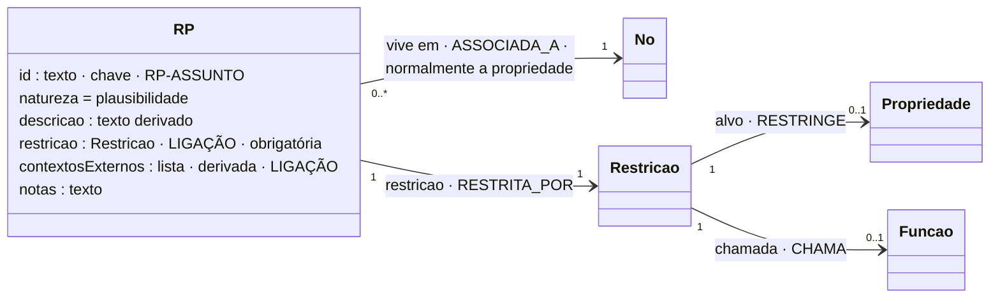

# RP: Regra de Plausibilidade

## Descrição

A plausibilidade representa o espaço de possibilidades admissíveis de uma propriedade: o que pode constituir um código postal, que unidades podem representar uma medição, que formas válidas tem um email. As RP de uma propriedade formam o seu **Conjunto de Regras de Plausibilidade**. Funcionam como tipos refinados: a ECM diz que a propriedade existe e qual é o tipo base; as RP dizem o que ela pode representar.

Uma RP tem **sempre uma restrição** e **nunca tem condição de aplicabilidade**: aplica-se sempre, em qualquer utilização.

## Diagrama

Todos os atributos da entidade e todas as ligações a outras entidades. **LIGAÇÃO** marca os atributos que ligam a outra entidade; cada seta indica o atributo da declaração e a aresta correspondente no grafo.



## Atributos

Os atributos comuns a todas as regras (`id`, `natureza`, `descricao`, `contextosExternos`, `notas`) estão em [Regra.md](Regra.md); aqui ficam os próprios deste tipo.

Os atributos comuns estão em [Regra.md](Regra.md). Na RP: `natureza: "plausibilidade"`, `restricao` obrigatória, sem `condicao` (ou `[]`).

### Ligações no grafo

| Aresta | Para | Significado |
|---|---|---|
| `ASSOCIADA_A` | Propriedade, USM, SM ou HLM | Onde vive. |
| `RESTRITA_POR` | Restricao | A restrição (com a mensagem de não conformidade). |

Através da restrição: `RESTRINGE` (tipificada) ou `CHAMA` → Funcao → `LE` (função).

No grafo: nó `RP` (chave `id`). O modelo completo do grafo está em [ecv/4_graph/graph_model.json](../../../ecv/4_graph/graph_model.json).

## Exemplos

### Esboço na declaração

Na propriedade (forma mais comum):

```json
{
  "nome": "latitude", "tipo": "decimal", "descricao": "…",
  "regras": [
    {
      "id": "RP-LAT",
      "natureza": "plausibilidade",
      "descricao": "InformacaoGeografica.latitude entre -90 e 90",
      "restricao": {"propriedade": "latitude", "operador": "RANGE", "valor": [-90, 90],
                    "mensagem": "A latitude tem de estar entre -90 e 90."}
    }
  ]
}
```

No modelo, quando a restrição é uma função que lê várias propriedades ou uma coleção:

```json
"regras": [
  {
    "id": "RP-SOMA", "natureza": "plausibilidade", "descricao": "somaIgualA(Linhas.Linha.valor, Cabecalho.totalFatura)",
    "restricao": {"operador": "FUNCTION",
                  "chamada": {"funcao": "somaIgualA", "argumentos": [{"caminho": "Linhas.Linha.valor"}, {"caminho": "Cabecalho.totalFatura"}]},
                  "mensagem": "O total da fatura não corresponde à soma dos valores das linhas."}
  }
]
```

### Exemplos das declarações de exemplo

RP tipificadas:

<!-- gerar:tabela-rp:tipificada -->
| Regra | Vive em | Restrição (descrição) | Mensagem de não conformidade |
|---|---|---|---|
| RP-IDENT | SM Identificacao.identificador | Identificacao.identificador segue o padrão ^[A-Z]+-[0-9]{4}$ | O identificador do dispositivo não tem o formato esperado (letras, hífen e quatro algarismos). |
| RP-FABRICANTE | SM Identificacao.fabricante | Identificacao.fabricante tem entre 2 e 50 caracteres | O fabricante tem de ter entre 2 e 50 caracteres. |
| RP-ESTADO | SM Identificacao.estado | Identificacao.estado ∈ {ATIVO, INATIVO, MANUTENCAO} | O estado tem de ser ativo, inativo ou em manutenção. |
| RP-TIPODISP | SM Identificacao.tipoDispositivo | Identificacao.tipoDispositivo ∈ {TEMPERATURA, HUMIDADE, PRESSAO, VELOCIDADE} | O tipo de dispositivo tem de ser temperatura, humidade, pressão ou velocidade. |
| RP-TIPODOC | SM Cabecalho.tipoDocumento | Cabecalho.tipoDocumento ∈ {FT, FS, FR, NC, ND} | O tipo de documento tem de ser FT, FS, FR, NC ou ND. |
| RP-TOTAL | SM Cabecalho.totalFatura | Cabecalho.totalFatura ≥ 0 | O total da fatura não pode ser negativo. |
| RP-ORDEM-NUM | SM Pedido.numeroOrdem | Pedido.numeroOrdem segue o padrão ^OI-[0-9]{4}-[0-9]{5}$ | O número da ordem tem a forma OI-AAAA-NNNNN. |
| RP-CP | USM Morada.codigoPostal | Morada.codigoPostal segue o padrão ^([1-9][0-9]{3}-[0-9]{3}\|[0-5][0-9]{4}\|[A-Z]{1,2}[0-9][0-9A-Z]? [0-9][A-Z]{2})$ | O código postal não tem nenhum dos formatos possíveis (português, espanhol ou britânico). |
| RP-FREGUESIA | USM Morada.freguesia | Morada.freguesia ∈ {AJUDA, ALCANTARA, ALVALADE, AREEIRO, ARROIOS, AVENIDAS_NOVAS, BEATO, BELEM, BENFICA, CAMPO_DE_OURIQUE, CAMPOLIDE, CARNIDE, ESTRELA, LUMIAR, MARVILA, MISERICORDIA, OLIVAIS, PARQUE_DAS_NACOES, PENHA_DE_FRANCA, SANTA_CLARA, SANTA_MARIA_MAIOR, SANTO_ANTONIO, SAO_DOMINGOS_DE_BENFICA, SAO_VICENTE} | A freguesia não pertence às freguesias de Lisboa conhecidas. |
| RP-PAIS | USM Morada.pais | Morada.pais ∈ {PT, ES, GB} | O país tem de ser PT, ES ou GB. |
| RP-UNIDADE | USM Medicao.unidadeMedida | Medicao.unidadeMedida ∈ {°C, K, °F, %, hPa, bar, m/s, km/h} | A unidade de medida não pertence ao conjunto de valores plausíveis. |
| RP-VALOR-FISICO | USM Medicao.valor | Medicao.valor entre -273.15 e 2400 | O valor medido está fora do intervalo que qualquer sensor do domínio pode produzir. |
| RP-AMBIENTE | USM Instalacao.ambiente | Instalacao.ambiente ∈ {REFRIGERACAO, ESTUFA, ARMAZEM, SERVIDORES, EXTERIOR, INCINERADORA, LABORATORIO} | O ambiente tem de ser refrigeração, estufa, armazém, sala de servidores, exterior, incineradora ou laboratório. |
| RP-ASSIN-FORMA | USM Assinatura.assinatura | Assinatura.assinatura segue o padrão ^[0-9a-f]{64}$ | A assinatura tem de ter 64 caracteres hexadecimais (HMAC-SHA256). |
| RP-BATERIA | USM Diagnostico.nivelBateria | Diagnostico.nivelBateria entre 0 e 100 | O nível de bateria é uma percentagem entre 0 e 100. |
| RP-MANUT-DATA | USM Diagnostico.dataUltimaManutencao | Diagnostico.dataUltimaManutencao ≥ 2000-01-01 | A data da última manutenção não é uma data plausível. |
| RP-SINAL | USM Diagnostico.sinalRede | Diagnostico.sinalRede entre -140 e 0 | A intensidade do sinal de rede (dBm) tem de estar entre -140 e 0. |
| RP-LATENCIA | USM Diagnostico.latencia | Diagnostico.latencia entre 0 e 60000 | A latência (ms) tem de estar entre 0 e 60000. |
| RP-RECECAO | USM Diagnostico.taxaRececao | Diagnostico.taxaRececao entre 0 e 100 | A taxa de receção é uma percentagem entre 0 e 100. |
| RP-LAT | USM InformacaoGeografica.latitude | InformacaoGeografica.latitude entre -90 e 90 | A latitude tem de estar entre -90 e 90. |
| RP-LON | USM InformacaoGeografica.longitude | InformacaoGeografica.longitude entre -180 e 180 | A longitude tem de estar entre -180 e 180. |
| RP-ALT | USM InformacaoGeografica.altitude | InformacaoGeografica.altitude entre -500 e 9000 | A altitude (m) tem de estar entre -500 e 9000. |
| RP-SRC | USM InformacaoGeografica.sistemaReferencia | InformacaoGeografica.sistemaReferencia ∈ {WGS84, ETRS89, PT-TM06} | O sistema de referência tem de ser WGS84, ETRS89 ou PT-TM06. |
| RP-NIF | USM Entidade.nif | Entidade.nif segue o padrão ^[0-9]{9}$ | O NIF tem de ter nove algarismos. |
| RP-EMAIL | USM Contacto.email | Contacto.email segue o padrão ^[a-z0-9._-]+@[a-z0-9-]+(\.[a-z0-9-]+)+$ | O email tem de ter uma parte local e um domínio com pelo menos um ponto, sem espaços nem maiúsculas. |
| RP-LIN-NUMPOS | USM Linha.numero | Linha.numero ≥ 1 | O número da linha tem de ser igual ou superior a 1. |
| RP-LIN-DESC | USM Linha.descricao | Linha.descricao segue o padrão ^.{1,200}$ | A descrição da linha tem de ter entre 1 e 200 caracteres. |
| RP-VALOR | USM Linha.valor | Linha.valor ≥ 0 | O valor da linha não pode ser negativo. |
| RP-VALOR-DEC | USM Linha.valor | Linha.valor segue o padrão ^[0-9]+(\.[0-9]{1,2})?$ | O valor da linha tem no máximo duas casas decimais. |
| RP-TIPOIVA | USM Linha.tipoIVA | Linha.tipoIVA ∈ {ISENTA, REDUZIDA, INTERMEDIA, NORMAL} | O tipo de IVA tem de ser isenta, reduzida, intermédia ou normal. |
| RP-TAXAIVA | USM Linha.taxaIVA | Linha.taxaIVA entre 0 e 100 | A taxa de IVA tem de estar entre 0 e 100. |
| RP-TAXAIVA-DEC | USM Linha.taxaIVA | Linha.taxaIVA segue o padrão ^[0-9]+(\.[0-9]{1,2})?$ | A taxa de IVA tem no máximo duas casas decimais. |
<!-- /gerar -->

RP cuja restrição é uma função:

<!-- gerar:tabela-rp:funcao -->
| Regra | Vive em | Restrição (descrição) | Mensagem de não conformidade |
|---|---|---|---|
| RP-SOMA | HLM Fatura | somaIgualA(Linhas.Linha.valor, Cabecalho.totalFatura) | O total da fatura não corresponde à soma dos valores das linhas. |
| RP-ORDEM-MAX | HLM OrdemInstalacao | contagemInferiorA(Localizacao, 21) | Uma ordem de instalação abrange no máximo 20 locais. |
| RP-HASH | SM Cabecalho | hashEncadeadoValido(Cabecalho.numero, Cabecalho.dataEmissao, Cabecalho.totalFatura, Cabecalho.hash) | O hash do documento não corresponde ao encadeamento com o documento anterior. |
| RP-ATCUD | SM Cabecalho | atcudValido(Cabecalho.atcud, Cabecalho.serie) | O ATCUD não pertence a uma série comunicada à AT. |
| RP-DATAEMISSAO | SM Cabecalho.dataEmissao | naoPosteriorAHoje(Cabecalho.dataEmissao) | A data de emissão não pode ser posterior à data de hoje. |
| RP-LIN-NUM | SM Linhas | valoresUnicos(Linhas.Linha.numero) | Existem linhas com o mesmo número. |
| RP-LIN-SEQ | SM Linhas | valoresConsecutivos(Linhas.Linha.numero) | A numeração das linhas tem de começar em 1 e não ter falhas. |
| RP-LIN-MAX | SM Linhas | contagemInferiorA(Linhas.Linha, 100) | A fatura tem 100 ou mais linhas. |
| RP-ORDEM-DATA | SM Pedido.dataPedido | naoPosteriorAHoje(Pedido.dataPedido) | A data do pedido não pode ser posterior à data de hoje. |
| RP-RELOGIO | USM Medicao.dataMedicao | desfasamentoInferiorA(Medicao.dataMedicao, 300) | O instante da leitura está adiantado em relação ao relógio do servidor (relógio do dispositivo desacertado). |
| RP-ASSINATURA | USM Assinatura | assinaturaValida(Assinatura.mensagem, Assinatura.assinatura) | A assinatura não corresponde à mensagem e à chave do dispositivo. |
| RP-MANUT-FUTURA | USM Diagnostico.dataUltimaManutencao | naoPosteriorAHoje(Diagnostico.dataUltimaManutencao) | A data da última manutenção não pode ser posterior à data de hoje. |
| RP-AREA | USM InformacaoGeografica | dentroDe(InformacaoGeografica.latitude, InformacaoGeografica.longitude, [(38.8, -9.25), (38.8, -9.05), (38.68, -9.05), (38.68, -9.25)]) | O dispositivo está fora da área onde foi autorizado. |
| RP-NIF-DC | USM Entidade.nif | digitoControloValido(Entidade.nif) | O dígito de controlo do NIF não está correto. |
<!-- /gerar -->

RP sobre a coleção (vive no SM Linhas):

<!-- gerar:json-regra:RP-LIN-NUM -->
```json
{
  "id": "RP-LIN-NUM",
  "natureza": "plausibilidade",
  "descricao": "valoresUnicos(Linhas.Linha.numero)",
  "restricao": {
    "operador": "FUNCTION",
    "chamada": {
      "funcao": "valoresUnicos",
      "argumentos": [
        {"caminho": "Linha.numero"}
      ]
    },
    "mensagem": "Existem linhas com o mesmo número."
  }
}
```
<!-- /gerar -->

RP com parâmetro literal (a área autorizada é informação da própria regra, não um contexto externo):

<!-- gerar:json-regra:RP-AREA -->
```json
{
  "id": "RP-AREA",
  "natureza": "plausibilidade",
  "descricao": "dentroDe(InformacaoGeografica.latitude, InformacaoGeografica.longitude, [(38.8, -9.25), (38.8, -9.05), (38.68, -9.05), (38.68, -9.25)])",
  "restricao": {
    "operador": "FUNCTION",
    "chamada": {
      "funcao": "dentroDe",
      "argumentos": [
        {"caminho": "latitude"},
        {"caminho": "longitude"},
        {
          "literal": [[38.8, -9.25], [38.8, -9.05], [38.68, -9.05], [38.68, -9.25]]
        }
      ]
    },
    "mensagem": "O dispositivo está fora da área onde foi autorizado."
  },
  "notas": "A área autorizada é informação da própria regra (parâmetro literal), não contexto externo."
}
```
<!-- /gerar -->

RP com função e contexto externo:

<!-- gerar:json-regra:RP-ASSINATURA -->
```json
{
  "id": "RP-ASSINATURA",
  "natureza": "plausibilidade",
  "descricao": "assinaturaValida(Assinatura.mensagem, Assinatura.assinatura)",
  "restricao": {
    "operador": "EXT_FUNCTION",
    "chamada": {
      "funcao": "assinaturaValida",
      "argumentos": [
        {"caminho": "mensagem"},
        {"caminho": "assinatura"}
      ]
    },
    "mensagem": "A assinatura não corresponde à mensagem e à chave do dispositivo."
  },
  "contextosExternos": ["chaveDispositivo"]
}
```
<!-- /gerar -->

## Pode e não pode

| Pode | Não pode |
|---|---|
| Ter exatamente uma restrição | Ter condição de aplicabilidade (I4) |
| Ser tipificada (um alvo) ou ser uma função (alvos = argumentos) | Ter `mensagem` ao nível da regra (a mensagem é da restrição) |
| Viver numa propriedade ou num modelo, conforme o que lê | Ter `conclusao` |
| Depender de contextos externos, através de uma função EXT_FUNCTION | — |

### Como saber se é uma RP (e não uma RIR)

| Pergunta | Se sim |
|---|---|
| A validade decide-se só pelo valor e pelo conjunto de possibilidades da propriedade? | RP |
| Depende de outra propriedade, do momento da avaliação ou do cenário? | RIR (ou RIC) |
| Uma gama isolada (por exemplo `[0, 100]`) significaria algo diferente consoante a unidade ou o tipo? | Não é plausibilidade: é uma inferência (RIR). Na RP fica só o conjunto das gamas fisicamente possíveis. |
| O formato depende do país? | A RP admite todos os formatos possíveis (PT, ES, GB); a escolha do formato é uma RIR (RIR-CP-PT). |
| É uma verificação sobre toda uma coleção, sempre executada (números únicos)? | RP, cuja restrição é uma função, e que vive no SM da coleção |

## Detalhes

### Formas de uma RP

| Forma | Vive em | Restrição | Exemplos |
|---|---|---|---|
| **Tipificada na propriedade** | a propriedade | `{propriedade, operador, valor, mensagem}` | RP-LAT, RP-PAIS, RP-CP, RP-NIF |
| **Função com um alvo** | a propriedade | `{operador: FUNCTION/EXT_FUNCTION, chamada, mensagem}` | RP-NIF-DC, RP-RELOGIO, RP-MANUT-FUTURA |
| **Função com vários alvos** | o nó mais baixo que contém os alvos | idem | RP-AREA (USM), RP-HASH (SM Cabecalho), RP-ASSINATURA (USM) |
| **Sobre uma coleção** | o SM da coleção | função cujos argumentos atravessam a composição repetível | RP-LIN-NUM, RP-LIN-SEQ, RP-LIN-MAX |
| **Coleção e documento** | o HLM | função | RP-SOMA, RP-ORDEM-MAX |

Uma propriedade de texto cujo Conjunto de Regras de Plausibilidade é uma lista fechada (uma RP com `IN`) é, na prática, um **enumerado**, sem ser preciso um tipo de dados próprio. Os valores dessa lista são os **valores plausíveis** e os candidatos a **fatores discriminantes** nas condições das RIR (invariante I7).

### Conjuntos de Regras de Plausibilidade da tese (Tabela 3.4) e regras correspondentes

| Propriedade | Conjunto (tese) | Regra(s) |
|---|---|---|
| Contacto.email | Um @, parte local e domínio; sem espaços nem maiúsculas; … | RP-EMAIL |
| Morada.pais | PT, ES ou GB | RP-PAIS |
| Morada.codigoPostal | Um dos formatos {PT, ES, GB} | RP-CP (os três formatos); a escolha é das RIR-CP-PT/ES/GB |
| InformacaoGeografica.latitude | -90 a 90 | RP-LAT |
| InformacaoGeografica.longitude | -180 a 180 | RP-LON |
| Cabecalho.tipoDocumento | FT, FS, FR, NC, ND | RP-TIPODOC |
| Linha.taxaIVA | 0 a 100 | RP-TAXAIVA (+ RP-TAXAIVA-DEC) |
| Identificacao.tipoDispositivo | TEMPERATURA, HUMIDADE, VELOCIDADE (+ PRESSAO no Cap. 4) | RP-TIPODISP |
| Medicao.unidadeMedida | °C, K, °F, %, m/s, km/h (+ hPa, bar) | RP-UNIDADE |
| Medicao.valor | gamas fisicamente admissíveis do domínio | RP-VALOR-FISICO ([-273.15, 2400]); a gama de cada combinação é inferida pelas RIR |
| Instalacao.ambiente | REFRIGERACAO, ESTUFA, INCINERADORA (+ ARMAZEM, SERVIDORES, EXTERIOR, LABORATORIO) | RP-AMBIENTE |

## Verificações

- **I4:** tem restrição e não tem condição.
- **I5:** o operador é admissível para o tipo do alvo; a forma do valor é a do operador.
- **I3:** numa propriedade, só lê essa propriedade.
- **S-RESTR:** a mensagem tem pelo menos 10 caracteres.
