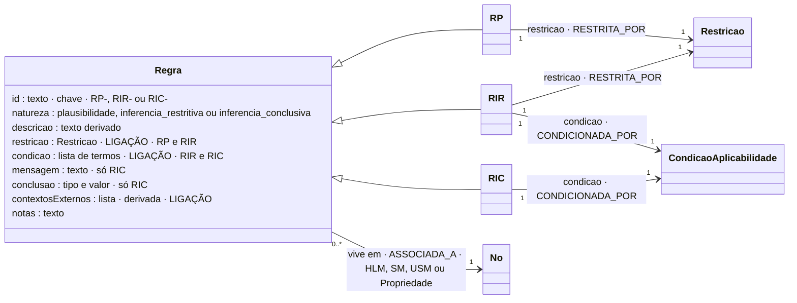

# Regra (o que é comum a RP, RIR e RIC)

## Descrição

Uma regra é conhecimento de validação declarado fora do modelo que valida e fora do mecanismo que a avalia (eixo E2). A ECR caracteriza cada regra em três dimensões paralelas:

| Dimensão | Pergunta | Na declaração |
|---|---|---|
| **Natureza** | Que conhecimento expressa esta validade? | `natureza` (e o prefixo do `id`) |
| **Alcance** | Onde vive a regra? | o sítio onde a regra é declarada (o nó ou a propriedade) |
| **Expressividade** | Como é escrita, para ser lida por pessoas e avaliada pelo motor? | `restricao` e `condicao` (verificações tipificadas e funções), `descricao` e mensagens |

## Diagrama

Todos os atributos da entidade e todas as ligações a outras entidades. **LIGAÇÃO** marca os atributos que ligam a outra entidade; cada seta indica o atributo da declaração e a aresta correspondente no grafo.

## Atributos

| Atributo | Tipo | Obrigatório | Descrição |
|---|---|---|---|
| `id` | texto `TIPO-ASSUNTO[-QUALIFICADOR]` | sim | Único na declaração. O prefixo (RP, RIR, RIC) é coerente com a natureza. |
| `natureza` | `plausibilidade` · `inferencia_restritiva` · `inferencia_conclusiva` | sim | O tipo de conhecimento. |
| `descricao` | texto | sim | Derivada da condição, da restrição (ou conclusão) e do nó; ver abaixo. |
| `restricao` | Restrição | RP, RIR | Ver [Restricao.md](Restricao.md). |
| `condicao` | lista de termos | RIR, RIC | Ver [CondicaoAplicabilidade.md](CondicaoAplicabilidade.md). |
| `mensagem` | texto (≥ 10) | só RIC | A mensagem de conclusão. Numa RP ou RIR, a mensagem está na restrição. |
| `conclusao` | `{tipo: ACAO|ESTADO, valor}` | só RIC (recomendado) | O estado ou a ação inferidos, estruturados. |
| `contextosExternos` | lista de nomes | não (derivado) | Contextos de que a regra depende; se presente, tem de coincidir com os usados (I11). |
| `notas` | texto | não | Comentário livre. |

No grafo: nó `RP` (chave `id`); nó `RIR` (chave `id`); nó `RIC` (chave `id`). O modelo completo do grafo está em [ecv/4_graph/graph_model.json](../../../ecv/4_graph/graph_model.json).

## Exemplos

### Exemplos das declarações de exemplo

Os exemplos estão em [RP.md](RP.md), [RIR.md](RIR.md) e [RIC.md](RIC.md). Todas as regras têm uma ficha gerada em [`documentacao/vistas/`](../../../documentacao/vistas/index.html) (`regra_<ID>.html`).

## Detalhes

### Os quatro tipos de conhecimento

| Tipo | Nome | Restrição | Condição de aplicabilidade | Mensagem | Resultado da avaliação |
|---|---|---|---|---|---|
| **RE** | regra estrutural | — | — | — | presença, tipo e cardinalidade, expressos pela projeção ([RE_Projecao.md](RE_Projecao.md)) |
| **RP** | regra de plausibilidade | sim (uma) | **nunca** | de não conformidade, na restrição | cumprida / não cumprida |
| **RIR** | regra de inferência restritiva | sim (uma) | sim (uma, com 1..N termos) | de não conformidade, na restrição | não aplicável / cumprida / não cumprida |
| **RIC** | regra de inferência conclusiva | **não** | sim (uma, com 1..N termos) | de conclusão, na própria regra | não aplicável / conclusão |

A RP e a RIR partilham a restrição: o que as distingue é a condição, que só a RIR tem. A RIR e a RIC partilham a condição: o que as distingue é a restrição, que só a RIR tem. As naturezas são níveis progressivos de conhecimento: **Estrutural → Plausibilidade → Inferência**.

Correspondência com a literatura (tese, Natureza): RE e RP correspondem às asserções estruturais e às regras definicionais; a RIR às asserções de ação e às regras operativas, que podem ser violadas; a RIC às derivações, que produzem conhecimento novo (Business Rules Group; SBVR).

### Alcance: onde vive a regra

**Princípio de posicionamento:** uma regra vive no nível mais baixo da estrutura que contenha toda a informação de que precisa para ser avaliada, tanto na condição como na restrição.

| Lê | Vive em | Exemplo |
|---|---|---|
| Só uma propriedade | na propriedade | RP-LAT (`latitude`), RIC-MED-DIFERIDA (`dataMedicao`) |
| Várias propriedades do mesmo USM | no USM | RIR-CP-PT (`Morada`), RIC-MANUT (`Diagnostico`), RP-AREA (`InformacaoGeografica`) |
| Propriedades de vários USM do mesmo SM, ou residuais do SM | no SM | RIR-EMAIL-CX (`Emitente`), RIR-FS (`Cabecalho`) |
| Todas as instâncias de uma coleção | no SM da coleção | RP-LIN-NUM (`Linhas`) |
| Propriedades de vários SM | no HLM | RP-SOMA, RIR-TEMP-REFRIG-CELSIUS |

A regra declara o seu alcance pelo sítio onde é escrita na declaração (aninhada no nó ou na propriedade). No grafo, a aresta `ASSOCIADA_A` aponta para esse nó. Os caminhos da regra são relativos a esse nó. Numa regra declarada numa propriedade, são relativos ao modelo que contém a propriedade.

Uma regra que vive num USM reutilizado vale em todas as ocorrências: as RIR do código postal valem para a morada do emitente, do cliente e da instalação.

### Nomenclatura dos identificadores

A forma é `tipo-assunto-qualificador`, em maiúsculas, com hífens:

| Parte | Exemplos |
|---|---|
| tipo | `RP`, `RIR`, `RIC` |
| assunto | `TEMP` (temperatura), `CP` (código postal), `IVA`, `FS` (fatura simplificada), `LIN` (linhas), `MANUT` (manutenção) |
| qualificador | `REFRIG-CELSIUS`, `PT`, `ISE`, `NUM`, `LX-AJUDA` |

Por exemplo, `RIR-TEMP-REFRIG-CELSIUS` é a RIR da temperatura em refrigeração em °C, e `RIR-FS-NUM` é a RIR das faturas simplificadas sobre o número. A tese usava `RI-` antes de separar RIR de RIC; essa forma já não existe.

### Descrição derivada e mensagens

A descrição não acrescenta conhecimento: resulta de três partes que a regra já contém.

1. **"Se …":** os termos da condição ligados por "e". Não existe numa RP.
2. **Prefixo do modelo:** cada caminho é prefixado pelo nome do nó onde a regra vive (exceto no HLM).
3. **"→ …":** a restrição. Numa RIC é substituída por "informa Ação|Estado VALOR".

Exemplos:

- `Se Identificacao.tipoDispositivo = TEMPERATURA e Leitura.Medicao.unidadeMedida = °C e Leitura.Instalacao.ambiente = REFRIGERACAO → Leitura.Medicao.valor entre -30 e 0`
- `Se Diagnostico.nivelBateria entre 0 e 10 e excedeDiasDesdeHoje(Diagnostico.dataUltimaManutencao, 7) → informa Ação MANUTENCAO`

`python -m ecv descricoes <ficheiro> --escrever` recalcula-as. O invariante I12 avisa quando uma descrição não coincide com a derivada.

A regra lê-se completamente em linguagem natural pela descrição e pela mensagem, juntas. A descrição diz o que é exigido e quando. A mensagem diz o que é comunicado:

- numa RP ou numa RIR, a mensagem de não conformidade, atributo da restrição;
- numa RIC, a mensagem de conclusão, atributo da regra.

### Ciclo de avaliação (tese, Expressividade)

1. **Alvos:** a partir do nó onde a regra vive.
2. **Leitura:** os valores da instância.
3. **Condição:** aplicável ou não aplicável. Numa RP não há condição.
4. **Restrição:** a verificação tipificada ou a função.
5. **Resultado e mensagem.**

Se a condição não é satisfeita, o resultado é "não aplicável", e não "inválido". O perfil pode resolver termos antes da execução (seleção estática, [Perfil.md](Perfil.md)).

## Verificações

**S-REGRA**, **I3**, **I4**, **I5**, **I6**, **I7**, **I8**, **I11** e **I12**; ver [Verificacao.md](../transversal/Verificacao.md).
