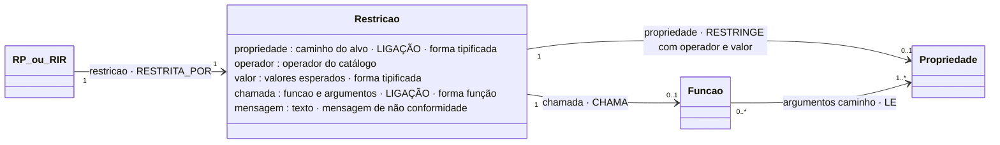

# Restrição

## Descrição

A restrição é o que o dado tem de cumprir. Usam-na a **RP** e a **RIR**. Tem quatro elementos (tese, Figura "Tipos de regra e elementos que cada um usa"):

1. **alvo:** exatamente uma propriedade, a que é validada;
2. **operador:** um tipo de verificação do catálogo;
3. **valores esperados:** com a forma que o operador exige;
4. **mensagem de não conformidade:** comunicada quando a verificação falha.

O operador e os valores formam uma **verificação tipificada**. Quando nenhuma verificação do catálogo exprime o que se quer verificar (uma soma, a unicidade numa coleção, uma geometria, um hash), a restrição é uma **função**. A função ocupa o lugar da verificação e tem o mesmo papel: verificar e, se falhar, dar lugar à mensagem. Os alvos passam a ser os argumentos da função, lidos a partir do nó onde a regra vive.

## Diagrama

Todos os atributos da entidade e todas as ligações a outras entidades. **LIGAÇÃO** marca os atributos que ligam a outra entidade; cada seta indica o atributo da declaração e a aresta correspondente no grafo.



## Atributos

| Atributo | Papel |
|---|---|
| `propriedade` | caminho do alvo · **ligação** · forma tipificada |
| `operador` | operador do catálogo |
| `valor` | valores esperados · forma tipificada |
| `chamada` | funcao e argumentos · **ligação** · forma função |
| `mensagem` | texto · mensagem de não conformidade |

### Ligações no grafo

| Aresta | Sentido | Outro extremo | Atributos |
|---|---|---|---|
| `RESTRITA_POR` | ← | RP ou RIR | — |
| `RESTRINGE` | Restricao → | Propriedade (0..1) | `operador`, `valor` (JSON), `minimo`/`maximo` (RANGE), `caminho`, `texto` |
| `CHAMA` | Restricao → | Funcao | `chamada`, `argumentos` (JSON), `operador`, `regra` |

Atributos do nó `Restricao`: `id` (`<regra>#restricao`), `regra`, `operador`, `valor` (JSON; vazio numa função), `mensagem`, `forma` (`tipificada` ou `funcao`) e `descricao`.

No grafo: nó `Restricao` (chave `id`). O modelo completo do grafo está em [ecv/4_graph/graph_model.json](../../../ecv/4_graph/graph_model.json).

## Exemplos

### Esboço na declaração

No atributo `restricao` da regra (RP ou RIR):

```json
"restricao": {"propriedade": "codigoPostal", "operador": "PATTERN", "valor": "^[1-9][0-9]{3}-[0-9]{3}$",
              "mensagem": "O código postal português tem de ter o formato 0000-000, sem começar por zero."}
```

```json
"restricao": {"operador": "EXT_FUNCTION",
              "chamada": {"funcao": "hashEncadeadoValido",
                          "argumentos": [{"caminho": "numero"}, {"caminho": "dataEmissao"}, {"caminho": "totalFatura"}, {"caminho": "hash"}]},
              "mensagem": "O hash do documento não corresponde ao encadeamento com o documento anterior."}
```

Nota sobre a tese: nos JSON da tese, a mensagem estava na regra e a chamada era um texto (`"valor": "somaIgualA(…)"`). Na declaração final, a mensagem está na restrição, como no grafo do Capítulo 4, e a chamada está estruturada (`chamada.funcao`, `chamada.argumentos`). Assim, os alvos ficam explícitos e podem ser verificados. O texto da chamada continua a aparecer na descrição.

### Exemplos das declarações de exemplo

Distribuição dos operadores:

<!-- gerar:tabela-operadores -->
| Operador | Grupo | Forma do valor | Tipos base | Restrições nos exemplos | Termos nos exemplos |
|---|---|---|---|---|---|
| EQUALS | igualdade e pertença | valor | texto, inteiro, decimal, data, booleano | 5 | 188 |
| NOT_EQUALS | igualdade e pertença | valor | texto, inteiro, decimal, data | 1 | 0 |
| IN | igualdade e pertença | lista | texto, inteiro, decimal | 13 | 0 |
| RANGE | intervalo e comparação | intervalo | inteiro, decimal, data | 45 | 4 |
| LT | intervalo e comparação | numero | inteiro, decimal, data | 0 | 1 |
| LTE | intervalo e comparação | numero | inteiro, decimal, data | 1 | 0 |
| GT | intervalo e comparação | numero | inteiro, decimal, data | 0 | 1 |
| GTE | intervalo e comparação | numero | inteiro, decimal, data | 4 | 0 |
| PATTERN | padrão | padrao | texto, inteiro, decimal | 36 | 0 |
| CONTAINS | texto | texto | texto | 0 | 0 |
| STARTS_WITH | texto | texto | texto | 1 | 0 |
| ENDS_WITH | texto | texto | texto | 2 | 0 |
| LENGTH | texto | comprimento | texto | 1 | 0 |
| FUNCTION | função | chamada | qualquer tipo | 8 | 1 |
| EXT_FUNCTION | função | chamada | qualquer tipo | 7 | 1 |
<!-- /gerar -->

As listas completas estão em [RP.md](RP.md) e [RIR.md](RIR.md). A vista `operadores` lista todas as restrições agrupadas por operador.

## Pode e não pode

| Pode | Não pode |
|---|---|
| Ter um alvo (tipificada) ou ser uma chamada (função) | Ter dois alvos numa verificação tipificada |
| Ter um alvo a qualquer profundidade do nó da regra (`Cliente.Entidade.nif`) | Ter como alvo um modelo (só funções leem coleções e instâncias) |
| Passar literais declarados na regra a uma função (a área autorizada, `7` dias) | Ter um alvo lido pela condição da mesma regra (I6) |
| Depender de contextos externos, através de uma função EXT_FUNCTION | Existir sem mensagem |

## Detalhes

### Duas formas

| Forma | Declaração | Alvos | Exemplo |
|---|---|---|---|
| **Tipificada** | `{"propriedade", "operador", "valor", "mensagem"}` | exatamente 1 (`propriedade`) | `valor RANGE [-30, 0]` |
| **Função** | `{"operador": "FUNCTION" ou "EXT_FUNCTION", "chamada": {"funcao", "argumentos"}, "mensagem"}` | os argumentos `{caminho}` (0..N); os `{literal}` são parâmetros | `somaIgualA(Linhas.Linha.valor, Cabecalho.totalFatura)` |

Uma regra que precise de verificar duas propriedades declara duas restrições, uma em cada regra. A exceção é uma função que as relacione (RP-SOMA, RP-AREA).

### Operadores e valores

O catálogo completo está em [Catalogo.md](../transversal/Catalogo.md). Em resumo:

| Grupo | Operadores | Valor esperado |
|---|---|---|
| igualdade e pertença | `EQUALS`, `NOT_EQUALS`, `IN` | um valor; uma lista |
| intervalo e comparação | `RANGE`, `LT`, `LTE`, `GT`, `GTE` | `[mín, máx]`; um número (ou uma data) |
| padrão | `PATTERN` | expressão regular |
| texto | `CONTAINS`, `STARTS_WITH`, `ENDS_WITH`, `LENGTH` | texto; inteiro ou `[mín, máx]` |
| função | `FUNCTION`, `EXT_FUNCTION` | `chamada` |

O operador tem de ser admissível para o tipo base do alvo (I5): `RANGE` sobre texto é rejeitado. `FUNCTION` é usado quando a função só lê valores do modelo e da regra; `EXT_FUNCTION` quando a função declara contextos externos.

## Verificações

**S-RESTR** (operador do catálogo; um alvo, exceto numa função; mensagem ≥ 10), **S-VALOR** (forma do valor), **S-CHAMADA** (função declarada; número e tipo dos argumentos; coleções), **I5**, **I6**.
