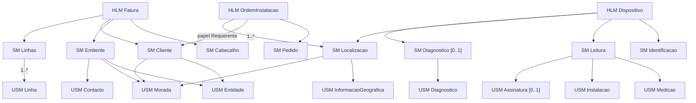

# Exemplos: uma declaração por HLM

| Ficheiro | HLM | Conteúdo |
|---|---|---|
| [`dispositivo.ecv.json`](dispositivo.ecv.json) | Dispositivo | Identificação, leitura, localização e diagnóstico; as gamas inferidas por tipo, unidade e ambiente; as RIC de diagnóstico; funções, contextos externos, projeções e perfis. |
| [`fatura.ecv.json`](fatura.ecv.json) | Fatura | Cabeçalho, emitente, cliente e linhas (coleção); RP sobre a coleção, RIR de IVA, funções de NIF, hash e ATCUD. |
| [`ordem_instalacao.ecv.json`](ordem_instalacao.ecv.json) | OrdemInstalacao | O exemplo da Secção ECM: reutiliza o SM Cliente (papel Requerente) e o SM Localizacao (1..*). |

**Cada declaração descreve um só HLM e é uma exportação completa**: contém todos os modelos que esse HLM usa, com todas as suas regras, e todas as funções, contextos externos, projeções e perfis de que depende. Os modelos partilhados (USM Morada, USM Entidade, SM Cliente, SM Localizacao, …) repetem-se, iguais, em cada declaração que os usa. Uma declaração lê-se, verifica-se e materializa-se sozinha, sem precisar das outras.

Ao ingerir (`python -m ecv grafo` ou `python -m ecv importar`), cada declaração é materializada e **fundida** no grafo: cada modelo, propriedade, regra, função e contexto é procurado pela sua identidade; o que já existe e é igual é reutilizado, o que é novo é acrescentado, e o que existe com outra definição é um conflito (a declaração é rejeitada). Ver [ecv/3_ingestion/README.md](../../ecv/3_ingestion/README.md). Ingerir as três dá um grafo com 3 HLM, 9 SM, 9 USM e 43 propriedades, sem nada repetido.

As três passam a verificação. Os únicos resultados que não são "sem problemas" são os dois avisos intencionais do Dispositivo, descritos abaixo.

## O que está nas declarações (combinadas)

<!-- gerar:contagens -->
| Entidade | Quantidade |
|---|---|
| HLM | 3 |
| SM | 9 |
| USM | 9 |
| Propriedades | 43 |
| RP | 46 |
| RIR | 78 |
| RIC | 3 |
| Funções | 12 |
| Contextos externos | 5 |
| Projeções | 5 |
| Perfis | 9 |
<!-- /gerar -->

## Onde está cada exemplo da tese

| Na tese | Na declaração |
|---|---|
| Tabela "Naturezas aplicadas a um email, a um código postal e a uma leitura" | RP-EMAIL, RIR-EMAIL-CX/CY; RP-CP, RIR-CP-PT/ES/GB; RP-VALOR-FISICO, RIR-TEMP-REFRIG-CELSIUS |
| Figura "Modelos Fatura e Dispositivo e respetivas projeções" | projeções FaturaSimplificada, FaturaAT, DispositivoTeste, DispositivoProducao |
| Tabela 3.4 "Conjuntos de Regras de Plausibilidade" | RP-EMAIL, RP-PAIS, RP-CP, RP-LAT, RP-LON, RP-TIPODOC, RP-TAXAIVA, RP-TIPODISP, RP-UNIDADE, RP-VALOR-FISICO, RP-AMBIENTE |
| Figura "Gamas por tipo de dispositivo e unidade" | RIR-TEMP-C, RIR-TEMP-K, RIR-HUM, RIR-VEL-MS, RIR-VEL-KMH (e RIR-TEMP-F, RIR-PRES-HPA, RIR-PRES-BAR) |
| Tabela "Partes de uma regra de inferência" | RIR-TEMP-C |
| Figura "Uma regra por condição e por restrição" | RIR-HUM / RIR-VEL-MS; RIR-FS / RIR-FS-NUM |
| Figura "Regras de inferência sobre a temperatura consoante o ambiente" | RIR-TEMP-REFRIG-CELSIUS, RIR-TEMP-ESTUFA-CELSIUS |
| Figura "RIC-MANUT e RIC-REDE" | RIC-MANUT, RIC-REDE |
| Observações sobre a aplicabilidade (ARMAZEM fora dos plausíveis, incineradora) | RIR-TEMP-CAMARA-CELSIUS (anomalia I7), RIR-TEMP-INCIN-* |
| Figura "Associação das regras aos nós do HLM Dispositivo" | vista `regras_Dispositivo` (modelo com regras) |
| Figura "Tipos de regra e elementos" e "Ciclo de avaliação" | RIR-TEMP-REFRIG-CELSIUS (ficha `regra_RIR-TEMP-REFRIG-CELSIUS`) |
| Listagem "Cardinalidade declarada na composição" | Linhas → Linha `1..*`; OrdemInstalacao → Localizacao `1..*` |
| Tabela "Regras sobre as linhas de uma fatura" | RP-LIN-NUMPOS, RP-LIN-DESC, RP-VALOR, RP-VALOR-DEC, RP-TIPOIVA, RP-TAXAIVA, RP-TAXAIVA-DEC, RP-LIN-NUM, RP-LIN-SEQ, RP-LIN-MAX, RP-SOMA, RIR-IVA-ISE/RED/INT/NOR, RIR-FS-LIN |
| Figura "RP-AREA" | RP-AREA |
| Tabela "Funções declaradas" | as 12 funções de `funcoes` (ver [Funcao.md](../entidades/ecr/Funcao.md) sobre eQuadrado, eCirculo e interseta) |
| Funções: dígito de controlo do NIF, cadeia de hash, ATCUD, assinatura, relógio | RP-NIF-DC, RP-HASH, RP-ATCUD, RP-ASSINATURA, RP-RELOGIO |
| "Regra que só se aplica a dispositivos instalados em Lisboa" (função num termo) | RIR-LX-LOCALIDADE |
| "dataDeHoje posterior a dataMedicao" (contexto num termo) | RIC-MED-DIFERIDA |
| Listagem "Dois perfis sobre o mesmo HLM Dispositivo" | RefrigeracaoLote, LeiturasIndustriais |
| Figura "Seleção estática" | perfil RefrigeracaoLote (vista `perfil_RefrigeracaoLote`) |
| Figura "Propriedade usada na aplicabilidade mas não projetada" | TesteLaboratorio (I10) e TesteRefrigeracao (ambiente fixado, não projetado) |
| Tabela "Pesquisa das propriedades usadas na aplicabilidade" | vista `candidatos_perfil` |
| Exemplo ECM: Fatura, Ordem de Instalação, Medição de Dispositivo; Cliente Comprador; Localização de Equipamento; consentimento; indicação de acesso | HLM OrdemInstalacao; SM Cliente (`consentimentoComercial`) e Localizacao (`indicacaoAcesso`); USM InformacaoGeografica com altitude e sistema de referência |
| Capítulo 4, "Matriz de decisão das gamas" (com PRESSAO e os ambientes ARMAZEM, SERVIDORES, EXTERIOR, LABORATORIO) | todas as RIR-*-<AMBIENTE>-* do HLM Dispositivo |
| Capítulo 4, "Códigos postais admitidos por freguesia de Lisboa" | RP-FREGUESIA e as 24 RIR-CP-LX-* em Morada |
| Capítulo 4, vista global (RP de identificador, fabricante, diagnóstico, naoPosteriorAHoje) | RP-IDENT, RP-FABRICANTE, RP-BATERIA, RP-MANUT-DATA, RP-MANUT-FUTURA, RP-SINAL, RP-LATENCIA, RP-RECECAO |

Acrescentos que completam as nuances (não estavam na tese como regras declaradas):

- RIR-FT-NIF: condição com GT e restrição NOT_EQUALS.
- RIR-CP-GB: completa os três formatos.
- RP-DATAEMISSAO e RP-ORDEM-DATA: reutilizam `naoPosteriorAHoje`.
- RP-ALT e RP-SRC.
- RP-ASSIN-FORMA.
- RP-ORDEM-NUM e RP-ORDEM-MAX: uma função sobre uma coleção de SM, no HLM.
- Os perfis Estufas, AuditoriaSetembro2026, TesteLaboratorio, TesteRefrigeracao e OrdensCorrentes.

## Anomalias intencionais

Estão marcadas em `notas`. Servem para que as vistas de coerência mostrem o que detetam.

| Anomalia | Onde aparece |
|---|---|
| **RIR-PRES-EXTERIOR-BAR** exige [950, 1050] bar (o valor do mapeamento original estava em hPa) e não tem nenhum valor em comum com RIR-PRES-BAR [0.3, 1.1]. | Célula vermelha na matriz `decisao_Medicao_valor`; vista `coerencia` ("regras incompatíveis"). |
| **LABORATORIO** é um ambiente plausível sem nenhuma gama. | Linha cinzenta na matriz; árvore ("valores plausíveis sem regra"). |
| **RIR-TEMP-CAMARA-CELSIUS** usa `ambiente = CAMARA_FRIGORIFICA`, que não é plausível: nunca se aplica. | Aviso I7; linha vermelha na matriz; árvore; vista `coerencia`. |
| **Perfil TesteLaboratorio** usa DispositivoTeste, que não projeta `ambiente`, e não o fixa. | Aviso I10; vista `perfil_TesteLaboratorio` (28 regras não avaliáveis). |
| **Valores sem gama específica** (por exemplo 70 °C) entre as gamas por ambiente. | Vista `decisao_Medicao_valor_TEMPERATURA_C`, modo árvore ("valores que nenhum ramo cobre"). |

## Diferenças em relação aos valores citados na tese

- **RIR-TEMP-C** usa a gama física [-60, 1300] do mapeamento do Capítulo 4. No Capítulo 3, RIR-TEMP-C [-50, 100] era ilustrativa e servia para mostrar a incompatibilidade com a incineradora [200, 1200]. Com a gama física, essa incompatibilidade desaparece; a anomalia de pressão desempenha esse papel.
- **RP-VALOR-FISICO** é [-273.15, 2400]: a tese referia "[-273,15, …]" no Capítulo 3 e "-100 a 2000" na vista global do Capítulo 4. Escolheu-se um intervalo que contém todas as gamas do mapeamento (até 2372 °F).
- **tipoDispositivo** inclui PRESSAO, e **ambiente** inclui ARMAZEM, SERVIDORES, EXTERIOR e LABORATORIO, como no Capítulo 4.
- A projeção **DispositivoProducao** segue a matriz do Capítulo 4: Diagnóstico obrigatório; da morada, só `pais` é obrigatório.
- Os nomes dos SM do exemplo ECM (Cliente Comprador, Localização de Equipamento) são `Cliente` e `Localizacao`, e a "Pessoa" é `Entidade`.

## Instâncias

As instâncias (dados a validar) e o motor de avaliação (fases 0, 1 e 2) não fazem parte desta entrega. O código para avaliar uma verificação tipificada já existe em `ecv/5_views/viewmodels/evaluation.py`, e é usado pela seleção estática dos perfis. Fica como próximo passo.
